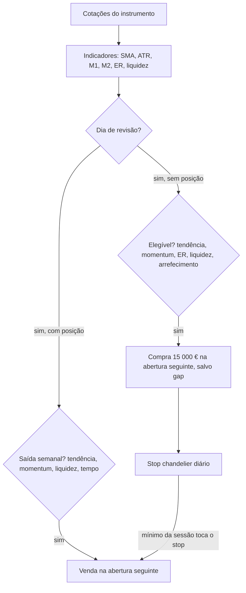

# B-Opus — Estratégia de tendência e momentum por instrumento

> Especificação de implementação da estratégia B-Opus na aplicação Stocks. A B-Opus é uma estratégia **por instrumento**, como a A-Momentum, com regras e indicadores diferentes: cada instrumento é simulado isoladamente, com os seus próprios dados, no mesmo ambiente (registo `shared/strategies/`, API, BackTest, página do instrumento e Sinais), com o mesmo orçamento por compra e sem comissões. Os valores e regras aqui definidos são vinculativos. Descrição metodológica para estudo e simulação; não constitui recomendação de investimento.

---

## 0. Instruções para a implementação

1. Lê este documento inteiro antes de escrever código.
2. A B-Opus é um módulo JavaScript puro, sem dependências, em `shared/strategies/b-opus.js`, registado em `shared/strategies/index.js` exactamente como a A-Momentum: `run(quotes, options)` devolve o resultado no formato comum do registo (secção 12). É o mesmo código que corre no browser (página do instrumento) e no servidor (BackTest e Sinais): não pode haver lógica de decisão duplicada.
3. Cada simulação usa **apenas os dados do próprio instrumento**, como a A-Momentum.
4. Ordem de implementação: preparação dos dados → indicadores (com testes) → simulação (com testes) → registo e dados de entrada na API → interface → documentação.
5. Sem *lookahead*: uma decisão tomada no fecho da sessão t usa apenas dados até ao fecho de t, inclusive.
6. Resultados determinísticos: a estratégia não usa aleatoriedade.
7. Para e pergunta ao utilizador quando encontrares uma contradição ou ambiguidade nesta especificação. Nunca inventes dados.
8. A tarefa está concluída quando todos os critérios da secção 14 forem cumpridos.

---

## 1. Resumo da estratégia

Em cada instrumento, a B-Opus compra quando a acção está numa tendência de alta limpa e com momentum ajustado ao risco, e protege a posição com um stop de volatilidade que só sobe.

- **Entrada (revisão semanal):** fecho > SMA200 e SMA50 > SMA200; M1 > 0 (SMA10/SMA125 normalizado pelo ATR) e M2 > 0 (momentum 12-1 ajustado à volatilidade); tendência limpa (Efficiency Ratio ≥ 0,25); liquidez mínima; sem arrefecimento após um stop recente.
- **Execução:** decisão no fecho da última sessão da semana, compra na abertura da sessão seguinte, com protecção contra gaps.
- **Posição:** 15 000 € por compra (quantidade inteira), uma posição de cada vez, sem reforços.
- **Saídas:** stop chandelier diário (máximo desde a entrada − 3 × ATR, só sobe); saídas semanais por quebra de tendência, perda de momentum, falta de liquidez ou stop temporal. Venda da posição inteira.
- **Sem comissões**, como a A-Momentum.

Diferenças em relação à A-Momentum:

| | A-Momentum | B-Opus |
|---|---|---|
| Sinal de entrada | Padrão descer-subir-subir do SMA10/SMA200, com o preço acima da SMA200 | Tendência (SMA50 e SMA200), M1 e M2 positivos, Efficiency Ratio, liquidez |
| Frequência | Diária | Semanal (entradas e saídas planeadas); stops diários |
| Execução | Fecho da sessão do sinal | Abertura da sessão seguinte |
| Posição | 15 000 € e reforços de 15 000 € a cada +10% | 15 000 €, sem reforços |
| Saída | Padrão subir-descer-descer com SMA8/SMA125 < 1%; protecção de 15% dos reforços | Stop chandelier (3 × ATR), quebra de tendência, perda de momentum, stop temporal |
| Custos | Sem comissões | Sem comissões |



---

## 2. Convenções

| Tema | Convenção |
|---|---|
| Sessão | Sessão em que o instrumento tem cotação (as suas próprias datas) |
| Índice temporal | t = sessão actual; t−k = k sessões antes no histórico do instrumento |
| Dados disponíveis em t | Tudo até ao fecho de t, inclusive |
| Execução | Decisões do fecho de t executam-se na abertura da sessão seguinte do instrumento |
| Dia de revisão | Última sessão do instrumento em cada semana ISO (normalmente sexta-feira). `review: 'biweekly'` = revisões semanais alternadas, começando pela primeira; `review: 'monthly'` = última sessão de cada mês |
| Preços | Indicadores e decisões sobre OHLC ajustados (secção 3.2); preços de execução e resultados em preços reais, como a A-Momentum |
| Retorno diário | r_t = C_t / C_{t−1} − 1, com fecho ajustado |
| Desvio-padrão | Amostral (n − 1), salvo indicação em contrário |
| Anualização | 252 sessões por ano |
| Frações | Percentagens nas opções escrevem-se como frações (0.25 = 25%) |
| Moeda | EUR (o catálogo só aceita instrumentos em EUR) |
| Valores em falta | Um indicador sem dados suficientes é `null`; qualquer critério que dependa de um `null` é considerado falhado |
| Datas | Strings `AAAA-MM-DD`, como no resto da aplicação |

---

## 3. Dados

### 3.1 Fonte e entrada

A base MariaDB da aplicação, tabela `daily_quotes`, entregue pela API ao browser e ao servidor como já acontece com a A-Momentum. `run(quotes, options)` recebe as sessões do instrumento em ordem cronológica:

```js
{ date, open, high, low, close, adjClose, volume }   // open, high, low, close: brutos; adjClose: ajustado
```

A recolha (motor Python com yfinance) guarda OHLC e fecho **não ajustados** e o fecho ajustado a dividendos e desdobramentos numa coluna própria, com três anos de histórico por instrumento (`STOCKS_HISTORY_YEARS = 3`). Os indicadores pré-calculados na base (`ema9`, `sma10`, `sma50`, `sma125`, `sma200`) não são usados na decisão: todos os indicadores da B-Opus são calculados dentro do módulo a partir dos preços. Podem ser usados num teste de consistência.

### 3.2 Ajustamento de preços

A base fornece fecho ajustado e OHLC brutos:

```
f_t = adjClose_t / close_t
O_t = open_t × f_t;   H_t = high_t × f_t;   L_t = low_t × f_t;   C_t = adjClose_t
```

Todos os indicadores, stops e decisões usam a série ajustada (O, H, L, C), que é contínua nas datas de dividendos e desdobramentos. Os preços de execução e o resultado são registados em **preços reais** da sessão (preço ajustado ÷ f_t), como na A-Momentum, que opera ao fecho real.

### 3.3 Limpeza

- Ignora sessões com OHLC em falta ou não positivo, ou sem `adjClose`.
- Se `close` ou `open` estiverem fora de [low, high], usa `low = min(O, H, L, C)` e `high = max(O, H, L, C)` e conta a correcção.
- Volume em falta = 0.
- O resultado inclui `dataQuality`: sessões ignoradas e correcções feitas.

### 3.4 Período simulado

Para ser comparável com a A-Momentum, a B-Opus actua na mesma janela: **os últimos 2 anos até à última sessão do instrumento**. Os indicadores precisam de 253 sessões de aquecimento (secção 4.4), por isso quem chama passa todo o histórico disponível (três anos) e indica o início da janela:

```js
run(quotes, { from: 'AAAA-MM-DD' })   // indicadores calculados sobre todas as sessões; compras só a partir de `from`
```

Sem `from`, a B-Opus pode actuar desde a primeira sessão com indicadores válidos. `firstDate` no resultado é a primeira sessão em que a estratégia pode actuar (a mais tardia entre `from` e o fim do aquecimento).

---

## 4. Indicadores

Calculados sobre as sessões do instrumento, com preços ajustados. Funções puras, exportadas para teste. Os parâmetros entre parênteses são os valores por omissão (secção 13).

### 4.1 Médias móveis simples

```
SMA_n(t) = média(C_{t−n+1}, …, C_t)
```

Usadas: SMA10, SMA50, SMA125, SMA200 (`smaTrendFast = 50`, `smaTrendSlow = 200`, `m1Fast = 10`, `m1Slow = 125`). Reutiliza `rollingMean` de `shared/momentum.js`.

### 4.2 True range e ATR (Wilder)

```
TR_t = max(H_t − L_t, |H_t − C_{t−1}|, |L_t − C_{t−1}|)      (primeira sessão: TR = H − L)
ATR_n(t0) = média(TR_1 … TR_n)                                 (semente na sessão n)
ATR_n(t)  = ATR_n(t−1) + (TR_t − ATR_n(t−1)) / n               (t > n)
```

`atrN = 22`. Um único ATR é usado em toda a estratégia.

### 4.3 M1 — rácio SMA10/SMA125 normalizado

```
M1(t) = (SMA10(t) − SMA125(t)) / ATR22(t)
```

Equivale a (SMA10/SMA125 − 1) × SMA125/ATR: distância entre as médias em unidades de ATR. É a mesma família de sinal que a A-Momentum usa (SMA10/SMA200 e SMA8/SMA125), normalizada pela volatilidade.

### 4.4 M2 — momentum 12-1 ajustado à volatilidade

```
ret_12_1(t) = C_{t−21} / C_{t−252} − 1
sigma(t)    = desvio-padrão(r_{t−251}, …, r_t) × sqrt(252)
M2(t)       = ret_12_1(t) / sigma(t)
```

`m2Lookback = 252`, `m2Skip = 21`. Exige 253 fechos válidos: é o indicador que define o aquecimento.

### 4.5 Efficiency Ratio de Kaufman

```
ER_n(t) = |C_t − C_{t−n}| / Σ_{i=t−n+1..t} |C_i − C_{i−1}|      (denominador 0 → ER = 0)
```

`erWindow = 60`. Num passeio aleatório de 60 sessões, ER ≈ 0,13.

### 4.6 Liquidez

```
VMN50(t) = média_{50 sessões}(close × volume)        (preços e volumes brutos)
```

Em EUR. Limiar `minTradedValue = 5 000 000` (cerca de 285 dos 296 instrumentos do catálogo cumprem-no).

### 4.7 ADX (Wilder) — só na variante `trendStrength: 'adx'`

```
up_t   = H_t − H_{t−1};   down_t = L_{t−1} − L_t
+DM_t  = up_t   se up_t > down_t e up_t > 0, senão 0
−DM_t  = down_t se down_t > up_t e down_t > 0, senão 0
TR, +DM, −DM suavizados com Wilder (n = adxN = 14), como no ATR
+DI = 100 × sm(+DM) / sm(TR);   −DI = 100 × sm(−DM) / sm(TR)
DX  = 100 × |+DI − −DI| / (+DI + −DI)     (soma 0 → DX = 0)
ADX = suavização de Wilder de DX com n = 14
```

### 4.8 Indicadores das variantes

- **CMF(20)** (variante `volumeConfirmation`): `MFM = ((C − L) − (H − C)) / (H − L)` (H = L → 0); `CMF = Σ_20 (MFM × V) / Σ_20 V` (Σ V = 0 → CMF = 0).
- **P90 de M1** (variantes `overextensionBlock` e `partialTakeProfit`): percentil 90 de M1 do próprio instrumento nas últimas 504 sessões, exigindo pelo menos 252 observações. Com três anos de dados, só fica disponível a partir do segundo ano; antes disso o critério é considerado falhado (secção 2).

---

## 5. Elegibilidade para entrada

Avaliada em cada dia de revisão t, só quando não há posição aberta nem compra pendente, e só a partir de `from` (secção 3.4). O instrumento é elegível se cumprir todos:

1. pelo menos `minHistory = 253` sessões válidas até t;
2. **liquidez:** `VMN50(t) ≥ minTradedValue`;
3. **tendência:** `C > SMA200` e `SMA50 > SMA200`;
4. **momentum:** `M1 > 0` e `M2 > 0`;
5. **força de tendência** (`trendStrength`): `'er'` → `ER60 ≥ erThreshold (0.25)`; `'adx'` → `ADX14 ≥ adxThreshold (20)`; `'none'` → sem filtro;
6. **arrefecimento:** se a última posição saiu por stop na sessão e, só volta a ser elegível quando o número de sessões do instrumento depois de e até t, inclusive, for pelo menos `cooldownSessions = 10`;
7. **variante** `volumeConfirmation: true`: `CMF20 > 0`;
8. **variante** `overextensionBlock: true`: `M1 ≤ P90(M1)`.

O resultado conta as revisões em que cada critério falhou (`blocked`: `{ liquidity, trend, momentum, trendStrength, cooldown, volume, overextension }`), para o painel explicar porque é que a estratégia não comprou.

---

## 6. Entrada

Se o instrumento for elegível no dia de revisão t, planeia-se uma compra para a abertura da sessão seguinte.

- **Quantidade:** `floor(budget / preço de execução real)`, com `budget = 15 000 €` (o mesmo da A-Momentum). Se for 0, a compra é cancelada.
- **Protecção contra gaps:** a compra é cancelada se `O_{t+1} > C_t + gapProtectAtr × ATR_t` (`gapProtectAtr = 1.0`). O instrumento pode voltar a ser elegível na revisão seguinte.
- **Stop inicial:** `stop_0 = preço de execução − stopMult × ATR_t` (`stopMult = 3.0`), em preços ajustados, com o ATR do dia de revisão. O stop está activo desde a sessão da compra.
- **Uma posição de cada vez, sem reforços.**

**Variante `pullbackEntry: true`:** em vez de compra na abertura, ordem limite a `C_t − pullbackAtr × ATR_t` (`pullbackAtr = 1.0`), válida durante `pullbackWindow = 5` sessões. É executada na primeira sessão em que `L ≤ limite`, ao preço `min(O, limite)`. Não executada → cancelada. Sem protecção contra gaps nesta variante.

---

## 7. Saídas

Qualquer saída vende a posição inteira, excepto a variante de realização parcial (7.3).

### 7.1 Stop diário (chandelier)

No fecho de cada sessão s com posição aberta (incluindo a sessão de entrada):

```
HH   = max(HH, H_s)                                  (HH inicial = preço de execução)
stop = max(stop, HH − stopMult × ATR22(s))
```

O stop nunca desce. O novo valor aplica-se a partir da sessão seguinte.

Execução, por sessão:

1. **Gap na abertura:** se `O_t ≤ stop`, vende tudo a `O_t` (motivo `stop`).
2. **Durante a sessão:** se `L_t ≤ stop`, vende tudo ao preço do stop (motivo `stop`).

### 7.2 Saídas semanais

No dia de revisão t, com posição aberta, aplica-se o primeiro motivo verificado, por esta ordem:

| Motivo (`reason`) | Condição no fecho de t |
|---|---|
| `liquidity` | `VMN50(t) < minTradedValue` |
| `trend_break` | `C ≤ SMA200` ou `SMA50 ≤ SMA200` |
| `momentum_loss` | `M1 ≤ 0` ou `M2 ≤ 0` |
| `time_stop` | Pelo menos `timeStopSessions = 20` sessões desde a entrada e o maior fecho desde a entrada (inclusive) < `entryPrice + timeStopAtr × atrEntry` (`timeStopAtr = 1.0`). Desactivado com `useTimeStop: false` |

Se algum indicador necessário for `null`, não se toma decisão semanal nessa revisão. A venda executa-se na abertura da sessão seguinte (antes, nessa abertura, aplica-se o stop com gap se for o caso).

### 7.3 Variante `partialTakeProfit: true`

Na revisão, se a posição ainda não teve realização parcial e `M1 > P90(M1)`: vende-se `floor(Q / 2)` na abertura seguinte e marca-se `partialDone = true`. O valor recebido entra no resultado da operação quando esta fecha (a operação regista `partialSales: [{ date, quantity, price, proceeds }]`).

### 7.4 Fim dos dados

Uma posição aberta na última sessão é valorizada ao último fecho real (posição aberta no resultado), como na A-Momentum.

---

## 8. Sequência de cada sessão t

Para t desde a primeira sessão com dados até à última:

**Abertura de t**

1. Stop com gap (7.1, passo 1).
2. Venda pendente (saída semanal ou realização parcial) a `O_t`.
3. Compra pendente: protecção contra gaps; quantidade; stop inicial (secção 6).
4. Ordem limite da variante `pullbackEntry`.

**Durante a sessão t**

5. Stop intradiário (7.1, passo 2), incluindo numa posição comprada nesta abertura.

**Fecho de t**

6. Actualização do chandelier (7.1).
7. Se t for dia de revisão: com posição → saídas semanais (7.2) e realização parcial (7.3); sem posição → elegibilidade (secção 5) e compra planeada (secção 6).
8. Sinais para o gráfico: `buy` na sessão da compra executada, `sell` na sessão da venda (com `reason`).

---

## 9. Posição (estrutura de dados)

| Campo | Descrição |
|---|---|
| `buyDate`, `entryPrice` | Sessão e preço real de execução da compra |
| `quantity` | Quantidade (inteira) |
| `cost` | `quantity × entryPrice` |
| `atrEntry` | ATR22 do dia de revisão que gerou a compra (preços ajustados) |
| `initialStop`, `stop` | Stop inicial e stop actual (chandelier), em preços ajustados |
| `highestHigh`, `highestClose` | Máximo e maior fecho desde a entrada (ajustados) |
| `partialDone` | Realização parcial já feita (variante) |

Na interface, os stops são mostrados em preços reais da sessão (stop ÷ f_t).

---

## 10. Variantes (opções)

Todas as regras opcionais são controladas por opções (secção 13), como as opções da A-Momentum, para comparar variantes sem alterar código.

| Opção | Por omissão | Efeito |
|---|---|---|
| `trendStrength` | `'er'` | `'er'`, `'adx'` ou `'none'` |
| `useTimeStop` | `true` | Stop temporal |
| `volumeConfirmation` | `false` | Exige CMF20 > 0 na entrada |
| `overextensionBlock` | `false` | Bloqueia entradas com M1 > P90 |
| `partialTakeProfit` | `false` | Venda de metade com M1 > P90 |
| `pullbackEntry` | `false` | Ordem limite em recuo |
| `review` | `'weekly'` | `'weekly'`, `'biweekly'` ou `'monthly'` |

---

## 11. Validação

### 11.1 Comparação com a A-Momentum

O BackTest corre a B-Opus em todos os instrumentos activos, na mesma janela de 2 anos que a A-Momentum, com o mesmo orçamento por compra e sem comissões. A comparação faz-se com as métricas que o BackTest já mostra: resultado em € e em %, instrumentos com ganho e com perda, taxa de acerto, comparação com comprar e manter e soma dos resultados. O resultado inclui o aviso «Histórico curto (2 anos simulados): resultados indicativos, sem validação fora da amostra».

### 11.2 Ablação e sensibilidade

Um script em `scripts/` (fora da aplicação) corre a B-Opus em todos os instrumentos com a configuração por omissão (`full`) e com cada variante, alterando uma única opção, e escreve uma tabela em Markdown com a soma dos resultados, instrumentos com ganho e perda, as perdas dos 10 piores, os ganhos dos 10 melhores, o número de operações e a taxa de acerto:

| Id | Tipo | Alteração |
|---|---|---|
| `no_trend_strength` | remover | `trendStrength: 'none'` |
| `adx_instead_of_er` | substituir | `trendStrength: 'adx'` |
| `no_time_stop` | remover | `useTimeStop: false` |
| `with_volume_confirmation` | adicionar | `volumeConfirmation: true` |
| `with_pullback_entry` | adicionar | `pullbackEntry: true` |
| `with_overextension_block` | adicionar | `overextensionBlock: true` |
| `with_partial_take_profit` | adicionar | `partialTakeProfit: true` |
| `monthly_review` | substituir | `review: 'monthly'` |

O mesmo script corre uma análise de sensibilidade com as gamas da secção 13, um parâmetro de cada vez, para verificar que o resultado não depende de um valor exacto. Com dois anos de dados não se fazem optimizações: os resultados ficam registados na documentação e as opções por omissão só mudam por decisão do utilizador.

### 11.3 Testes automáticos

- Indicadores: valores conhecidos (ATR de Wilder, ER, M1, M2, ADX, CMF, P90) sobre séries pequenas calculadas à mão.
- Ajustamento: o factor f_t aplicado a O, H e L; execução e resultado em preços reais.
- Simulação: compra na abertura seguinte a uma revisão elegível; protecção contra gaps; stop com gap na abertura; stop intradiário; chandelier que nunca desce; cada motivo de saída semanal pela ordem da tabela; arrefecimento; uma posição de cada vez; quantidade com o orçamento de 15 000 €; respeito por `from`.
- Sem *lookahead*: acrescentar sessões futuras não altera nenhuma decisão anterior.
- Determinismo: duas execuções dão resultados idênticos.
- Formato: o resultado tem os campos do formato comum (secção 12) e funciona no painel e no BackTest existentes.

---

## 12. Integração na aplicação

### 12.1 Registo

Em `shared/strategies/index.js`, a entrada da B-Opus passa a `available: true`, com `budget: 15000`, `summary` e `rules` (texto das regras da secção 1) e `run: (quotes, { mom, from } = {}) => bOpus.backtest(quotes, { from })`. Não há outras alterações no registo.

`run` devolve o formato comum do registo, igual ao da A-Momentum:

```js
{
  trades: [{ buyDate, sellDate, quantity, cost, avgPrice, lots: [{ date, price, quantity, cost }],
             reinforcements: 0, sellPrice, proceeds, pnl, pnlPct, reason,
             initialStop, partialSales }],
  open: null | { buyDate, quantity, cost, avgPrice, lots, reinforcements: 0, lastDate, lastPrice, value, pnl, pnlPct, stop },
  signals: [{ date, side: 'buy' | 'sell', reason }],
  firstDate,
  summary: { closed, wins, reinforcements: 0, peakCost, realized, unrealized, total, totalPct, buyHold },
  // campos próprios da B-Opus:
  blocked: { liquidity, trend, momentum, trendStrength, cooldown, volume, overextension },
  gapCancels, exitReasons: { stop, trend_break, momentum_loss, liquidity, time_stop },
  dataQuality
}
```

`summary.buyHold` é calculado como na A-Momentum (o orçamento investido no primeiro dia da janela e mantido até ao fim).

### 12.2 Dados de entrada

A B-Opus precisa de `open`, `high`, `low` e `volume`, além de `close` e `adjClose`, e de 253 sessões antes da janela de 2 anos:

- **Página do instrumento:** com a B-Opus escolhida, a página pede as cotações dos últimos 3 anos (`GET /instruments/{id}/quotes?from=…`, que já devolve OHLC, fecho ajustado e volume), mostra o gráfico com o período escolhido e passa à B-Opus todo o histórico com `from` = início da janela de 2 anos.
- **BackTest (`GET /backtest?strategy=b-opus`):** a consulta passa a incluir `open`, `high`, `low` e `volume` e, para a B-Opus, todo o histórico de cada instrumento; `run` recebe `from` = última sessão − 2 anos (a mesma janela da A-Momentum, que continua a receber só os 2 anos).
- **Sinais:** a página Sinais ganha o menu «Estratégia» (A-Momentum, B-Opus); `GET /signals?strategy=b-opus` corre a B-Opus sobre todo o histórico e lista as compras e vendas das últimas N sessões, com o motivo. Os botões Comprar e Vender abrem uma operação simulada na carteira virtual do utilizador; os sinais nunca executam operações sozinhos.

### 12.3 Interface

Reutiliza os componentes da A-Momentum:

- **Página do instrumento:** «B-Opus» activa no menu «Estratégia»; marcadores C (compra) e V (venda) no gráfico; linha do stop da posição aberta; painel com as regras, o resultado, as operações (com o motivo de saída e o stop inicial), a posição aberta com o stop actual, a comparação com comprar e manter e, se não houve compras, as razões (`blocked`).
- **BackTest:** «B-Opus» activa no menu «Estratégia»; a mesma tabela e o mesmo resumo da A-Momentum (sem a coluna de reforços, que é sempre 0).
- **Sinais:** menu «Estratégia» e, com a B-Opus, o motivo de cada sinal.

---

## 13. Opções

As opções são um objecto exportado por `shared/strategies/b-opus.js`, como as da A-Momentum:

```js
export const DEFAULT_OPTIONS = {
  budget: 15000,               // EUR por compra, como a A-Momentum

  // indicadores
  smaTrendFast: 50, smaTrendSlow: 200, m1Fast: 10, m1Slow: 125, atrN: 22,
  m2Lookback: 252, m2Skip: 21, erWindow: 60, adxN: 14, cmfN: 20,
  p90Window: 504, p90MinObs: 252, minHistory: 253,

  // elegibilidade
  minTradedValue: 5000000,
  trendStrength: 'er', erThreshold: 0.25, adxThreshold: 20, cooldownSessions: 10,
  volumeConfirmation: false, overextensionBlock: false,

  // entradas
  gapProtectAtr: 1.0, pullbackEntry: false, pullbackAtr: 1.0, pullbackWindow: 5,

  // saídas
  stopMult: 3.0, useTimeStop: true, timeStopSessions: 20, timeStopAtr: 1.0, partialTakeProfit: false,

  // calendário
  review: 'weekly',            // 'weekly' | 'biweekly' | 'monthly'
};
```

As opções são validadas ao correr (tipos, gamas, chaves desconhecidas → erro). O resultado inclui `options`, com as opções efectivas.

Gamas para a análise de sensibilidade (secção 11.2):

| Opção | Por omissão | Valores |
|---|---|---|
| `smaTrendFast` | 50 | 40, 50, 60 |
| `smaTrendSlow` | 200 | 150, 200, 250 |
| `m1Fast` | 10 | 5, 10, 20 |
| `m1Slow` | 125 | 100, 125, 150 |
| `m2Lookback` | 252 | 126, 189, 252 |
| `m2Skip` | 21 | 0, 10, 21 |
| `atrN` | 22 | 14, 22, 30 |
| `stopMult` | 3.0 | 2.5, 3.0, 3.5, 4.0 |
| `erThreshold` | 0.25 | 0.20, 0.25, 0.30 |
| `timeStopSessions` | 20 | 10, 20, 40 |
| `cooldownSessions` | 10 | 5, 10, 20 |
| `gapProtectAtr` | 1.0 | 0.5, 1.0, 2.0 |
| `review` | weekly | weekly, monthly |

Valores de `m2Lookback` ou `smaTrendSlow` acima do por omissão alongam o aquecimento além das 253 sessões e encurtam a janela efectiva.

---

## 14. Critérios de aceitação

1. `shared/strategies/b-opus.js` implementa as secções 3 a 9 com as opções da secção 13, sem dependências e sem aleatoriedade, e `run` devolve o formato comum (secção 12.1).
2. A B-Opus está registada com `available: true` e aparece activa no menu «Estratégia» da página do instrumento, do BackTest e dos Sinais; a A-Momentum continua a dar exactamente os mesmos resultados.
3. Os testes da secção 11.3 passam, incluindo o teste sem *lookahead*.
4. A página do instrumento mostra as operações da B-Opus nesse instrumento, calculadas com os 3 anos de histórico e actuando nos últimos 2, com o stop da posição aberta e as razões quando não houve compras.
5. `GET /backtest?strategy=b-opus` devolve o resultado de todos os instrumentos na mesma janela da A-Momentum, e os valores de cada instrumento coincidem com os da página do instrumento (testado).
6. Os Sinais mostram as compras e vendas recentes da B-Opus com o motivo.
7. O script da secção 11.2 corre e o resultado (ablação e sensibilidade) está registado na documentação.
8. A documentação (arquitectura, guia de estilos, plano e OpenAPI) está actualizada e o código está publicado em produção.
