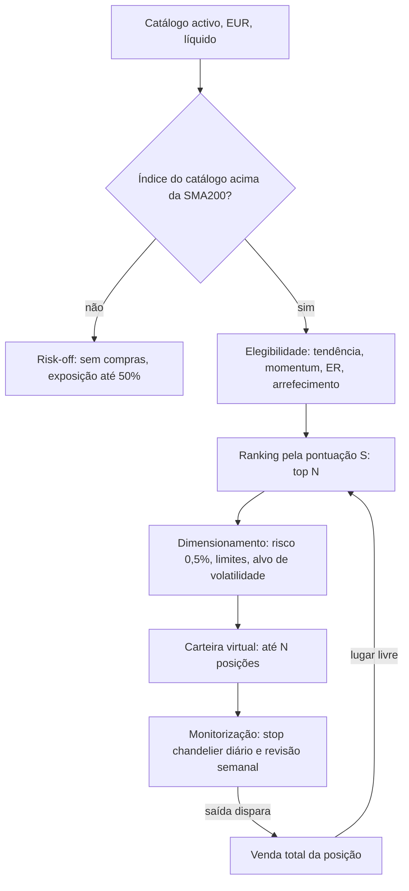

# B-Opus — Estratégia de carteira de tendência e momentum

> Especificação de implementação da estratégia B-Opus na aplicação Stocks, adaptada ao ambiente já criado para a A-Momentum (registo `shared/strategies/`, API Fastify, BackTest, página do instrumento e Sinais). Os valores e regras aqui definidos são vinculativos. Descrição metodológica para estudo e simulação; não constitui recomendação de investimento.
>
> Versão adaptada (24 out. 2026) a partir da especificação original «Estratégia de tendência e momentum». As diferenças face ao original estão na secção 18.

---

## 0. Instruções para a implementação

1. Lê este documento inteiro antes de escrever código.
2. A B-Opus é um módulo JavaScript puro, sem dependências, em `shared/strategies/b-opus.js`, registado em `shared/strategies/index.js` como a A-Momentum. É o mesmo código que corre no BackTest, na página do instrumento e nos Sinais: não pode haver lógica de decisão duplicada.
3. Ao contrário da A-Momentum (simulada instrumento a instrumento), a B-Opus é uma estratégia **de carteira**: em cada semana escolhe as melhores acções de todo o catálogo e reparte um capital comum. Por isso corre no servidor (API), sobre todos os instrumentos, e o browser recebe o resultado.
4. Universo: os instrumentos **activos do catálogo partilhado**, todos cotados em EUR (cerca de 296 acções europeias: XETRA, Paris, Milão, Amesterdão, Madrid, Helsínquia, Bruxelas, Viena, Lisboa e Dublin). É um universo de grandes e médias empresas europeias semelhante ao STOXX 600, mas não é o índice.
5. Ordem de implementação: preparação dos dados → indicadores (com testes) → motor de simulação (com testes) → bases de comparação e métricas → integração na API → interface (BackTest, instrumento, Sinais) → documentação.
6. Sem *lookahead*: uma decisão tomada no fecho da sessão t usa apenas dados até ao fecho de t, inclusive.
7. Resultados determinísticos: a estratégia não usa aleatoriedade.
8. Para e pergunta ao utilizador quando encontrares uma contradição ou ambiguidade nesta especificação. Nunca inventes dados.
9. A tarefa está concluída quando todos os critérios da secção 19 forem cumpridos.

---

## 1. Resumo da estratégia

Carteira virtual de até N = 10 acções líquidas em tendência de alta, escolhidas semanalmente por momentum ajustado ao risco e protegidas por stops de volatilidade.

- **Regime de mercado:** só há compras quando o índice de referência (um índice equiponderado do catálogo, secção 4.10) está acima da sua SMA200, com histerese de ±1%. Em regime contrário não há compras e a exposição desce a 50%.
- **Elegibilidade:** tendência (fecho > SMA200 e SMA50 > SMA200), momentum absoluto positivo, tendência limpa (Efficiency Ratio), liquidez e arrefecimento após stop.
- **Ranking:** pontuação S que combina o rácio SMA10/SMA125 normalizado por ATR (M1) e o momentum 12-1 ajustado à volatilidade (M2). Compram-se as 10 melhores; uma posição só sai por ranking quando cai abaixo do 20.º lugar.
- **Saídas:** stop chandelier diário (máximo desde a entrada − 3 × ATR, só sobe); saídas semanais por quebra de tendência, perda de momentum, ranking, stop temporal ou regime de mercado. Sem realizações parciais.
- **Risco:** 0,5% do capital em risco por posição até ao stop; limites de peso, exposição e risco aberto; alvo de volatilidade da carteira de 15% ao ano; sem alavancagem nem vendas a descoberto.
- **Calendário:** decisões no fecho da última sessão de cada semana; execução na abertura da sessão seguinte; stops activos todos os dias.

Diferenças em relação à A-Momentum:

| | A-Momentum | B-Opus |
|---|---|---|
| Unidade | Cada instrumento isoladamente | Uma carteira com todo o catálogo |
| Capital | 15 000 € por compra e por reforço, sem limite | 150 000 € partilhados por até 10 posições |
| Decisões | Diárias, ao fecho do sinal | Semanais (entradas e saídas planeadas), stops diários |
| Execução | Fecho da sessão do sinal | Abertura da sessão seguinte |
| Custos | Sem comissões | 0,15% por execução |
| Onde corre | Browser e servidor | Servidor (precisa de todos os instrumentos) |



---

## 2. Convenções

| Tema | Convenção |
|---|---|
| Sessão | Dia do calendário do catálogo (secção 3.4) |
| Índice temporal | t = sessão actual; t−k = k sessões antes no histórico do instrumento |
| Dados disponíveis em t | Tudo até ao fecho de t, inclusive |
| Execução | Decisões do fecho de t executam-se na abertura da sessão seguinte em que o instrumento negoceia |
| Dia de revisão | Última sessão do calendário em cada semana ISO (normalmente sexta-feira). `review: 'biweekly'` = revisões semanais alternadas, começando pela primeira; `review: 'monthly'` = última sessão de cada mês |
| Preços | OHLC ajustados (secção 3.2), excepto onde se diz «bruto» |
| Retorno diário | r_t = C_t / C_{t−1} − 1, com fecho ajustado |
| Desvio-padrão | Amostral (n − 1), salvo indicação em contrário |
| Anualização | 252 sessões por ano |
| Frações | Percentagens nas opções escrevem-se como frações (0.005 = 0,5%) |
| Moeda | EUR; não há conversão cambial (o catálogo só aceita instrumentos em EUR) |
| Valores em falta | Um indicador sem dados suficientes é `null`; qualquer critério que dependa de um `null` é considerado falhado |
| Datas | Strings `AAAA-MM-DD`, como no resto da API |

---

## 3. Dados

### 3.1 Fonte

A base MariaDB da aplicação, lida pela API. A B-Opus não acede à base: recebe os dados já carregados, como a A-Momentum.

| Origem | Campos usados |
|---|---|
| `instruments` | `id`, `symbol`, `name`, `exchange`, `currency` (sempre EUR), `status` (só `active`), `last_session` |
| `daily_quotes` | `session_date`, `open`, `high`, `low`, `close` (brutos), `adj_close` (ajustado a dividendos e desdobramentos), `volume` |

A recolha (motor Python com yfinance) guarda OHLC e fecho **não ajustados** e o fecho ajustado numa coluna própria, com três anos de histórico por instrumento (`STOCKS_HISTORY_YEARS = 3`). Os indicadores pré-calculados na base (`ema9`, `sma10`, `sma50`, `sma125`, `sma200`) são ignorados na decisão: todos os indicadores são recalculados a partir dos preços, dentro do módulo. Podem ser usados num teste de consistência.

A API entrega à B-Opus, por instrumento, as sessões em ordem cronológica:

```js
{ id, symbol, name, exchange, quotes: [{ date, open, high, low, close, adjClose, volume }] }
```

### 3.2 Ajustamento de preços

A base fornece fecho ajustado e OHLC brutos (caso 2 da especificação original):

```
f_t = adjClose_t / close_t
O_t = open_t × f_t;   H_t = high_t × f_t;   L_t = low_t × f_t;   C_t = adjClose_t
close_raw_t = close_t;   volume_raw_t = volume_t
```

Os brutos (`close_raw`, `volume_raw`) só servem para a liquidez (secção 4.7) e para mostrar preços reais na interface. Os preços de execução simulados são os ajustados (a série é coerente ao longo do tempo); a interface mostra também o preço bruto da sessão.

### 3.3 Limpeza

- Remove sessões com OHLC em falta ou não positivo, ou sem `adjClose`.
- Se `close` ou `open` estiverem fora de [low, high], corrige `low = min(O, H, L, C)` e `high = max(O, H, L, C)` e conta a correcção.
- Volume em falta = 0.
- O resultado inclui um bloco `dataQuality`: instrumentos recebidos, sessões removidas, correcções feitas e instrumentos com menos de `minHistory` sessões.

### 3.4 Calendário

O calendário é o conjunto das datas em que pelo menos 50% dos instrumentos do catálogo com histórico nessa data têm preço (não há índice na base). As bolsas do catálogo têm feriados diferentes; uma data com menos de 50% não é sessão do calendário.

Um instrumento sem preço numa sessão do calendário (feriado local ou suspensão) não é avaliado nessa sessão: não entra, não sai por regra semanal e mantém o último fecho para avaliação da carteira. Os seus stops são avaliados na próxima sessão em que negociar.

### 3.5 Universo e deslistagens

- Pertence ao universo em t todo o instrumento activo do catálogo com preço em t (não há composição histórica de índices na base).
- O catálogo só contém instrumentos que existem hoje: o resultado inclui sempre o aviso «Resultados sujeitos a viés de sobrevivência».
- **Fim de dados:** se uma posição deixa de ter preços antes do fim dos dados do catálogo (instrumento removido ou sem recolha há mais de 10 sessões), é vendida ao último fecho disponível, com custos, motivo `delisted`.

### 3.6 Período

A B-Opus simula todo o histórico disponível (três anos). O aquecimento consome as primeiras 253 sessões (secção 15.1), por isso a simulação efectiva cobre cerca dos **últimos 2 anos** — a mesma janela do BackTest da A-Momentum, o que permite compará-las.

Se o universo tiver em média menos de 3 × N instrumentos, o resultado inclui o aviso «Universo demasiado pequeno para o ranking».

---

## 4. Indicadores

Calculados por instrumento sobre as suas próprias sessões, com preços ajustados. Funções puras, exportadas para teste. Os parâmetros entre parênteses são os valores por omissão (secção 17).

### 4.1 Médias móveis simples

```
SMA_n(t) = média(C_{t−n+1}, …, C_t)
```

Usadas: SMA10, SMA50, SMA125, SMA200 (`smaTrendFast = 50`, `smaTrendSlow = 200`, `m1Fast = 10`, `m1Slow = 125`). Reutiliza `rollingMean` de `shared/momentum.js`.

### 4.2 True range e ATR (Wilder)

```
TR_t = max(H_t − L_t, |H_t − C_{t−1}|, |L_t − C_{t−1}|)      (primeira sessão: TR = H − L)
ATR_n(t0) = média(TR_1 … TR_n)                                 (semente na sessão n)
ATR_n(t)  = ATR_n(t−1) + (TR_t − ATR_n(t−1)) / n               (t > n)
```

`atrN = 22`. Um único ATR é usado em toda a estratégia.

### 4.3 M1 — rácio SMA10/SMA125 normalizado

```
M1(t) = (SMA10(t) − SMA125(t)) / ATR22(t)
```

Equivale a (SMA10/SMA125 − 1) × SMA125/ATR: distância entre as médias em unidades de ATR. É a mesma família de sinal que a A-Momentum usa (SMA10/SMA200 e SMA8/SMA125), normalizada pela volatilidade.

### 4.4 M2 — momentum 12-1 ajustado à volatilidade

```
ret_12_1(t) = C_{t−21} / C_{t−252} − 1
sigma(t)    = desvio-padrão(r_{t−251}, …, r_t) × sqrt(252)
M2(t)       = ret_12_1(t) / sigma(t)
```

`m2Lookback = 252`, `m2Skip = 21`. Exige 253 fechos válidos.

### 4.5 Pontuação S

Calculada em cada revisão sobre o conjunto `U_rank` (secção 6.2):

```
z(x_i) = clip((x_i − média(x)) / desvio_populacional(x), −3, +3)
S_i    = wM1 × z(M1_i) + (1 − wM1) × z(M2_i)
```

`wM1 = 0.5`, `zClip = 3`. Se `U_rank` tiver menos de 2 elementos ou desvio nulo, z = 0.

### 4.6 Efficiency Ratio de Kaufman

```
ER_n(t) = |C_t − C_{t−n}| / Σ_{i=t−n+1..t} |C_i − C_{i−1}|      (denominador 0 → ER = 0)
```

`erWindow = 60`. Num passeio aleatório de 60 sessões, ER ≈ 0,13.

### 4.7 Liquidez

```
VMN50(t) = média_{50 sessões}(close_raw × volume_raw)
```

Em EUR. Limiar `minTradedValue = 5 000 000` (cerca de 285 dos 296 instrumentos do catálogo cumprem-no).

### 4.8 ADX (Wilder) — só na variante `trendStrength: 'adx'`

```
up_t   = H_t − H_{t−1};   down_t = L_{t−1} − L_t
+DM_t  = up_t   se up_t > down_t e up_t > 0, senão 0
−DM_t  = down_t se down_t > up_t e down_t > 0, senão 0
TR, +DM, −DM suavizados com Wilder (n = adxN = 14), como no ATR
+DI = 100 × sm(+DM) / sm(TR);   −DI = 100 × sm(−DM) / sm(TR)
DX  = 100 × |+DI − −DI| / (+DI + −DI)     (soma 0 → DX = 0)
ADX = suavização de Wilder de DX com n = 14
```

### 4.9 Indicadores das variantes

- **CMF(20)** (variante `volumeConfirmation`): `MFM = ((C − L) − (H − C)) / (H − L)` (H = L → 0); `CMF = Σ_20 (MFM × V) / Σ_20 V` (Σ V = 0 → CMF = 0).
- **P90 de M1** (variantes `overextensionBlock` e `partialTakeProfit`): percentil 90 de M1 do próprio instrumento nas últimas 504 sessões, exigindo pelo menos 252 observações. Com três anos de dados, só fica disponível no último ano da simulação; antes disso o critério é considerado falhado (secção 2).

### 4.10 Índice de referência do catálogo

A base não tem índices (só acções), por isso o índice de referência é um **proxy equiponderado** do universo:

```
r_proxy(t) = média dos r_t de todos os instrumentos do universo com preço em t e em t−1
proxy(t)   = 100 × Π (1 + r_proxy)
```

O proxy só tem fecho; quando for necessária uma abertura (bases de comparação, secção 13), usa-se o fecho. A interface chama-lhe «Índice do catálogo (equiponderado)».

### 4.11 Volatilidade da carteira

```
w_i     = Q_i × C_i(t) / equity(t)
Σ       = matriz de covariância amostral dos retornos diários das últimas 63 sessões (volWindowPortfolio)
sigma_p = sqrt(252 × wᵀ Σ w)
```

Retornos em falta tratam-se por covariância par a par; cada par exige pelo menos 40 observações comuns, senão a covariância desse par é 0 e regista-se um aviso.

---

## 5. Regime de mercado

Avaliado em cada dia de revisão com o fecho do índice do catálogo X(t) e a sua SMA200 (`regime.sma = 200`), com histerese `band = 0.01`:

```
se estado = risk_off e X(t) > SMA200(t) × (1 + band): estado ← risk_on
se estado = risk_on  e X(t) < SMA200(t) × (1 − band): estado ← risk_off
caso contrário: mantém o estado
estado inicial (primeira revisão com SMA200 válida): risk_on se X > SMA200, senão risk_off
```

| Estado | Efeito |
|---|---|
| `risk_on` | Novas entradas permitidas; exposição bruta máxima `maxGross = 1.0` |
| `risk_off` | Sem novas entradas; exposição bruta máxima `riskoffMaxGross = 0.5` (secção 8.4) |

Com `useMarketRegime: false` o estado é sempre `risk_on`.

---

## 6. Universo, elegibilidade e ranking

Avaliados em cada dia de revisão t, apenas para instrumentos com preço em t.

### 6.1 Universo `U(t)`

Instrumento activo do catálogo que cumpre todos:

1. tem preço em t;
2. tem pelo menos `minHistory = 253` sessões válidas até t;
3. `VMN50(t) ≥ minTradedValue`.

### 6.2 Conjunto de ranking `U_rank(t)`

Instrumentos de `U(t)` com:

1. `C > SMA200` e `SMA50 > SMA200`;
2. `M1 > 0` e `M2 > 0`.

Ordenam-se por S decrescente (desempate por `symbol` crescente). `rank_i` = posição (1 = melhor). S calcula-se sobre este conjunto (secção 4.5).

### 6.3 Elegibilidade para entrada `E(t)`

Instrumentos de `U_rank(t)` que cumprem ainda:

1. **Força de tendência** (`trendStrength`): `'er'` → `ER60 ≥ erThreshold (0.25)`; `'adx'` → `ADX14 ≥ adxThreshold (20)`; `'none'` → sem filtro.
2. **Arrefecimento:** se o instrumento saiu por stop na sessão e, só volta a ser elegível quando o número de sessões do calendário depois de e até t, inclusive, for pelo menos `cooldownSessions = 10`.
3. **Variante** `volumeConfirmation: true`: `CMF20 > 0`.
4. **Variante** `overextensionBlock: true`: `M1 ≤ P90(M1)`.

Os critérios da secção 6.3 aplicam-se só a novas compras; uma posição aberta nunca é vendida por deixar de os cumprir.

---

## 7. Entradas

No dia de revisão t, depois das saídas semanais (secção 8.2), se o regime for `risk_on`:

```
slots       = N − (número de posições que continuam após as saídas planeadas)
candidatos  = instrumentos com rank ≤ N, não detidos, pertencentes a E(t), por ordem de rank
para cada candidato, enquanto slots > 0:
    calcular Q_base (secção 9.1)
    aplicar os limites (secção 9.2); se falhar, passa ao candidato seguinte
    planear compra; slots ← slots − 1
```

`N = nPositions = 10`. Os lugares que não se preencham ficam em liquidez até à revisão seguinte.

**Ordem:** compra na abertura da sessão seguinte.

**Protecção contra gaps:** a compra é cancelada se `O_{t+1} > C_t + gapProtectAtr × ATR_t` (`gapProtectAtr = 1.0`). O instrumento pode voltar a ser candidato na revisão seguinte.

**Stop inicial:** `stop_0 = preço de execução − stopMult × ATR_t` (`stopMult = 3.0`), com o ATR do dia de revisão. O stop está activo desde a sessão da compra.

**Variante `pullbackEntry: true`:** em vez de compra na abertura, ordem limite a `C_t − pullbackAtr × ATR_t` (`pullbackAtr = 1.0`), válida durante `pullbackWindow = 5` sessões. É executada na primeira sessão em que `L ≤ limite`, ao preço `min(O, limite)`. Não executada → cancelada. Sem protecção contra gaps nesta variante.

---

## 8. Saídas

Qualquer saída vende a posição inteira, excepto a variante de realização parcial (8.3) e os ajustes de volatilidade (9.3).

### 8.1 Stop diário (chandelier)

Para cada posição, no fecho de cada sessão s em que o instrumento negoceia (incluindo a sessão de entrada):

```
HH   = max(HH, H_s)                                  (HH inicial = preço de execução)
stop = max(stop, HH − stopMult × ATR22(s))
```

O stop nunca desce. O novo valor aplica-se a partir da sessão seguinte. A execução segue a secção 10.2.

### 8.2 Saídas semanais

No dia de revisão t, para cada posição com preço em t, aplica-se o primeiro motivo verificado, por esta ordem:

| Motivo (`reason`) | Condição no fecho de t |
|---|---|
| `universe_exit` | O instrumento não está em `U(t)` (perdeu liquidez) |
| `trend_break` | `C ≤ SMA200` ou `SMA50 ≤ SMA200` |
| `momentum_loss` | `M1 ≤ 0` ou `M2 ≤ 0` |
| `rank_exit` | `rank > bufferMult × N` (`bufferMult = 2.0`, ou seja, fora do top 20) |
| `time_stop` | Pelo menos `timeStopSessions = 20` sessões desde a entrada e o maior fecho desde a entrada (inclusive) < `entryPrice + timeStopAtr × atrEntry` (`timeStopAtr = 1.0`). Desactivado com `useTimeStop: false` |

Se algum indicador necessário for `null`, não se toma decisão semanal sobre essa posição nessa revisão. A venda executa-se na abertura da sessão seguinte.

### 8.3 Variante `partialTakeProfit: true`

Na revisão, se a posição ainda não teve realização parcial e `M1 > P90(M1)`: vende-se `floor(Q / 2)`, `baseQuantity` é dividida por 2 (arredondada para baixo) e marca-se `partialDone = true`. Motivo `partial_take_profit`.

### 8.4 Redução em `risk_off`

Se o estado for `risk_off` e, depois das saídas de 8.2, a exposição bruta for superior a `riskoffMaxGross × equity`, vendem-se posições inteiras por ordem crescente de S (as que não estão em `U_rank` primeiro) até a exposição ficar igual ou abaixo do limite. Motivo `risk_off`. A exposição calcula-se com os fechos de t.

---

## 9. Dimensionamento e limites de carteira

`equity(t) = cash(t) + Σ Q_i × C_i(t)`, calculado no fecho do dia de revisão, antes das novas ordens.

### 9.1 Quantidade base

```
Q_risk = floor(equity × riskPerPosition / (stopMult × ATR_t))      riskPerPosition = 0.005
Q_cap  = floor(maxWeight × equity / C_t)                           maxWeight = 0.15
Q_base = min(Q_risk, Q_cap)
```

Exemplo de referência (usado nos testes): equity = 100 000, r = 0,005, C = 50, ATR = 1,00, stopMult = 3 → Q_risk = floor(500 / 3) = 166; Q_cap = floor(15 000 / 50) = 300; Q_base = 166 (8 300, ou 8,3% do capital).

Com o capital por omissão (150 000 €), uma posição típica fica entre 8 000 € e 22 500 €, da mesma ordem que uma compra da A-Momentum (15 000 €). A relação `r ≈ (exposição alvo / N) × distância típica do stop` (N = 10 e stop típico de 6% → r ≈ 0,6%) é informativa e não é verificada pelo código.

### 9.2 Limites verificados em cada compra planeada

Por esta ordem; `V_hold` = valor das posições que continuam, `V_new` = valor das compras já planeadas nesta revisão, aos fechos de t.

1. **Exposição bruta:** se `V_hold + V_new + Q_base × C_t > maxGross × equity`, reduz-se Q_base para caber. Se a quantidade reduzida for inferior a 50% da original, o candidato é ignorado.
2. **Risco aberto:**
   ```
   OR = Σ_posições max(0, C_i − stop_i) × Q_i + Σ_compras_planeadas stopMult × ATR_j × Q_j
   ```
   Se `OR + stopMult × ATR_t × Q_base > openRiskMax × equity` (`openRiskMax = 0.06`), o candidato é ignorado. Este limite nunca força vendas.
3. **Ordem mínima:** se `Q_base × C_t < minOrderWeight × equity` (`minOrderWeight = 0.005`), o candidato é ignorado.

Cada candidato ignorado é registado com o motivo (`gross_limit`, `open_risk_limit`, `min_order`).

### 9.3 Alvo de volatilidade

Na revisão, depois de planear saídas, reduções e entradas, com `useVolTarget: true`:

```
carteira P = posições que continuam (com baseQuantity) + compras planeadas (com Q_base)
sigma_p    = volatilidade de P (secção 4.11), com Q = baseQuantity
k          = min(1, volTarget / sigma_p)                            volTarget = 0.15
Q_alvo_i   = floor(baseQuantity_i × k)
```

- Compras novas executam `Q_alvo`.
- Posições existentes: só se emite ordem de ajuste se `|Q_alvo − Q_actual| / Q_actual > rebalanceTolerance (0.20)` e o valor da ordem for pelo menos `minOrderWeight × equity`. Reduções são vendas parciais (motivo `vol_target`); aumentos são compras que nunca levam a quantidade acima de `baseQuantity`.
- k nunca é superior a 1: não há alavancagem.

Com `useVolTarget: false`, `k = 1`.

---

## 10. Motor de simulação

### 10.1 Estado inicial

`cash = initialCapital` (150 000 €), sem posições. A simulação começa na primeira sessão após o aquecimento (secção 15.1).

### 10.2 Sequência de cada sessão t

**Abertura de t**

1. **Stops com gap:** para cada posição com preço em t, se `O_t ≤ stop`, vende tudo a `O_t` (motivo `stop`) e cancela ordens pendentes desse instrumento.
2. **Vendas pendentes** (saídas, reduções, ajustes de volatilidade): executam-se a `O_t`. Se o instrumento não tiver preço em t, a ordem mantém-se pendente até negociar.
3. **Compras pendentes**, por ordem de rank, seguidas dos aumentos de ajuste de volatilidade:
   - protecção contra gaps (secção 7);
   - limite de liquidez: `Q = min(Q, floor(cash / (O_t × (1 + costPerSide))))`; se Q = 0, cancela;
   - se o instrumento não tiver preço em t, a compra é cancelada.
4. **Ordens limite** da variante `pullbackEntry`: verificadas em cada sessão da validade.

**Durante a sessão t**

5. Para cada posição com preço em t (incluindo as compradas nesta abertura): se `L_t ≤ stop`, vende tudo ao preço do stop (motivo `stop`).

**Fecho de t**

6. **Fim de dados:** posição cujo instrumento não tem preços depois de t, sendo t anterior à última data do catálogo → venda a `C_t` (motivo `delisted`).
7. **Avaliação:** `equity = cash + Σ Q × C` (último fecho conhecido para instrumentos sem preço em t). A liquidez não rende juros.
8. **Stops:** actualização do chandelier (secção 8.1).
9. **Revisão** (se t for dia de revisão): regime → universo e ranking → saídas semanais → redução risk-off → entradas → alvo de volatilidade → ordens pendentes para a sessão seguinte.
10. **Registos** diários: data, equity, liquidez, exposição bruta, número de posições, regime, valor do índice do catálogo.

### 10.3 Custos

Cada execução paga `costPerSide × |Q × preço|` (`costPerSide = 0.0015`), deduzido de `cash`. O custo representa comissão, spread e *slippage* em conjunto. Não há vendas a descoberto nem frações de acções. Não há impostos.

### 10.4 Posição (estrutura de dados)

| Campo | Descrição |
|---|---|
| `instrumentId`, `symbol` | Identificação |
| `quantity` | Quantidade actual |
| `baseQuantity` | Quantidade de referência para o alvo de volatilidade |
| `entryDate`, `entryPrice` | Data e preço de execução da compra |
| `atrEntry` | ATR22 do dia de revisão que gerou a compra |
| `initialStop` | Stop inicial |
| `stop` | Stop actual (chandelier) |
| `highestHigh` | Máximo desde a entrada |
| `highestClose` | Maior fecho desde a entrada (para o stop temporal) |
| `partialDone` | Realização parcial já feita (variante) |

Estado da carteira: `cash`, posições, `cooldowns` (instrumento → data da última saída por stop), `regimeState`, ordens pendentes.

---

## 11. Variantes (opções)

Todas as regras opcionais são controladas por opções (secção 17), para permitir comparar variantes sem alterar código, como as opções da A-Momentum.

| Opção | Por omissão | Efeito |
|---|---|---|
| `useMarketRegime` | `true` | Filtro do índice do catálogo (secção 5) |
| `trendStrength` | `'er'` | `'er'`, `'adx'` ou `'none'` |
| `volumeConfirmation` | `false` | Exige CMF20 > 0 na entrada |
| `overextensionBlock` | `false` | Bloqueia entradas com M1 > P90 |
| `useTimeStop` | `true` | Stop temporal |
| `partialTakeProfit` | `false` | Venda de metade com M1 > P90 |
| `pullbackEntry` | `false` | Ordem limite em recuo |
| `useVolTarget` | `true` | Alvo de volatilidade |
| `wM1` | `0.5` | Peso de M1 na pontuação |
| `review` | `'weekly'` | `'weekly'`, `'biweekly'` ou `'monthly'` |

---

## 12. Parâmetros por omissão e gamas de sensibilidade

| Opção | Por omissão | Valores para análise de sensibilidade |
|---|---|---|
| `smaTrendFast` | 50 | 40, 50, 60 |
| `smaTrendSlow` | 200 | 150, 200, 250 |
| `m1Fast` | 10 | 5, 10, 20 |
| `m1Slow` | 125 | 100, 125, 150 |
| `m2Lookback` | 252 | 126, 189, 252 |
| `m2Skip` | 21 | 0, 10, 21 |
| `wM1` | 0.5 | 0, 0.5, 1 |
| `atrN` | 22 | 14, 22, 30 |
| `stopMult` | 3.0 | 2.5, 3.0, 3.5, 4.0 |
| `erThreshold` | 0.25 | 0.20, 0.25, 0.30 |
| `nPositions` | 10 | 8, 10, 15 |
| `bufferMult` | 2.0 | 1.5, 2.0, 3.0 |
| `riskPerPosition` | 0.005 | 0.004, 0.005, 0.007 |
| `volTarget` | 0.15 | 0.10, 0.15, 0.20 |
| `timeStopSessions` | 20 | 10, 20, 40 |
| `cooldownSessions` | 10 | 5, 10, 20 |
| `review` | weekly | weekly, monthly |
| `costPerSide` | 0.0015 | 0, 0.0015, 0.003 (sensibilidade a custos) |

Parâmetros fixos: `minTradedValue = 5 000 000`, `minHistory = 253`, `volWindowPortfolio = 63`, `rebalanceTolerance = 0.20`, `minOrderWeight = 0.005`, `maxGross = 1.0`, `riskoffMaxGross = 0.5`, `zClip = 3`, `timeStopAtr = 1.0`.

M2 precisa de 253 sessões e o histórico tem cerca de 780: valores de `m2Lookback` ou `smaTrendSlow` maiores do que o por omissão encurtam o período simulado. A análise de sensibilidade é feita com um script em `scripts/` (não faz parte da aplicação) e serve só para verificar que o resultado não depende de um valor exacto; com dois anos de simulação não se fazem optimizações.

---

## 13. Bases de comparação

Simuladas no mesmo período, com o mesmo capital inicial e os mesmos custos, e mostradas no BackTest ao lado da B-Opus.

| Id | Descrição | Regras |
|---|---|---|
| `buy_hold` | Índice do catálogo (equiponderado) | Investido a 100% desde o início do período simulado |
| `index_sma200` | Índice do catálogo com filtro SMA200 | Na última sessão de cada mês: fecho > SMA200 → investido; caso contrário → liquidez. Execução no fecho seguinte (o índice não tem abertura). Custos em cada mudança |
| `equal_weight` | Carteira equiponderada do universo | Na última sessão de cada mês, pesos iguais em todos os instrumentos de `U(t)`; execução na abertura seguinte; custos sobre o volume transaccionado |
| `a_momentum` | A-Momentum no mesmo período | Soma dos resultados da A-Momentum por instrumento (já calculada pelo BackTest), apresentada como referência: não é comparável em % porque não tem capital fixo |

O índice do catálogo é calculado com fechos ajustados (inclui dividendos).

---

## 14. Métricas

Calculadas sobre a série diária de equity de cada simulação, no período simulado (sem taxa sem risco: r_f = 0).

| Métrica | Definição |
|---|---|
| Resultado | `E_fim − E_início`, em EUR, e em % do capital inicial |
| CAGR | `(E_fim / E_início)^(252 / T) − 1`, T = número de sessões |
| Volatilidade | `desvio(r) × sqrt(252)` |
| Sharpe | `média(r) / desvio(r) × sqrt(252)` |
| Sortino | `média(r) / sqrt(média(min(r, 0)²)) × sqrt(252)` |
| MaxDD | Maior queda relativa entre um máximo e um mínimo posterior (magnitude positiva) |
| Duração do MaxDD | Sessões desde o máximo até recuperar esse máximo (ou até ao fim) |
| Calmar | `CAGR / MaxDD` |
| Taxa de acerto | Percentagem de operações fechadas com resultado > 0 |
| Payoff | Ganho médio das operações vencedoras / perda média das perdedoras |
| R-múltiplo médio | Média de `resultado / ((entryPrice − initialStop) × quantidade inicial)` |
| Rotação anual | `Σ |valor transaccionado| / 2 / equity média`, por ano |
| Exposição média | Média diária de `valor das posições / equity` |
| Custos totais | Soma dos custos, em EUR e em % da equity média |
| N.º de operações | Operações fechadas, por motivo de saída |

---

## 15. Validação

### 15.1 Períodos

- **Aquecimento:** as primeiras sessões do calendário até haver indicadores válidos (pelo menos 253 sessões; 504 se uma variante usar o P90 de M1) e pelo menos 3 × N instrumentos em `U(t)`.
- **Período simulado:** da primeira sessão após o aquecimento até à última sessão do catálogo (cerca de 2 anos com os dados actuais). As métricas e as comparações medem-se neste período.
- O resultado inclui sempre o aviso «Histórico curto (cerca de 2 anos simulados): resultados indicativos, sem validação fora da amostra».

### 15.2 Regra de comparação

Para duas simulações A e B no mesmo período:

```
ΔSharpe = Sharpe_A − Sharpe_B
ΔDD     = MaxDD_B − MaxDD_A          (positivo = A tem menor drawdown)
A é melhor que B se:
    (ΔSharpe ≥ +0.05 ou ΔDD ≥ +0.02) e (ΔSharpe ≥ −0.05 e ΔDD ≥ −0.02)
```

O BackTest mostra, para a B-Opus face a cada base de comparação, se é «melhor», «pior» ou «equivalente» segundo esta regra.

### 15.3 Ablação

Script em `scripts/` que corre a configuração por omissão (`full`) e cada uma das variantes seguintes, alterando uma única opção, e escreve uma tabela em Markdown com as métricas e a classificação.

| Id | Tipo | Alteração |
|---|---|---|
| `no_vol_target` | remover | `useVolTarget: false` |
| `no_trend_strength` | remover | `trendStrength: 'none'` |
| `adx_instead_of_er` | substituir | `trendStrength: 'adx'` |
| `no_market_regime` | remover | `useMarketRegime: false` |
| `no_time_stop` | remover | `useTimeStop: false` |
| `rank_m1_only` | substituir | `wM1: 1` |
| `rank_m2_only` | substituir | `wM1: 0` |
| `with_volume_confirmation` | adicionar | `volumeConfirmation: true` |
| `with_pullback_entry` | adicionar | `pullbackEntry: true` |
| `with_overextension_block` | adicionar | `overextensionBlock: true` |
| `with_partial_take_profit` | adicionar | `partialTakeProfit: true` |
| `monthly_review` | substituir | `review: 'monthly'` |

Classificação: **remover** → componente `justificado` se `full` for melhor que a variante (secção 15.2), senão `não justificado`; **adicionar / substituir** → `melhora` se a variante for melhor que `full`, senão `não melhora`. Os resultados são guardados na documentação (secção 5.4 da arquitectura) e não alteram as opções por omissão sem decisão do utilizador.

### 15.4 Testes automáticos

- Indicadores: valores conhecidos (ATR de Wilder, ER, M1, M2, z-scores com clip, ADX, CMF) sobre séries pequenas calculadas à mão.
- Dimensionamento: o exemplo da secção 9.1 e cada limite da secção 9.2.
- Motor: entrada na abertura seguinte, protecção contra gaps, stop com gap na abertura, stop intradiário, chandelier que nunca desce, cada motivo de saída semanal pela ordem da tabela, arrefecimento, regime com histerese e redução em risk-off, alvo de volatilidade sem alavancagem, custos.
- Sem *lookahead*: acrescentar sessões futuras não altera nenhuma decisão anterior.
- Determinismo: duas execuções dão resultados idênticos.
- Coerência: a soma dos resultados por instrumento mais os custos de operações abertas é igual à variação da equity.

---

## 16. Integração na aplicação

### 16.1 Registo de estratégias

A B-Opus é registada em `shared/strategies/index.js` com `available: true`, `kind: 'portfolio'` e `runPortfolio(instruments, options)`. A A-Momentum passa a ter `kind: 'instrument'` (o seu `run(quotes)` não muda). O registo continua a expor `id`, `name`, `summary`, `rules` e `budget` (para a B-Opus, o capital inicial).

`runPortfolio` devolve:

```js
{
  firstDate, lastDate,                      // período simulado
  equity: [{ date, equity, cash, gross, positions, regime, index }],
  trades: [{ instrumentId, symbol, entryDate, entryPrice, quantity, initialStop,
             exitDate, exitPrice, reason, pnl, pnlPct, costs, rMultiple }],
  open: [{ instrumentId, symbol, entryDate, entryPrice, quantity, stop, lastPrice, value, pnl }],
  orders: [{ instrumentId, symbol, side, quantity, type, price, reason }],  // para a sessão seguinte
  ranking: [{ instrumentId, symbol, rank, S, M1, M2, ER, eligible, reason }], // última revisão
  regime: { state, index, sma200, distancePct },
  metrics: { ... },                          // secção 14
  benchmarks: { buy_hold: { metrics, equity }, index_sma200: { ... }, equal_weight: { ... } },
  skipped: [{ date, instrumentId, symbol, reason }],
  dataQuality: { ... }, warnings: [ ... ],
  byInstrument: { [instrumentId]: { trades, open, signals, summary } }
}
```

`byInstrument` projecta a carteira para cada instrumento no mesmo formato que a A-Momentum devolve (`trades`, `open`, `signals` com `buy`/`sell`, `summary` com `closed`, `wins`, `total`, `totalPct`, `peakCost`), para reutilizar o gráfico, o painel e a tabela do BackTest.

### 16.2 API

| Rota | Função |
|---|---|
| `GET /strategies` | Já existe; passa a incluir `kind` |
| `GET /backtest?strategy=b-opus&scope=all\|watchlist` | Corre `runPortfolio` sobre todos os instrumentos activos (o âmbito filtra só a tabela por instrumento, nunca a simulação) e devolve as linhas por instrumento a partir de `byInstrument`, mais um bloco `portfolio` com equity, métricas, bases de comparação, regime e avisos. Cache de 10 minutos, como a A-Momentum |
| `GET /strategies/b-opus/instruments/{id}` | Projecção de um instrumento (`byInstrument[id]`) e o seu lugar no ranking, para a página do instrumento |
| `GET /signals?strategy=b-opus` | Ordens para a sessão seguinte, ranking da última revisão e posições abertas com stop |

A simulação carrega todo o histórico (cerca de 224 000 sessões) numa só consulta, como os Sinais. Deve terminar em menos de 5 s no servidor; o resultado fica em cache e é partilhado por todos os utilizadores.

### 16.3 Interface

- **BackTest:** com «B-Opus» escolhida no menu «Estratégia», mostra primeiro a carteira:
  - resumo: resultado, CAGR, Sharpe, MaxDD, operações, taxa de acerto, exposição média, custos e regime actual;
  - gráfico da equity da B-Opus com as bases de comparação e as zonas de risk-off;
  - comparação com as bases, com a classificação da secção 15.2;
  - avisos (viés de sobrevivência, histórico curto, índice equiponderado).

  Por baixo fica a tabela por instrumento (as mesmas colunas da A-Momentum, com os instrumentos que a carteira negociou) e a lista das operações com o motivo de saída.
- **Página do instrumento:** «B-Opus» no menu «Estratégia» pede a projecção à API e mostra no gráfico as compras (C) e vendas (V) da carteira nesse instrumento, o stop da posição aberta e um painel com as operações, o lugar no ranking e a elegibilidade actual (com o critério que falha). Se o instrumento nunca entrou na carteira, o painel explica porquê.
- **Sinais:** um menu «Estratégia» (A-Momentum, B-Opus). Com a B-Opus, mostra o regime, as ordens para a sessão seguinte (comprar, vender e stops a actualizar, com o motivo), o top 20 do ranking e as posições abertas. Os botões Comprar e Vender abrem uma operação simulada normal na carteira virtual do utilizador, com a quantidade da estratégia (o utilizador pode alterá-la); os sinais nunca executam operações sozinhos.

Não há estado guardado em ficheiros nem registo de execuções reais: a B-Opus é recalculada a partir das cotações sempre que a cache expira, e as operações do utilizador continuam na carteira virtual da aplicação.

---

## 17. Configuração

As opções são um objecto exportado por `shared/strategies/b-opus.js`, como as da A-Momentum:

```js
export const DEFAULT_OPTIONS = {
  initialCapital: 150000,      // EUR (10 posições × 15 000 €, a ordem de grandeza da A-Momentum)
  costPerSide: 0.0015,

  // indicadores
  smaTrendFast: 50, smaTrendSlow: 200, m1Fast: 10, m1Slow: 125, atrN: 22,
  m2Lookback: 252, m2Skip: 21, erWindow: 60, adxN: 14, cmfN: 20,
  p90Window: 504, p90MinObs: 252, minHistory: 253, volWindowPortfolio: 63,

  // universo e ranking
  minTradedValue: 5000000, wM1: 0.5, zClip: 3, nPositions: 10, bufferMult: 2.0,

  // filtros
  trendStrength: 'er', erThreshold: 0.25, adxThreshold: 20, cooldownSessions: 10,
  volumeConfirmation: false, overextensionBlock: false,

  // regime
  useMarketRegime: true, regimeSma: 200, regimeBand: 0.01, riskoffMaxGross: 0.5,

  // entradas
  gapProtectAtr: 1.0, pullbackEntry: false, pullbackAtr: 1.0, pullbackWindow: 5,

  // saídas
  stopMult: 3.0, useTimeStop: true, timeStopSessions: 20, timeStopAtr: 1.0, partialTakeProfit: false,

  // dimensionamento
  riskPerPosition: 0.005, maxWeight: 0.15, maxGross: 1.0, openRiskMax: 0.06,
  useVolTarget: true, volTarget: 0.15, rebalanceTolerance: 0.20, minOrderWeight: 0.005,

  // calendário
  review: 'weekly',            // 'weekly' | 'biweekly' | 'monthly'
};
```

As opções são validadas ao correr (tipos, gamas, chaves desconhecidas → erro). O resultado inclui `options`, com as opções efectivas.

---

## 18. Diferenças face à especificação original

| Original | Nesta aplicação | Motivo |
|---|---|---|
| Ferramenta Python (`pandas`, `DataAdapter`, `LocalDbAdapter`, cache Parquet, `TRENDMOM_DB_URL`) | Módulo JavaScript em `shared/strategies/`, dados entregues pela API | As estratégias da aplicação são JavaScript partilhado entre servidor e browser; a base é a MariaDB da aplicação |
| Configuração YAML (`config/default.yaml`, `config_used.yaml`) | Objecto `DEFAULT_OPTIONS` | Igual à A-Momentum |
| Relatórios em `reports/<run_id>/` | Página BackTest e resposta da API | A aplicação mostra os resultados na interface |
| Modo de sinais em CLI (`trendmom signals`, `apply-fills`, `state/*.json`, `orders.csv`) | Página Sinais com a B-Opus; operações na carteira virtual | A aplicação já tem Sinais e uma carteira virtual por utilizador |
| Vários mercados, mercado configurável | Um universo: o catálogo activo em EUR | A aplicação só aceita EUR e tem um catálogo partilhado |
| Índice de referência STOXX 600 | Índice equiponderado do catálogo (proxy da secção 4.10) | A base não tem séries de índices |
| Universo point-in-time e deslistados | Catálogo actual, com aviso de viés de sobrevivência | Não há composição histórica nem instrumentos deslistados |
| Filtro de resultados (datas de resultados) | Removido | A base não tem datas de resultados |
| Limites setoriais | Removidos | A base não tem setores |
| Juro da liquidez e série de taxas | Sem juro | A carteira virtual da aplicação não rende juros |
| Impostos (28%) | Sem impostos | A simulação da aplicação não tem impostos |
| Capital de 100 000 | 150 000 € | Posições da mesma ordem de grandeza que as compras da A-Momentum |
| 15 anos de dados, calibração de 5 anos, walk-forward, Deflated Sharpe, Monte Carlo, regra de suspensão | Período simulado de cerca de 2 anos; comparação com bases, ablação e sensibilidade por script | Há três anos de histórico (dois após o aquecimento); a validação fora da amostra não é possível com estes dados |
| Grelha de varrimento completa e mapas de calor | Gamas reduzidas (secção 12), sem optimização | Evitar ajustar parâmetros a dois anos de dados |
| `docs/data_mapping.md` | Secção 3 deste documento | O mapeamento está feito: OHLC brutos, `adj_close` ajustado, volume, EUR |
| Referências às secções 19 e 21 | Secção 10.2 (registos) e secção 19 (critérios) | O documento original não incluía essas secções |

Extensões possíveis (fora do âmbito desta implementação, cada uma exige alterar a recolha de dados): série do índice STOXX 600 como referência; setores para os limites setoriais; datas de resultados para o filtro de resultados; mais anos de histórico para validação fora da amostra.

---

## 19. Critérios de aceitação

1. `shared/strategies/b-opus.js` implementa as secções 3 a 10 com as opções da secção 17, sem dependências e sem aleatoriedade.
2. A B-Opus está registada com `available: true` e aparece activa nos menus «Estratégia» do BackTest, da página do instrumento e dos Sinais; a A-Momentum continua a dar exactamente os mesmos resultados.
3. Os testes da secção 15.4 passam, incluindo o exemplo de dimensionamento da secção 9.1 e o teste sem *lookahead*.
4. `GET /backtest?strategy=b-opus` devolve a carteira, as bases de comparação e as linhas por instrumento em menos de 5 s sem cache, sobre os dados de produção.
5. O BackTest mostra a equity da B-Opus com as bases de comparação, as métricas da secção 14, a classificação da secção 15.2 e os avisos (viés de sobrevivência, histórico curto, índice equiponderado).
6. A página do instrumento mostra as operações da carteira nesse instrumento e o seu lugar no ranking; os Sinais mostram as ordens para a sessão seguinte.
7. O script de ablação (secção 15.3) corre e o resultado está registado na documentação.
8. A documentação (arquitectura, guia de estilos, plano e OpenAPI) está actualizada e o código está publicado em produção.
