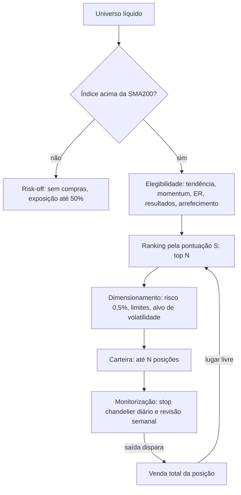

# Estratégia de tendência e momentum — Especificação de implementação

> Documento normativo para implementação por um agente de código. Os valores e regras aqui definidos são vinculativos. Descrição metodológica para estudo e teste; não constitui recomendação de investimento.

---

## 0. Instruções para o agente

1. Lê este documento inteiro antes de escrever código.
2. **Passo inicial obrigatório: inspecionar a base de dados local** (secção 3). Documenta o esquema encontrado em `docs/data_mapping.md` e o mapeamento para a interface de dados da secção 3.2.
3. **Para e pergunta ao utilizador** antes de continuar quando:
   - falta na base um campo obrigatório (secção 3.2);
   - não é claro se os preços estão ajustados a dividendos e *splits*;
   - não é claro como identificar o mercado, a moeda ou o índice de referência de cada instrumento;
   - é preciso definir a lista de mercados a configurar (propõe uma a partir da base e pede confirmação);
   - encontras uma contradição ou ambiguidade nesta especificação.
   Nunca inventes dados nem preenchas campos em falta com suposições.
4. O mercado é o STOXX600 em EUR

5. Ordem de implementação: camada de dados → indicadores (com testes) → motor de simulação (com testes) → bases de comparação → métricas e relatórios → validação → modo de sinais → README.
6. O backtest e o modo de sinais usam **o mesmo código de decisão**. Não pode haver lógica duplicada entre os dois.
7. Sem *lookahead*: qualquer decisão tomada no fecho da sessão t usa apenas dados até ao fecho de t, inclusive.
8. Resultados determinísticos: toda a aleatoriedade usa a seed configurada.
9. A tarefa está concluída quando todos os critérios da secção 21 forem cumpridos.

---

## 1. Resumo da estratégia

Carteira de até N = 10 ações líquidas em tendência de alta, escolhidas semanalmente por momentum ajustado ao risco e protegidas por stops de volatilidade.

- **Regime de mercado:** só há compras quando o índice de referência está acima da sua SMA200 (com histerese de ±1%). Em regime contrário não há compras e a exposição desce a 50%.
- **Elegibilidade:** tendência (fecho > SMA200 e SMA50 > SMA200), momentum absoluto positivo, tendência limpa (Efficiency Ratio), liquidez, sem resultados iminentes, sem arrefecimento após stop.
- **Ranking:** pontuação S que combina o rácio SMA10/SMA125 normalizado por ATR (M1) e o momentum 12-1 ajustado à volatilidade (M2). Compram-se os 10 melhores; uma posição só sai por ranking quando cai abaixo do 20.º lugar.
- **Saídas:** stop chandelier diário (máximo desde a entrada − 3 × ATR, só sobe); saídas semanais por quebra de tendência, perda de momentum, ranking, stop temporal ou regime de mercado. Sem realizações parciais.
- **Risco:** 0,5% do capital em risco por posição até ao stop; limites de peso, exposição, setor e risco aberto; alvo de volatilidade da carteira de 15% ao ano; sem alavancagem nem vendas a descoberto.
- **Calendário:** decisões no fecho da última sessão de cada semana; execução na abertura da sessão seguinte; stops ativos todos os dias.

O diagrama abaixo resume o fluxo.



---

## 2. Convenções

| Tema | Convenção |
|---|---|
| Sessão | Dia de negociação do calendário do mercado (secção 3.5) |
| Índice temporal | t = sessão atual; t−k = k sessões antes no calendário do instrumento |
| Dados disponíveis em t | Tudo até ao fecho de t, inclusive |
| Execução | Decisões do fecho de t executam-se na abertura da sessão seguinte em que o instrumento negoceia |
| Dia de revisão | Última sessão de cada semana ISO (normalmente sexta-feira). `review: biweekly` = revisões semanais alternadas, começando pela primeira; `review: monthly` = última sessão de cada mês |
| Preços | OHLC ajustados a dividendos e *splits* (secção 3.3), exceto onde se diz "bruto" |
| Retorno diário | r_t = C_t / C_{t−1} − 1, com fecho ajustado |
| Desvio-padrão | Amostral (ddof = 1), salvo indicação em contrário |
| Anualização | 252 sessões por ano |
| Frações | Percentagens na configuração escrevem-se como frações (0.005 = 0,5%) |
| Moeda | Cada mercado é simulado na sua moeda; não há conversão cambial |
| NaN | Um indicador sem dados suficientes é NaN; qualquer critério que dependa de um NaN é considerado falhado |

---

## 3. Dados

### 3.1 Fonte

Base de dados local com instrumentos. A ligação faz-se pela string em `data.db_url` da configuração, que pode vir da variável de ambiente `TRENDMOM_DB_URL`. O tipo de base (SQLite, PostgreSQL, DuckDB, ficheiros, outro) é determinado na inspeção inicial; implementa um adaptador `LocalDbAdapter` com a interface da secção 3.2.

Se a base tiver colunas pré-calculadas (médias móveis, rácios), **ignora-as**: todos os indicadores são recalculados a partir dos preços. Podem ser usadas num teste de consistência opcional.

### 3.2 Interface de dados

**Obrigatórios**

| Entidade | Campos |
|---|---|
| Instrumento | `instrument_id` (único), `symbol`, `currency`, `market` (ou forma inequívoca de o derivar) |
| Preço diário | `date`, `open`, `high`, `low`, `close`, `volume`, e ajustamento (preços já ajustados, ou fatores/eventos que permitam ajustar) |

**Opcionais** (cada funcionalidade dependente é desativada, com aviso no relatório, se o campo faltar)

| Campo | Funcionalidade dependente |
|---|---|
| `sector` por instrumento | Limites setoriais (secção 9.3) |
| Datas de resultados por instrumento | Filtro de resultados (secção 6.3) |
| Composição histórica do índice (entradas e saídas com datas) | Universo point-in-time (secção 3.6) |
| Série diária do índice de referência (pelo menos `close`; `open` desejável) | Regime de mercado e bases de comparação; sem ela usa-se o proxy da secção 4.10 |
| Instrumentos deslistados com histórico | Ausência de viés de sobrevivência (secção 3.6) |
| Taxa de juro de curto prazo diária | Juro da liquidez; sem ela usa-se `capital.cash_rate_annual` |

A interface Python a expor (assinaturas indicativas):

```python
class DataAdapter(Protocol):
    def list_instruments(self, market: str) -> pd.DataFrame: ...
        # colunas: instrument_id, symbol, currency, market, sector (opcional)
    def load_prices(self, instrument_ids: list[str], start: date | None, end: date | None) -> pd.DataFrame: ...
        # índice (instrument_id, date); colunas: open, high, low, close, volume,
        # close_raw, volume_raw (brutos, para liquidez)
    def load_index(self, index_id: str) -> pd.DataFrame | None: ...
    def load_earnings_dates(self, instrument_ids: list[str]) -> pd.DataFrame | None: ...
        # colunas: instrument_id, date
    def load_membership(self, market: str) -> pd.DataFrame | None: ...
        # colunas: instrument_id, start_date, end_date (end_date nulo = ainda membro)
    def load_cash_rate(self, market: str) -> pd.Series | None: ...
```

Os dados carregados são guardados em cache em `cache/` (formato Parquet), com chave que inclui o intervalo de datas e o mercado.

### 3.3 Ajustamento de preços

- Se a base já fornece OHLC ajustados, usa-os diretamente.
- Se fornece apenas fecho ajustado e OHLC brutos: `f_t = adj_close_t / close_t`; aplica `f_t` a open, high e low.
- Se fornece preços brutos e eventos (dividendos, *splits*): calcula fatores de ajustamento retroativos e aplica-os a O, H, L e C. O volume ajusta-se apenas aos *splits*, no sentido inverso.
- Guarda também o fecho e o volume brutos (`close_raw`, `volume_raw`) para o cálculo da liquidez.
- Se não houver forma de ajustar, **para e pergunta ao utilizador**.

### 3.4 Limpeza

- Remove sessões com qualquer valor OHLC em falta ou não positivo.
- Se `close` ou `open` estiverem fora de [low, high], corrige `low = min(open, high, low, close)` e `high = max(open, high, low, close)` e conta a ocorrência no relatório de qualidade de dados.
- Volume em falta = 0.
- Regista em `reports/<run_id>/data_quality.md`: instrumentos carregados, sessões removidas, correções feitas, instrumentos com menos de `min_history` sessões.

### 3.5 Calendário

O calendário de um mercado é o conjunto das datas em que o índice de referência tem dados. Sem índice na base, é o conjunto das datas em que pelo menos 50% dos instrumentos do mercado com histórico nessa data têm preço.

Um instrumento sem preço numa sessão do calendário (suspensão) não é avaliado nessa sessão: não entra, não sai por regra semanal e mantém o último fecho para avaliação da carteira. Os seus stops são avaliados na próxima sessão em que negociar.

### 3.6 Universo point-in-time e deslistagens

- Com composição histórica disponível, um instrumento pertence ao universo do mercado em t se for membro do índice em t.
- Sem ela, pertence ao universo todo o instrumento do mercado com preço em t.
- O relatório indica se a base contém instrumentos deslistados (instrumentos cujo último preço é anterior em mais de 10 sessões à última data do mercado). Se não contiver, o relatório inclui o aviso: "Resultados sujeitos a viés de sobrevivência".
- **Deslistagem:** se uma posição em carteira deixa de ter preços antes do fim dos dados do mercado, é vendida ao último fecho disponível, com custos, motivo `delisted`.

### 3.7 Mercados

A configuração tem uma lista `markets`. Cada mercado define o filtro de instrumentos, a moeda, o índice de referência e o limiar de liquidez. Cada mercado é simulado e validado de forma independente. Após inspecionar a base, propõe a lista de mercados ao utilizador e pede confirmação.

Se um mercado tiver em média menos de 3 × N instrumentos no universo, o relatório emite o aviso "Universo demasiado pequeno para o ranking".

---

## 4. Indicadores

Calculados por instrumento sobre as suas próprias sessões, com preços ajustados. Os parâmetros entre parênteses são os valores por defeito (secção 17).

### 4.1 Médias móveis simples

```
SMA_n(t) = média(C_{t−n+1}, …, C_t)
```

Usadas: SMA10, SMA50, SMA125, SMA200 (`sma_trend_fast = 50`, `sma_trend_slow = 200`, `m1_fast = 10`, `m1_slow = 125`).

### 4.2 True range e ATR (Wilder)

```
TR_t = max(H_t − L_t, |H_t − C_{t−1}|, |L_t − C_{t−1}|)      (primeira sessão: TR = H − L)
ATR_n(t0) = média(TR_1 … TR_n)                                 (semente na sessão n)
ATR_n(t)  = ATR_n(t−1) + (TR_t − ATR_n(t−1)) / n               (t > n)
```

`atr_n = 22`. Um único ATR é usado em toda a estratégia.

### 4.3 M1 — rácio SMA10/SMA125 normalizado

```
M1(t) = (SMA10(t) − SMA125(t)) / ATR22(t)
```

Equivale a (SMA10/SMA125 − 1) × SMA125/ATR: distância entre as médias medida em unidades de ATR.

### 4.4 M2 — momentum 12-1 ajustado à volatilidade

```
ret_12_1(t) = C_{t−21} / C_{t−252} − 1
sigma(t)    = desvio-padrão(r_{t−251}, …, r_t) × sqrt(252)
M2(t)       = ret_12_1(t) / sigma(t)
```

`m2_lookback = 252`, `m2_skip = 21`. Exige 253 fechos válidos.

### 4.5 Pontuação S

Calculada em cada revisão sobre o conjunto `U_rank` (secção 6.2):

```
z(x_i) = clip((x_i − média(x)) / desvio_populacional(x), −3, +3)
S_i    = w_m1 × z(M1_i) + (1 − w_m1) × z(M2_i)
```

`w_m1 = 0.5`, `z_clip = 3.0`. Se `U_rank` tiver menos de 2 elementos ou desvio nulo, z = 0.

### 4.6 Efficiency Ratio de Kaufman

```
ER_n(t) = |C_t − C_{t−n}| / Σ_{i=t−n+1..t} |C_i − C_{i−1}|      (denominador 0 → ER = 0)
```

`er_window = 60`. Num passeio aleatório de 60 sessões, ER ≈ 0,13.

### 4.7 Liquidez

```
VMN50(t) = média_{50 sessões}(close_raw × volume_raw)
```

Na moeda do mercado. Limiar `min_traded_value` por mercado (5 000 000 por defeito).

### 4.8 ADX (Wilder) — usado apenas na variante `trend_strength: adx`

```
up_t   = H_t − H_{t−1};   down_t = L_{t−1} − L_t
+DM_t  = up_t   se up_t > down_t e up_t > 0, senão 0
−DM_t  = down_t se down_t > up_t e down_t > 0, senão 0
TR, +DM, −DM suavizados com Wilder (n = adx_n = 14), como no ATR
+DI = 100 × sm(+DM) / sm(TR);   −DI = 100 × sm(−DM) / sm(TR)
DX  = 100 × |+DI − −DI| / (+DI + −DI)     (soma 0 → DX = 0)
ADX = suavização de Wilder de DX com n = 14
```

### 4.9 Indicadores das variantes

- **CMF(20)** (variante `volume_confirmation`): `MFM = ((C − L) − (H − C)) / (H − L)` (H = L → 0); `CMF = Σ_20 (MFM × V) / Σ_20 V` (Σ V = 0 → CMF = 0).
- **P90 de M1** (variantes `overextension_block` e `partial_take_profit`): percentil 90 de M1 do próprio instrumento nas últimas 504 sessões, exigindo pelo menos 252 observações não NaN.

### 4.10 Índice de referência e proxy

O índice de referência do mercado é o instrumento indicado em `regime_index`. Se for `null` ou não existir na base, constrói-se um proxy equiponderado:

```
r_proxy(t)   = média dos r_t de todos os instrumentos do universo com preço em t e em t−1
proxy(t)     = 100 × Π (1 + r_proxy)
```

O proxy só tem fecho; quando for necessária uma abertura, usa-se o fecho (secção 13).

### 4.11 Volatilidade da carteira

```
w_i     = Q_i × C_i(t) / equity(t)
Σ       = matriz de covariância amostral dos retornos diários das últimas 63 sessões (vol_window_portfolio)
sigma_p = sqrt(252 × wᵀ Σ w)
```

Retornos em falta tratam-se por covariância *pairwise*; cada par exige pelo menos 40 observações comuns, senão a covariância desse par é 0 e regista-se um aviso.

---

## 5. Regime de mercado

Avaliado em cada dia de revisão com o fecho do índice X(t) e a sua SMA200 (`regime.sma = 200`), com histerese `band = 0.01`:

```
se estado = risk_off e X(t) > SMA200(t) × (1 + band): estado ← risk_on
se estado = risk_on  e X(t) < SMA200(t) × (1 − band): estado ← risk_off
caso contrário: mantém o estado
estado inicial (primeira revisão com SMA200 válida): risk_on se X > SMA200, senão risk_off
```

| Estado | Efeito |
|---|---|
| `risk_on` | Novas entradas permitidas; exposição bruta máxima `max_gross = 1.0` |
| `risk_off` | Sem novas entradas; exposição bruta máxima `riskoff_max_gross = 0.5` (secção 8.4) |

Com `use_market_regime: false` o estado é sempre `risk_on`.

---

## 6. Universo, elegibilidade e ranking

Avaliados em cada dia de revisão t, apenas para instrumentos com preço em t.

### 6.1 Universo `U(t)`

Instrumento do mercado que cumpre todos:

1. pertence ao universo em t (secção 3.6);
2. tem pelo menos `min_history = 253` sessões válidas até t;
3. `VMN50(t) ≥ min_traded_value`.

### 6.2 Conjunto de ranking `U_rank(t)`

Instrumentos de `U(t)` com:

1. `C > SMA200` e `SMA50 > SMA200`;
2. `M1 > 0` e `M2 > 0`.

Ordenam-se por S decrescente (desempate por `instrument_id` crescente). `rank_i` = posição (1 = melhor). S calcula-se sobre este conjunto (secção 4.5).

### 6.3 Elegibilidade para entrada `E(t)`

Instrumentos de `U_rank(t)` que cumprem ainda:

1. **Força de tendência** (`trend_strength`): `er` → `ER60 ≥ er_threshold (0.25)`; `adx` → `ADX14 ≥ adx_threshold (20)`; `none` → sem filtro.
2. **Resultados:** não existe data de resultados d com t < d ≤ (t + `earnings_window` sessões do calendário), `earnings_window = 5`. Desativado se `use_earnings_filter: false` ou se não houver datas na base (com aviso).
3. **Arrefecimento:** se o instrumento saiu por stop na sessão e, só volta a ser elegível quando o número de sessões do calendário depois de e até t, inclusive, for pelo menos `cooldown_sessions = 10`.
4. **Variante** `volume_confirmation: true`: `CMF20 > 0`.
5. **Variante** `overextension_block: true`: `M1 ≤ P90(M1)`.

Os critérios da secção 6.3 aplicam-se só a novas compras; uma posição aberta nunca é vendida por deixar de os cumprir.

---

## 7. Entradas

No dia de revisão t, depois das saídas semanais (secção 8.2), se o regime for `risk_on`:

```
slots       = N − (número de posições que continuam após as saídas planeadas)
candidatos  = instrumentos com rank ≤ N, não detidos, pertencentes a E(t), por ordem de rank
para cada candidato, enquanto slots > 0:
    calcular Q_base (secção 9.1)
    aplicar os limites (secção 9.3); se falhar, passa ao candidato seguinte
    planear compra; slots ← slots − 1
```

`N = n_positions = 10`. Os lugares que não se preencham ficam em liquidez até à revisão seguinte.

**Ordem:** compra a mercado na abertura da sessão seguinte.

**Proteção contra gaps:** a compra é cancelada se `O_{t+1} > C_t + gap_protect_atr × ATR_t` (`gap_protect_atr = 1.0`). O instrumento pode voltar a ser candidato na revisão seguinte.

**Stop inicial:** `stop_0 = preço de execução − stop_mult × ATR_t` (`stop_mult = 3.0`), com o ATR do dia de revisão. O stop está ativo desde a sessão da compra.

**Variante `pullback_entry: true`:** em vez de ordem a mercado, ordem limite a `C_t − pullback_atr × ATR_t` (`pullback_atr = 1.0`), válida durante `pullback_window = 5` sessões. É executada na primeira sessão em que `L ≤ limite`, ao preço `min(O, limite)`. Não executada → cancelada. Sem proteção contra gaps nesta variante.

---

## 8. Saídas

Qualquer saída vende a posição inteira, exceto a variante de realização parcial (8.3) e os ajustes de volatilidade (9.4).

### 8.1 Stop diário (chandelier)

Para cada posição, no fecho de cada sessão s em que o instrumento negoceia (incluindo a sessão de entrada):

```
HH  = max(HH, H_s)                                  (HH inicial = preço de execução)
stop = max(stop, HH − stop_mult × ATR22(s))
```

O stop nunca desce. O novo valor aplica-se a partir da sessão seguinte. A execução do stop segue a secção 10.2.

### 8.2 Saídas semanais

No dia de revisão t, para cada posição com preço em t, aplica-se o primeiro motivo verificado, por esta ordem:

| Motivo (`exit_reason`) | Condição no fecho de t |
|---|---|
| `universe_exit` | O instrumento não está em `U(t)` (perdeu liquidez ou deixou o índice) |
| `trend_break` | `C ≤ SMA200` ou `SMA50 ≤ SMA200` |
| `momentum_loss` | `M1 ≤ 0` ou `M2 ≤ 0` |
| `rank_exit` | `rank > buffer_mult × N` (`buffer_mult = 2.0`, ou seja, fora do top 20) |
| `time_stop` | Pelo menos `time_stop_sessions = 20` sessões desde a entrada e o maior fecho desde a entrada (inclusive) < `entry_price + time_stop_atr × atr_entry` (`time_stop_atr = 1.0`). Desativado com `use_time_stop: false` |

Se algum indicador necessário for NaN, não se toma decisão semanal sobre essa posição nessa revisão. A venda executa-se na abertura da sessão seguinte.

### 8.3 Variante `partial_take_profit: true`

Na revisão, se a posição ainda não teve realização parcial e `M1 > P90(M1)`: vende-se `floor(Q / 2)`, `base_quantity` é dividida por 2 (arredondada para baixo) e marca-se `partial_done = true`. Motivo `partial_take_profit`.

### 8.4 Redução em `risk_off`

Se o estado for `risk_off` e, depois das saídas de 8.2, a exposição bruta for superior a `riskoff_max_gross × equity`, vendem-se posições inteiras por ordem crescente de S (as que não estão em `U_rank` primeiro) até a exposição ficar igual ou abaixo do limite. Motivo `risk_off`. A exposição calcula-se com os fechos de t.

---

## 9. Dimensionamento e limites de carteira

`equity(t) = cash(t) + Σ Q_i × C_i(t)`, calculado no fecho do dia de revisão, antes das novas ordens.

### 9.1 Quantidade base

```
Q_risk = floor(equity × risk_per_position / (stop_mult × ATR_t))      risk_per_position = 0.005
Q_cap  = floor(max_weight × equity / C_t)                              max_weight = 0.15
Q_base = min(Q_risk, Q_cap)
```

Exemplo de referência (usado nos testes): equity = 100 000, r = 0,005, C = 50, ATR = 1,00, stop_mult = 3 → Q_risk = floor(500 / 3) = 166; Q_cap = floor(15 000 / 50) = 300; Q_base = 166 (8 300, ou 8,3% do capital).

### 9.2 Relação entre parâmetros

O risco por posição deve ser coerente com N e com a distância típica do stop: `r ≈ (exposição alvo / N) × distância típica do stop em %`. Com N = 10 e stop típico de 6%, r ≈ 0,6%; o valor por defeito de 0,5% deixa margem. Esta relação é informativa; não é verificada pelo código.

### 9.3 Limites verificados em cada compra planeada

Por esta ordem; `V_hold` = valor das posições que continuam, `V_new` = valor das compras já planeadas nesta revisão, aos fechos de t.

1. **Exposição bruta:** se `V_hold + V_new + Q_base × C_t > max_gross × equity`, reduz-se Q_base para caber. Se a quantidade reduzida for inferior a 50% da original, o candidato é ignorado.
2. **Setor** (`use_sector_limits: true` e setor disponível): o valor do setor (posições + compras planeadas) mais a nova compra não pode exceder `sector_max_weight = 0.30` × equity, e o setor não pode ter já `sector_max_positions = 3` posições. Se falhar, o candidato é ignorado.
3. **Risco aberto:**
   ```
   OR = Σ_posições max(0, C_i − stop_i) × Q_i + Σ_compras_planeadas stop_mult × ATR_j × Q_j
   ```
   Se `OR + stop_mult × ATR_t × Q_base > open_risk_max × equity` (`open_risk_max = 0.06`), o candidato é ignorado. Este limite nunca força vendas.
4. **Ordem mínima:** se `Q_base × C_t < min_order_weight × equity` (`min_order_weight = 0.005`), o candidato é ignorado.

Cada candidato ignorado é registado com o motivo (`gross_limit`, `sector_limit`, `open_risk_limit`, `min_order`).

### 9.4 Alvo de volatilidade

Na revisão, depois de planear saídas, reduções e entradas, com `use_vol_target: true`:

```
carteira P = posições que continuam (com base_quantity) + compras planeadas (com Q_base)
sigma_p    = volatilidade de P (secção 4.11), com Q = base_quantity
k          = min(1, vol_target / sigma_p)                            vol_target = 0.15
Q_alvo_i   = floor(base_quantity_i × k)
```

- Compras novas executam `Q_alvo`.
- Posições existentes: só se emite ordem de ajuste se `|Q_alvo − Q_atual| / Q_atual > rebalance_tolerance (0.20)` e o valor da ordem for pelo menos `min_order_weight × equity`. Reduções são vendas parciais (motivo `vol_target`); aumentos são compras que nunca levam a quantidade acima de `base_quantity`.
- k nunca é superior a 1: não há alavancagem.

Com `use_vol_target: false`, `k = 1`.

---

## 10. Motor de simulação

### 10.1 Estado inicial

`cash = capital.initial` (100 000 na moeda do mercado), sem posições. A simulação começa na primeira sessão após o aquecimento (secção 15.1).

### 10.2 Sequência de cada sessão t

**Abertura de t**

1. **Stops com gap:** para cada posição com preço em t, se `O_t ≤ stop`, vende tudo a `O_t` (motivo `stop`) e cancela ordens pendentes desse instrumento.
2. **Vendas pendentes** (saídas, reduções, ajustes de volatilidade): executam-se a `O_t`. Se o instrumento não tiver preço em t, a ordem mantém-se pendente até negociar.
3. **Compras pendentes**, por ordem de rank, seguidas dos aumentos de ajuste de volatilidade:
   - proteção contra gaps (secção 7);
   - limite de liquidez: `Q = min(Q, floor(cash / (O_t × (1 + cost_per_side))))`; se Q = 0, cancela;
   - se o instrumento não tiver preço em t, a compra é cancelada.
4. **Ordens limite** da variante `pullback_entry`: verificadas em cada sessão da validade.

**Durante a sessão t**

5. Para cada posição com preço em t (incluindo as compradas nesta abertura): se `L_t ≤ stop`, vende tudo ao preço do stop (motivo `stop`).

**Fecho de t**

6. **Deslistagem:** posição cujo instrumento não tem preços depois de t, sendo t anterior à última data do mercado → venda a `C_t` (motivo `delisted`).
7. **Juro:** `cash += cash × ((1 + taxa_anual)^(1/252) − 1)`. A taxa vem da série da base, se existir, ou de `cash_rate_annual` (0.0 por defeito). Aplica-se também a liquidez negativa.
8. **Avaliação:** `equity = cash + Σ Q × C` (último fecho conhecido para instrumentos sem preço em t).
9. **Stops:** atualização do chandelier (secção 8.1).
10. **Revisão** (se t for dia de revisão): regime → universo e ranking → saídas semanais → redução risk-off → entradas → alvo de volatilidade → ordens pendentes para a sessão seguinte.
11. **Impostos** (se `tax.rate > 0` e t for a última sessão do ano civil): `imposto = tax.rate × max(0, mais-valias realizadas no ano, líquidas de custos)`, deduzido de `cash`. Sem reporte de perdas entre anos. Se `cash` ficar negativo, é financiado à taxa de juro da liquidez e as compras seguintes ficam limitadas pelo passo 3.
12. **Registos** diários (secção 19).

### 10.3 Custos

Cada execução paga `cost_per_side × |Q × preço|` (`cost_per_side = 0.0015`), deduzido de `cash`. O custo representa comissão, spread e *slippage* em conjunto. Não há vendas a descoberto nem frações de ações.

### 10.4 Posição (estrutura de dados)

| Campo | Descrição |
|---|---|
| `instrument_id` | Identificador |
| `quantity` | Quantidade atual |
| `base_quantity` | Quantidade de referência para o alvo de volatilidade |
| `entry_date`, `entry_price` | Data e preço de execução da compra |
| `atr_entry` | ATR22 do dia de revisão que gerou a compra |
| `initial_stop` | Stop inicial |
| `stop` | Stop atual (chandelier) |
| `highest_high` | Máximo desde a entrada |
| `highest_close` | Maior fecho desde a entrada (para o stop temporal) |
| `partial_done` | Realização parcial já feita (variante) |
| `sector` | Setor, se disponível |

Estado da carteira: `cash`, lista de posições, `cooldowns` (instrumento → data da última saída por stop), `regime_state`, ordens pendentes, mais-valias realizadas no ano corrente.

---

## 11. Variantes (interruptores de configuração)

Todas as regras opcionais são controladas por chaves da configuração (secção 17), para permitir a ablação sem alterar código.

| Chave | Valor por defeito | Efeito |
|---|---|---|
| `regime.use_market_regime` | `true` | Filtro do índice (secção 5) |
| `filters.trend_strength` | `er` | `er`, `adx` ou `none` |
| `filters.use_earnings_filter` | `true` | Filtro de resultados |
| `filters.volume_confirmation` | `false` | Exige CMF20 > 0 na entrada |
| `filters.overextension_block` | `false` | Bloqueia entradas com M1 > P90 |
| `exits.use_time_stop` | `true` | Stop temporal |
| `exits.partial_take_profit` | `false` | Venda de metade com M1 > P90 |
| `entries.pullback_entry` | `false` | Ordem limite em recuo |
| `sizing.use_vol_target` | `true` | Alvo de volatilidade |
| `sizing.use_sector_limits` | `true` | Limites setoriais |
| `ranking.w_m1` | `0.5` | Peso de M1 na pontuação |
| `schedule.review` | `weekly` | `weekly`, `biweekly` ou `monthly` |

---

## 12. Parâmetros por defeito e gamas

| Parâmetro (chave) | Defeito | Valores do varrimento de sensibilidade |
|---|---|---|
| `indicators.sma_trend_fast` | 50 | 40, 45, 50, 55, 60 |
| `indicators.sma_trend_slow` | 200 | 150, 175, 200, 225, 250 |
| `indicators.m1_fast` | 10 | 5, 10, 15, 20 |
| `indicators.m1_slow` | 125 | 100, 115, 125, 135, 150 |
| `indicators.m2_lookback` | 252 | 126, 189, 252 |
| `indicators.m2_skip` | 21 | 0, 10, 21 |
| `ranking.w_m1` | 0.5 | 0, 0.25, 0.5, 0.75, 1 |
| `indicators.atr_n` | 22 | 14, 18, 22, 26, 30 |
| `exits.stop_mult` | 3.0 | 2.5, 3.0, 3.5, 4.0 |
| `indicators.er_window` | 60 | 40, 60, 90 |
| `filters.er_threshold` | 0.25 | 0.20, 0.25, 0.30, 0.35 |
| `ranking.n_positions` | 10 | 8, 10, 12, 15, 20 |
| `ranking.buffer_mult` | 2.0 | 1.5, 2.0, 2.5, 3.0 |
| `sizing.risk_per_position` | 0.005 | 0.004, 0.005, 0.006, 0.007, 0.008 |
| `sizing.max_weight` | 0.15 | 0.10, 0.125, 0.15, 0.175, 0.20 |
| `sizing.open_risk_max` | 0.06 | 0.04, 0.05, 0.06, 0.07, 0.08 |
| `sizing.sector_max_weight` | 0.30 | 0.20, 0.30, 0.40 |
| `sizing.vol_target` | 0.15 | 0.10, 0.125, 0.15, 0.175, 0.20 |
| `regime.band` | 0.01 | 0, 0.01, 0.02, 0.03 |
| `exits.time_stop_sessions` | 20 | 10, 20, 30, 40 |
| `filters.cooldown_sessions` | 10 | 5, 10, 15, 20 |
| `filters.earnings_window` | 5 | 0, 5, 10 |
| `entries.gap_protect_atr` | 1.0 | 0.5, 1.0, 1.5, 2.0 |
| `schedule.review` | weekly | weekly, biweekly, monthly |
| `costs.cost_per_side` | 0.0015 | 0.0005, 0.001, 0.0015, 0.002, 0.003 (sensibilidade a custos; não é critério de planalto) |

Parâmetros fixos (sem varrimento): `min_traded_value` (por mercado), `min_history = 253`, `vol_window_portfolio = 63`, `rebalance_tolerance = 0.20`, `min_order_weight = 0.005`, `max_gross = 1.0`, `riskoff_max_gross = 0.5`, `sector_max_positions = 3`, `z_clip = 3.0`, `time_stop_atr = 1.0`.

---

## 13. Bases de comparação

Simuladas no mesmo período, com os mesmos custos e o mesmo juro da liquidez.

| Id | Descrição | Regras |
|---|---|---|
| `B1_buy_hold` | Compra e manutenção do índice de referência (ou proxy) | Investido a 100% desde o início do período de medição |
| `B2_index_sma200` | Índice com filtro SMA200 | Na última sessão de cada mês: fecho > SMA200 → investido no índice; caso contrário → liquidez. Execução na abertura seguinte (no fecho seguinte se o índice não tiver abertura). Custos em cada mudança |
| `B3_equal_weight` | Carteira equiponderada do universo | Na última sessão de cada mês, pesos iguais em todos os instrumentos de `U(t)`; execução na abertura seguinte; custos sobre o volume transacionado; deslistagens como na secção 3.6 |

Se o índice da base for só de preço (sem dividendos), o relatório indica-o.

---

## 14. Métricas

Calculadas sobre a série diária de equity de cada simulação, no período de medição.

| Métrica | Definição |
|---|---|
| CAGR | `(E_fim / E_início)^(252 / T) − 1`, T = número de sessões |
| Volatilidade | `desvio(r) × sqrt(252)` |
| Sharpe | `média(r − r_f) / desvio(r − r_f) × sqrt(252)`, r_f = juro diário da liquidez |
| Sortino | `média(r − r_f) / sqrt(média(min(r − r_f, 0)²)) × sqrt(252)` |
| MaxDD | Maior queda relativa entre um máximo e um mínimo posterior (magnitude positiva) |
| Duração do MaxDD | Sessões desde o máximo até recuperar esse máximo (ou até ao fim, se não recuperar) |
| Calmar | `CAGR / MaxDD` |
| Taxa de acerto | Percentagem de operações fechadas com P&L > 0 |
| Payoff | Ganho médio das operações vencedoras / perda média das perdedoras |
| R-múltiplo médio | Média de `P&L / ((entry_price − initial_stop) × quantidade inicial)` |
| Rotação anual | `Σ |valor transacionado| / 2 / equity média`, por ano |
| Exposição média | Média diária de `valor das posições / equity` |
| Custos totais | Soma dos custos, em valor e em % da equity média anual |
| N.º de operações | Operações fechadas |

---

## 15. Protocolo de validação

### 15.1 Períodos

- **Aquecimento:** as primeiras sessões até haver indicadores válidos (pelo menos 253 sessões; 504 se uma variante usar o P90 de M1) e pelo menos 3 × N instrumentos em `U(t)`.
- **Início da simulação:** primeira sessão após o aquecimento.
- **Calibração:** os primeiros `calibration_years = 5` anos civis completos após o início.
- **Teste:** todos os anos civis seguintes (o último pode ser parcial).
- As simulações correm sempre sobre todo o período; as métricas de comparação medem-se **apenas no período de teste**.
- O relatório exige pelo menos 15 anos de dados após o aquecimento; com menos, emite o aviso "Histórico curto" e continua.

### 15.2 Regra de comparação

Para duas simulações A e B no mesmo período:

```
ΔSharpe = Sharpe_A − Sharpe_B
ΔDD     = MaxDD_B − MaxDD_A          (positivo = A tem menor drawdown)
A é melhor que B se:
    (ΔSharpe ≥ +0.05 ou ΔDD ≥ +0.02) e (ΔSharpe ≥ −0.05 e ΔDD ≥ −0.02)
```

### 15.3 Ablação

Todas com os parâmetros por defeito, alterando uma única chave.

| Id | Tipo | Alteração |
|---|---|---|
| `full` | — | Configuração por defeito |
| `no_vol_target` | remover | `sizing.use_vol_target: false` |
| `no_trend_strength` | remover | `filters.trend_strength: none` |
| `adx_instead_of_er` | substituir | `filters.trend_strength: adx` |
| `no_market_regime` | remover | `regime.use_market_regime: false` |
| `no_earnings_filter` | remover | `filters.use_earnings_filter: false` |
| `no_time_stop` | remover | `exits.use_time_stop: false` |
| `no_sector_limits` | remover | `sizing.use_sector_limits: false` |
| `rank_m1_only` | substituir | `ranking.w_m1: 1.0` |
| `rank_m2_only` | substituir | `ranking.w_m1: 0.0` |
| `with_volume_confirmation` | adicionar | `filters.volume_confirmation: true` |
| `with_pullback_entry` | adicionar | `entries.pullback_entry: true` |
| `with_overextension_block` | adicionar | `filters.overextension_block: true` |
| `with_partial_take_profit` | adicionar | `exits.partial_take_profit: true` |
| `monthly_review` | substituir | `schedule.review: monthly` |

Classificação no relatório:

- **remover:** componente `justificado` se `full` for melhor que a variante; caso contrário `não justificado`.
- **adicionar / substituir:** `melhora` se a variante for melhor que `full`; caso contrário `não melhora`.

Variantes que dependem de dados ausentes (por exemplo, sem setores ou sem datas de resultados) são marcadas `não avaliável`.

### 15.4 Sensibilidade

- **Varrimentos unidimensionais:** para cada parâmetro da secção 12, uma simulação por valor, mantendo os restantes por defeito.
- **Mapas de calor bidimensionais:** (`exits.stop_mult` × `ranking.n_positions`) e (`indicators.m1_slow` × `filters.er_threshold`), com os valores da secção 12. Métrica: Sharpe no período de teste.
- **Critério de planalto** para cada varrimento unidimensional (exceto custos):
  ```
  (a) Sharpe(v) ≥ Sharpe(defeito) − 0.25 para todos os valores v do varrimento
  (b) Sharpe(defeito) ≤ mediana(Sharpe do varrimento) + 0.15
  ```
  O relatório lista os parâmetros que falham.

### 15.5 Walk-forward

1. Grelha de otimização (81 combinações): `exits.stop_mult` ∈ {2.5, 3.0, 3.5} × `ranking.n_positions` ∈ {8, 10, 15} × `filters.er_threshold` ∈ {0.20, 0.25, 0.30} × `ranking.w_m1` ∈ {0, 0.5, 1}.
2. Corre cada combinação uma vez sobre todo o período.
3. Para cada ano de teste Y: escolhe a combinação com maior Sharpe nos 5 anos civis anteriores a Y (`wf_train_years = 5`); em caso de empate, a mais próxima dos valores por defeito (soma das distâncias normalizadas pela amplitude de cada parâmetro).
4. A curva fora da amostra é a concatenação dos retornos diários de cada ano Y retirados da simulação da combinação escolhida para Y.
5. Regista por ano: combinação escolhida, Sharpe de treino, Sharpe de teste.

### 15.6 Deflated Sharpe Ratio (Bailey e López de Prado, 2014)

Sobre os retornos diários da curva fora da amostra do walk-forward:

```
SR      = Sharpe por sessão (não anualizado) da curva fora da amostra
T       = número de sessões
g3, g4  = assimetria e curtose (não excedente) dos retornos diários
K       = número total de configurações distintas avaliadas (varrimentos + mapas de calor + walk-forward + ablação)
V       = variância, entre essas K configurações, do Sharpe por sessão no período de teste
γ       = 0.5772156649 (constante de Euler-Mascheroni)
Φ, Φ⁻¹  = função de distribuição da normal padrão e a sua inversa

SR*  = sqrt(V) × ((1 − γ) × Φ⁻¹(1 − 1/K) + γ × Φ⁻¹(1 − 1/(K × e)))      (K = 1 ou V = 0 → SR* = 0)
DSR  = Φ( (SR − SR*) × sqrt(T − 1) / sqrt(1 − g3 × SR + (g4 − 1)/4 × SR²) )
```

Critério: `DSR ≥ dsr_threshold (0.95)`.

### 15.7 Monte Carlo

- *Bootstrap* circular em blocos dos retornos diários da curva fora da amostra do walk-forward.
- Blocos de `mc_block = 20` sessões; `mc_sims = 5000` simulações, cada uma com o comprimento da amostra; `seed = 42`.
- Resultados: percentis 5, 50 e 95 do MaxDD e do CAGR.
- O percentil 95 do MaxDD é gravado em `reports/<run_id>/<market>/montecarlo.json` como `maxdd_p95` e é usado pela regra de suspensão (secção 16.4).

### 15.8 Vários mercados

Toda a validação corre em cada mercado configurado, com os mesmos parâmetros. Não há ajuste de parâmetros por mercado.

### 15.9 Impostos

As comparações de validação são feitas antes de impostos (`tax.rate` ignorado). O relatório principal inclui uma simulação adicional da configuração por defeito com `tax.rate` (0.28 por defeito), apresentada separadamente.

### 15.10 Critérios de aprovação

Avaliados automaticamente e escritos em `reports/<run_id>/approval.md`, cada um com PASSA / FALHA e os números que o justificam:

1. Na curva fora da amostra do walk-forward, Sharpe superior e MaxDD inferior a `B2_index_sma200`, no mesmo período, em pelo menos dois mercados. Se só existir um mercado, avalia-se nesse e indica-se "apenas um mercado disponível".
2. Todos os varrimentos unidimensionais cumprem o critério de planalto.
3. `DSR ≥ 0.95` em cada mercado.
4. Todos os componentes do tipo "remover" são `justificado` na ablação.

O relatório indica também as variantes classificadas como `melhora`.

---

## 16. Modo de sinais (operação)

Aplica as mesmas regras ao fim dos dados disponíveis, com a carteira real.

### 16.1 Estado

Ficheiro `state/<market>/portfolio.json`:

```json
{
  "as_of": "YYYY-MM-DD",
  "cash": 0.0,
  "regime_state": "risk_on",
  "realized_gains_ytd": 0.0,
  "positions": [
    {
      "instrument_id": "...",
      "quantity": 0,
      "base_quantity": 0,
      "entry_date": "YYYY-MM-DD",
      "entry_price": 0.0,
      "atr_entry": 0.0,
      "initial_stop": 0.0,
      "stop": 0.0,
      "highest_high": 0.0,
      "highest_close": 0.0,
      "partial_done": false
    }
  ],
  "cooldowns": {"instrument_id": "YYYY-MM-DD"},
  "pending_orders": []
}
```

Histórico de equity em `state/<market>/equity_history.csv` (`date, equity, cash`).

### 16.2 Comandos

- `trendmom signals --market M [--asof YYYY-MM-DD]` (por defeito, a última data da base):
  - atualiza `highest_high`, `highest_close` e `stop` de cada posição até `asof`;
  - acrescenta a linha de equity de `asof` ao histórico;
  - se `asof` for dia de revisão, executa a revisão completa (secção 10.2, passo 10);
  - escreve `signals/<market>/<asof>/orders.csv` e `signals/<market>/<asof>/summary.md`;
  - grava no estado os stops e máximos atualizados, mas não altera quantidades nem liquidez: isso só acontece com `apply-fills`.
- `trendmom apply-fills --market M --fills fills.csv`: atualiza o estado com as execuções reais. Colunas de `fills.csv`: `date, instrument_id, side (buy|sell), quantity, price, cost, reason`. Numa compra nova, define `entry_*`, `atr_entry` (ATR do dia de revisão que a gerou), `initial_stop`, `stop`, `base_quantity`. Numa venda com `reason = stop`, regista o arrefecimento. Atualiza `cash` e `realized_gains_ytd`.

### 16.3 Saídas

`orders.csv`: `instrument_id, symbol, side, quantity, order_type (market_open | stop | limit), price, valid_until, reason`. Inclui as ordens stop a colocar ou alterar no corretor, todas as sessões.

`summary.md`: regime e distância do índice à SMA200; top 2N do ranking com S, M1, M2, ER e elegibilidade; estado de cada posição (stop, distância ao stop em ATR, motivos de saída verificados); exposição bruta, risco aberto, volatilidade estimada e fator k; candidatos ignorados e motivo; avisos de dados.

### 16.4 Regra de suspensão

Se o drawdown corrente do histórico de equity for superior a `maxdd_p95` do relatório indicado em `signals.validation_report` da configuração, o `summary.md` mostra "SUSPENSÃO: novas entradas bloqueadas" e não são geradas ordens de compra. Stops e saídas continuam a ser gerados. Sem relatório de validação configurado, a regra fica inativa e o resumo indica-o.

---

## 17. Configuração

Ficheiro `config/default.yaml`:

```yaml
data:
  db_url: ${TRENDMOM_DB_URL}
  start_date: null            # null = início dos dados
  end_date: null              # null = fim dos dados
  cache_dir: cache

markets:                      # a confirmar com o utilizador após a inspeção da base
  - name: market_1
    instrument_filter: {}     # critério de seleção na base (ex.: {exchange: "XLIS"})
    currency: EUR
    regime_index: null        # instrument_id do índice; null = proxy equiponderado
    min_traded_value: 5000000

capital:
  initial: 100000
  cash_rate_annual: 0.0       # usado se a base não tiver taxa de juro

costs:
  cost_per_side: 0.0015

tax:
  rate: 0.28                  # só no relatório pós-impostos (15.9)

indicators:
  sma_trend_fast: 50
  sma_trend_slow: 200
  m1_fast: 10
  m1_slow: 125
  atr_n: 22
  m2_lookback: 252
  m2_skip: 21
  er_window: 60
  adx_n: 14
  cmf_n: 20
  p90_window: 504
  p90_min_obs: 252
  min_history: 253
  vol_window_portfolio: 63

ranking:
  w_m1: 0.5
  z_clip: 3.0
  n_positions: 10
  buffer_mult: 2.0

filters:
  trend_strength: er          # er | adx | none
  er_threshold: 0.25
  adx_threshold: 20
  use_earnings_filter: true
  earnings_window: 5
  cooldown_sessions: 10
  volume_confirmation: false
  overextension_block: false

regime:
  use_market_regime: true
  sma: 200
  band: 0.01
  riskoff_max_gross: 0.5

entries:
  gap_protect_atr: 1.0
  pullback_entry: false
  pullback_atr: 1.0
  pullback_window: 5

exits:
  stop_mult: 3.0
  use_time_stop: true
  time_stop_sessions: 20
  time_stop_atr: 1.0
  partial_take_profit: false

sizing:
  risk_per_position: 0.005
  max_weight: 0.15
  max_gross: 1.0
  open_risk_max: 0.06
  use_sector_limits: true
  sector_max_weight: 0.30
  sector_max_positions: 3
  use_vol_target: true
  vol_target: 0.15
  rebalance_tolerance: 0.20
  min_order_weight: 0.005

schedule:
  review: weekly              # weekly | biweekly | monthly

validation:
  calibration_years: 5
  min_years_warning: 15
  wf_train_years: 5
  wf_grid:
    exits.stop_mult: [2.5, 3.0, 3.5]
    ranking.n_positions: [8, 10, 15]
    filters.er_threshold: [0.20, 0.25, 0.30]
    ranking.w_m1: [0.0, 0.5, 1.0]
  mc_sims: 5000
  mc_block: 20
  seed: 42
  dsr_threshold: 0.95
  compare_sharpe_delta: 0.05
  compare_dd_delta: 0.02
  plateau_max_drop: 0.25
  plateau_max_peak: 0.15
  workers: null               # null = número de CPUs

signals:
  state_dir: state
  output_dir: signals
  validation_report: null     # caminho para reports/<run_id>; null = regra de suspensão inativa
```

A configuração é validada ao carregar (tipos, gamas, chaves desconhecidas → erro). Qualquer simulação regista em `config_used.yaml` a configuração efetiva.

---
