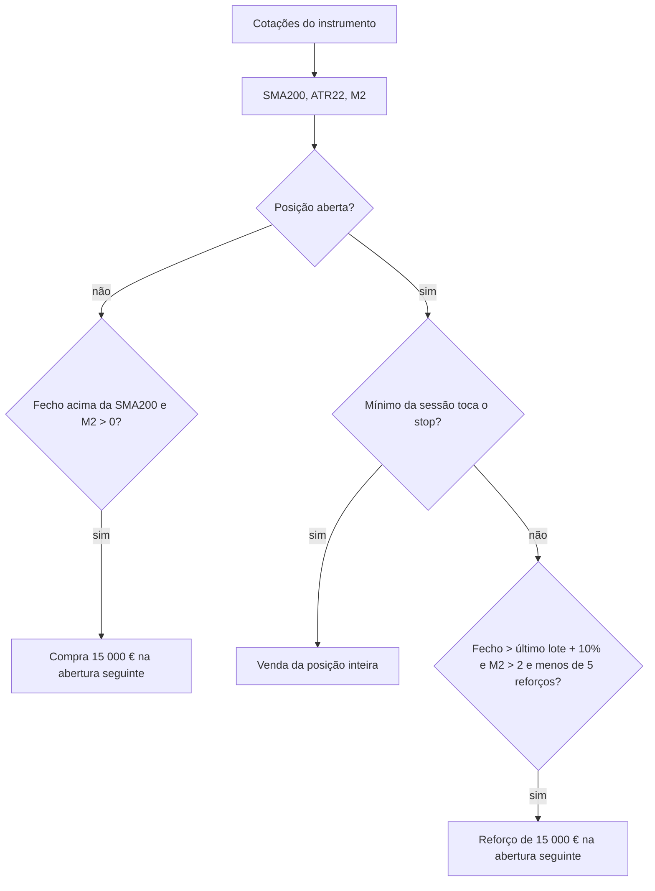

# C-AI — Estratégia de tendência com momentum e reforços selectivos

> Especificação da estratégia C-AI para a aplicação Stocks, elaborada a partir da análise de todos os instrumentos do catálogo (24 out. 2026). A C-AI é uma estratégia **por instrumento**, como a A-Momentum e a B-Opus: cada instrumento é simulado isoladamente, com os seus próprios dados, no mesmo ambiente (registo `shared/strategies/`, API, BackTest, página do instrumento e Sinais), com o mesmo orçamento por compra e sem comissões. Os valores e regras aqui definidos são vinculativos. Descrição metodológica para estudo e simulação; não constitui recomendação de investimento.
>
> Estado: **implementada a 24 out. 2026** em `shared/strategies/c-ai.js` (+1 491 k€, 182 instrumentos com ganho e 106 com perda, sobre os dados de produção).

---

## 0. Instruções para a implementação

1. Lê este documento inteiro antes de escrever código.
2. A C-AI é um módulo JavaScript puro, sem dependências, em `shared/strategies/c-ai.js`. A entrada `c-ai` do registo passa a `available: true`, com `run(quotes, { from })` a devolver o formato comum do registo (secção 9). É o mesmo código no browser e no servidor.
3. Reutiliza as funções de `shared/strategies/b-opus.js` que calculam a série ajustada (`prepare`), o ATR de Wilder (`atrWilder`) e o M2 (`m2Series`), e `rollingMean` de `shared/momentum.js`. Não dupliques estas funções.
4. Sem *lookahead*: a decisão no fecho da sessão t usa apenas dados até ao fecho de t.
5. Resultados determinísticos; sem aleatoriedade.
6. Para e pergunta ao utilizador se encontrares uma contradição ou ambiguidade.
7. A tarefa está concluída quando todos os critérios da secção 13 forem cumpridos.

---

## 1. Resumo da estratégia

A análise mostrou que, nos dados disponíveis, o que mais distingue os instrumentos que sobem dos que não sobem é estarem **acima da média de 200 sessões com momentum de 12 meses positivo ajustado à volatilidade** (secção 11.1). A C-AI aproveita isso com o mínimo de regras:

- **Entrada (qualquer sessão):** sem posição, quando o fecho ajustado está acima da SMA200 e o M2 (momentum 12-1 dividido pela volatilidade) é positivo, compra 15 000 € na abertura da sessão seguinte.
- **Saída:** só pelo stop chandelier de 5 × ATR22 (máximo desde a compra − 5 × ATR, só sobe), verificado todos os dias, com venda da posição inteira. Sem outras regras de saída.
- **Reforços selectivos:** mais 15 000 € na abertura seguinte quando o fecho sobe mais de 10% face ao último lote **e** o momentum é muito forte (M2 > 2); no máximo 5 reforços. O stop protege a posição inteira.
- **Reentrada:** depois de um stop, volta a comprar logo que as condições de entrada se verifiquem, sem arrefecimento.
- **Sem comissões**, uma posição de cada vez.

Comparação com as estratégias existentes (296 instrumentos, últimos 2 anos, 15 000 € por compra, sem comissões):

| | A-Momentum | B-Opus | **C-AI** |
|---|---|---|---|
| Soma dos resultados | +2 131 k€ | +841 k€ | **+1 483 k€** |
| Instrumentos com ganho / perda | 141 / 152 | 135 / 149 | **182 / 106** |
| Soma dos 10 piores | −113 k€ | −60 k€ | −76 k€ |
| Maior perda num instrumento | −13 k€ | −8 k€ | −11 k€ |
| Soma dos 10 melhores | +823 k€ | +467 k€ | +508 k€ |
| Resultado sobre o capital máximo investido | 12,6% | 8,0% | **15,6%** |
| Ano 1 (ganho / perda) | +914 k€ (132 / 143) | +267 k€ (116 / 130) | +893 k€ (160 / 109) |
| Ano 2, a começar sem posição (ganho / perda) | +286 k€ (112 / 165) | +512 k€ (123 / 133) | +402 k€ (152 / 115) |

A C-AI tem o maior número de instrumentos com ganho e o menor de instrumentos com perda das três, o melhor resultado por euro investido e é a única com mais instrumentos a ganhar do que a perder em cada um dos dois anos. A A-Momentum tem uma soma maior porque investe muito mais capital (reforços sem limite): a soma do seu capital máximo por instrumento é cerca de 16,9 M€, contra 9,5 M€ da C-AI.



---

## 2. Convenções

| Tema | Convenção |
|---|---|
| Sessão | Sessão em que o instrumento tem cotação |
| Dados disponíveis em t | Tudo até ao fecho de t, inclusive |
| Execução | Decisões do fecho de t executam-se na abertura da sessão seguinte do instrumento |
| Preços | Indicadores e stop sobre a série ajustada (OHLC × fecho ajustado ÷ fecho); preços de execução e resultados em preços reais, como a A-Momentum e a B-Opus |
| Retorno diário | r_t = C_t / C_{t−1} − 1, com fecho ajustado |
| Anualização | 252 sessões |
| Moeda | EUR |
| Valores em falta | Um indicador sem dados suficientes é `null`; qualquer critério que dependa de um `null` é considerado falhado |

---

## 3. Dados

`run(quotes, { from })` recebe as sessões do instrumento em ordem cronológica, como a B-Opus:

```js
{ date, open, high, low, close, adjClose, volume }   // open, high, low, close: brutos; adjClose: ajustado
```

- **Ajustamento:** `f_t = adjClose_t / close_t`; `O, H, L` = brutos × f_t; `C` = `adjClose`. Usar `prepare` de `b-opus.js` (inclui a limpeza: sessões sem OHLC positivo ou sem `adjClose` são ignoradas; OHLC fora de [low, high] corrigidos).
- **Janela:** a estratégia actua nos últimos 2 anos (`windowYears: 2`); o M2 precisa de 253 sessões de aquecimento, por isso o registo declara `warmupYears: 1` e quem chama passa 3 anos de histórico com `from` = início da janela. A página do instrumento, o BackTest e os Sinais já fazem isto para a B-Opus.
- Os indicadores pré-calculados na base (`sma10`, `sma200`, …) não são usados: tudo é calculado no módulo a partir dos preços.

---

## 4. Indicadores

| Indicador | Definição | Função |
|---|---|---|
| SMA200 | Média dos últimos 200 fechos ajustados | `rollingMean` |
| ATR22 | True range e ATR de Wilder com n = 22 (semente: média dos primeiros 22 TR) | `atrWilder` |
| M2 | `(C[t−21] / C[t−252] − 1) / (desvio-padrão amostral dos últimos 252 retornos diários × √252)` | `m2Series(C, 252, 21)` |

As três funções já existem e estão testadas na B-Opus.

---

## 5. Entrada

No fecho de cada sessão t, a partir de `from` e com pelo menos 253 sessões válidas, sem posição aberta nem compra pendente:

```
se C_t > SMA200_t e M2_t > 0: compra planeada para a abertura de t+1
```

- **Quantidade:** `floor(budget / preço de abertura real)`, com `budget = 15 000 €`. Se for 0, a compra é cancelada.
- **Stop inicial:** `stop_0 = abertura ajustada − stopMult × ATR22_t` (`stopMult = 5`).
- Não há protecção contra gaps, filtro de liquidez nem arrefecimento: nos testes, nenhum melhorou o resultado (secção 11.3).

---

## 6. Reforços

No fecho de cada sessão t com posição aberta (depois de actualizar o stop):

```
se fecho real_t > preço do último lote × (1 + addOnGain)        addOnGain = 0.10
   e M2_t > addMinM2                                            addMinM2 = 2
   e número de reforços < maxAdds                               maxAdds = 5
então: reforço planeado para a abertura de t+1
```

- **Quantidade:** `floor(budget / abertura real)` na abertura de t+1, salvo se a posição tiver sido vendida nessa abertura.
- O stop e o máximo desde a entrada não mudam: o chandelier protege a posição inteira.
- A condição M2 > 2 limita os reforços às acções com momentum forte e regular. Nas acções de baixa volatilidade, uma subida de 10% demora muito e o recuo normal seguinte (ainda dentro do stop) punha os lotes mais recentes em perda; com reforços a +10% sem esta condição, 42 instrumentos passavam de ganho a perda (secção 11.2).

---

## 7. Saída

Uma única regra, o **stop chandelier** sobre a posição inteira:

```
no fecho de cada sessão s com posição (incluindo a da compra):
  HH   = max(HH, H_s)                      (HH inicial = abertura ajustada da compra)
  stop = max(stop, HH − stopMult × ATR22_s)
```

O stop nunca desce; o novo valor aplica-se a partir da sessão seguinte. Execução:

1. **Gap na abertura:** se `O_t ≤ stop`, vende tudo a `O_t` (preço real `O_t / f_t`).
2. **Durante a sessão:** se `L_t ≤ stop`, vende tudo ao preço do stop (real `stop / f_t`).

Motivo da venda: `stop`. Uma posição aberta na última sessão é valorizada ao último fecho real.

Saídas por quebra de tendência (fecho abaixo da SMA200, SMA50 abaixo da SMA200), por perda de momento, por mínimos de 20 sessões, por média de 50 ou 100 sessões ou por tempo foram testadas e pioraram o resultado (secção 11.3): vendem durante os recuos normais das tendências e obrigam a recomprar mais caro.

---

## 8. Sequência de cada sessão t

**Abertura:** (1) stop com gap; (2) reforço pendente; (3) compra pendente (quantidade e stop inicial).
**Durante a sessão:** (4) stop intradiário, incluindo numa posição comprada nesta abertura.
**Fecho:** (5) actualização do chandelier; (6) com posição: reforço planeado (secção 6); sem posição: compra planeada (secção 5).
**Sinais:** `buy` na sessão da compra, `add` na de cada reforço e `sell` (motivo `stop`) na da venda, com o preço real da operação.

---

## 9. Integração e formato do resultado

Registo (`shared/strategies/index.js`), entrada `c-ai`:

```js
{
  id: 'c-ai', name: 'C-AI', available: true, budget: 15000,
  summary: 'Tendência (SMA200) com momentum positivo, stop chandelier de 5 × ATR e reforços só com momentum forte',
  rules: '…texto das secções 5 a 7…',
  windowYears: 2, warmupYears: 1,
  reasonLabels: { stop: 'stop' },
  run: (quotes, { from } = {}) => cAi.backtest(quotes, { from }),
}
```

`run` devolve o formato comum, igual ao da B-Opus: `trades` (com `lots`, `reinforcements`, `reason`, `initialStop`), `open` (com `stop`), `signals`, `firstDate`, `summary` (com `buyHold` calculado como nas outras estratégias) e, como campos próprios, `options` e `dataQuality`. Assim, o menu «Estratégia» da página do instrumento, o gráfico (marcadores C, R e V e linha do stop), o painel, o BackTest e os Sinais funcionam sem outras alterações.

---

## 10. Opções

```js
export const DEFAULT_OPTIONS = {
  budget: 15000,        // EUR por compra e por reforço
  smaTrend: 200,        // média de tendência
  atrN: 22,             // ATR de Wilder
  m2Lookback: 252, m2Skip: 21,
  minHistory: 253,
  stopMult: 5,          // chandelier: máximo desde a compra − stopMult × ATR
  addOnGain: 0.10,      // reforço quando o fecho sobe mais do que isto face ao último lote (0 desliga)
  addMinM2: 2,          // reforço só com M2 acima disto
  maxAdds: 5,           // máximo de reforços por posição (0 = sem limite)
};
```

As opções são validadas (chaves desconhecidas, tipos e gamas → erro), como na B-Opus. `addOnGain: 0` dá a versão sem reforços: +1 068 k€, 190 instrumentos com ganho e 98 com perda, 24,8% sobre o capital máximo investido; menos lucro, mas o menor número de perdedores e o melhor resultado por euro (secção 11.2).

---

## 11. Evidência (análise de 24 out. 2026)

Dados: 296 instrumentos activos do catálogo, três anos de cotações (o primeiro serve de aquecimento), estratégia avaliada nos últimos dois anos. Simulações feitas com um protótipo fora da aplicação, com as mesmas convenções (execução na abertura seguinte, preços reais, 15 000 € por compra, sem comissões).

### 11.1 Padrões de entrada

Rendimento médio e percentagem de casos positivos 20 e 60 sessões depois de cada padrão, em todas as sessões elegíveis de todos os instrumentos:

| Padrão | Ocorrências | Média 20 s | Positivos 20 s | Média 60 s | Positivos 60 s |
|---|---|---|---|---|---|
| Todas as sessões (referência) | 148 630 | +1,63% | 56,6% | +5,62% | 62,3% |
| Acima da SMA200 e SMA50 > SMA200 | 86 758 | +1,64% | 57,7% | +6,02% | 65,4% |
| Igual, com M2 > 0 | 78 599 | +1,80% | 58,5% | +6,33% | 66,4% |
| Máximo de 52 semanas em tendência | 5 928 | +1,87% | 58,4% | +6,48% | 67,3% |
| Recuo (RSI14 < 40) em tendência | 6 486 | +2,50% | 58,8% | +6,61% | 65,6% |
| Momento de 6 meses > 20% em tendência | 39 605 | +1,90% | 57,7% | +7,31% | 66,8% |
| Rompimento de 55 sessões com volume 1,5× | 1 489 | +1,90% | 56,4% | +8,09% | 67,7% |
| Cruzamento SMA50 > SMA200 (5 sessões) | 2 057 | +0,51% | 51,8% | +3,35% | 56,7% |
| Abaixo da SMA200 e SMA50 < SMA200 | 41 047 | +1,43% | 54,5% | +4,97% | 56,4% |

As diferenças são moderadas (o período foi de subida generalizada), mas consistentes: estar acima da SMA200 com momentum positivo é a condição que melhor separa os casos positivos dos negativos; o cruzamento de médias e as acções em tendência de baixa são os piores pontos de entrada. Os padrões mais raros (rompimentos, máximos de 52 semanas, recuos) têm médias semelhantes ou melhores, mas, usados como única condição de entrada, deixam a estratégia fora do mercado na maior parte das subidas e dão resultados piores (secção 11.3).

### 11.2 Configurações comparadas

| Configuração | Soma | Ganho / perda | 10 piores | Maior perda | Sobre o capital máx. |
|---|---|---|---|---|---|
| Acima da SMA200 e M2 > 0, stop 5 × ATR, sem reforços (`addOnGain: 0`) | +1 068 k€ | 190 / 98 | −72 k€ | −9 k€ | 24,8% |
| Stop 6 × ATR, reforços a +10% (até 5), sem condição de M2 | +1 989 k€ | 139 / 149 | −113 k€ | −15 k€ | — |
| Igual, com stop ≥ custo médio após cada reforço | +1 818 k€ | 134 / 154 | −88 k€ | −11 k€ | — |
| Stop 6 × ATR, reforços a cada +6 × ATR (até 5) | +1 338 k€ | 147 / 141 | −87 k€ | −12 k€ | — |
| **C-AI: stop 5 × ATR, reforços a +10% só com M2 > 2, até 5** | **+1 483 k€** | **182 / 106** | −76 k€ | −11 k€ | 15,6% |

Os reforços aumentam a soma, mas, sem filtro, aumentam muito o número de instrumentos com perda; com a condição M2 > 2, a C-AI fica perto do número de instrumentos com ganho da versão sem reforços (182 contra 190) com uma soma 39% maior. A versão sem reforços (`addOnGain: 0`) continua a ser a que tem menos perdedores e o melhor resultado por euro investido.

### 11.3 Regras testadas e rejeitadas

| Regra | Efeito (face à configuração equivalente) |
|---|---|
| Saída por quebra de tendência (fecho < SMA200 ou SMA50 < SMA200) | Soma −40 k€ a −80 k€, mais perdedores |
| Saída abaixo da SMA50, SMA100 ou do mínimo de 20 sessões | Soma −60 k€ a −220 k€, muitas mais operações |
| Exigir SMA50 > SMA200 na entrada | 181 / 107 em vez de 186 / 102 |
| Exigir Efficiency Ratio ≥ 0,15 | Soma −490 k€ |
| Exigir SMA200 a subir ou M2 > 0,5 | Menos perdedores (104), mas menos ganhadores e soma menor |
| Arrefecimento de 20 sessões após stop | Soma −460 k€ |
| Entradas só em rompimentos, máximos de 52 semanas ou recuos RSI | Soma −220 k€ a −290 k€ |
| Stop a partir do maior fecho em vez do máximo | Ligeiramente pior |

### 11.4 Sensibilidade

Variando um parâmetro de cada vez em torno da C-AI, o resultado fica estável (sem dependência de um valor exacto):

| Parâmetro | Valores | Soma | Ganho / perda |
|---|---|---|---|
| `stopMult` | 4,5 / **5** / 5,5 | 1 340 / **1 483** / 1 433 k€ | 180/108 / **182/106** / 176/112 |
| `addMinM2` | 1,75 / **2** / 2,25 | 1 560 / **1 483** / 1 347 k€ | 176/112 / **182/106** / 185/103 |
| `addOnGain` | 7,5% / **10%** / 12,5% | 1 620 / **1 483** / 1 391 k€ | 176/112 / **182/106** / 185/103 |
| `maxAdds` | 5 / 8 / sem limite | 1 483 / 1 477 / 1 475 k€ | 182/106 em todos |

No núcleo sem reforços, o stop entre 4 e 8 × ATR dá sempre entre 987 k€ e 1 027 k€ e entre 179 e 186 instrumentos com ganho.

### 11.5 Por tendência da acção

Quase todas as perdas estão nas acções que caíram ou ficaram paradas no período: 98 dos 106 instrumentos com perda subiram menos de 30% (comprar e manter). Nas 141 acções que subiram mais de 30%, 133 dão ganho. As perdas nas 82 acções que caíram ficam limitadas pelo stop: soma de −175 k€, contra −273 k€ da A-Momentum.

### 11.6 Melhores e piores (C-AI)

| Melhores | Resultado | Comprar e manter | | Piores | Resultado | Comprar e manter |
|---|---|---|---|---|---|---|
| HOT.DE | +92 k€ | +221% | | ALO.PA | −10,5 k€ | −21% |
| UNI.MC | +67 k€ | +241% | | ABVX.PA | −8,9 k€ | +725% |
| TPRO.MI | +58 k€ | +273% | | DHER.DE | −8,7 k€ | −9% |
| BPE.MI | +48 k€ | +160% | | TEG.DE | −8,0 k€ | −22% |
| RHM.DE | +46 k€ | +110% | | LHA.DE | −6,9 k€ | +15% |
| EBS.VI | +42 k€ | +123% | | COV.PA | −6,8 k€ | −6% |
| SAN.MC | +42 k€ | +166% | | PHIA.AS | −6,8 k€ | −12% |
| BBVA.MC | +40 k€ | +170% | | TUI1.DE | −6,7 k€ | −14% |
| ACS.MC | +38 k€ | +111% | | BOL.PA | −6,6 k€ | −11% |
| RBI.VI | +36 k€ | +224% | | UPM.HE | −6,1 k€ | −3% |

Os melhores são acções com tendências longas e regulares (bancos e construtoras ibéricos e italianos, defesa, energia), onde a estratégia fica investida durante a subida e os reforços multiplicam o ganho. Os piores são acções em queda ou laterais, em que a estratégia entra em várias recuperações curtas acima da SMA200 e sai pelo stop, e uma acção com saltos muito bruscos (ABVX.PA), em que os ganhos de um salto não compensaram as entradas falhadas antes e depois.

---

## 12. Limitações e riscos

- **Período curto e de subida:** dois anos com tendências fortes; a separação por ano ajuda, mas não substitui uma validação com mais história. Num mercado lateral ou em queda prolongada, uma estratégia que entra sempre que o preço está acima da SMA200 vai sofrer mais saídas pelo stop.
- **Viés de sobrevivência:** o catálogo só tem acções que existem hoje.
- **Sem comissões nem impostos:** com cerca de 1 800 operações em dois anos, comissões reais reduziriam o resultado; o painel e o BackTest devem continuar a indicá-lo.
- **Execução:** a abertura simulada é a da série diária; não há derrapagem.
- **Posições abertas:** cerca de metade dos instrumentos (143) termina o período com posição aberta; cerca de 11% do resultado ainda não está realizado.

---

## 13. Critérios de aceitação

1. `shared/strategies/c-ai.js` implementa as secções 3 a 8 com as opções da secção 10, reutilizando `prepare`, `atrWilder`, `m2Series` e `rollingMean`, sem dependências e sem aleatoriedade.
2. A C-AI fica `available: true` no registo, com `warmupYears: 1`, e aparece activa no menu «Estratégia» da página do instrumento, do BackTest e dos Sinais; a A-Momentum e a B-Opus continuam a dar os mesmos resultados.
3. Testes automáticos: entrada na abertura seguinte quando C > SMA200 e M2 > 0; quantidade com 15 000 €; stop inicial e chandelier que nunca desce; stop com gap e intradiário; reforço só com fecho > último lote + 10% e M2 > 2, até 5; reentrada sem arrefecimento; respeito por `from`; sem *lookahead*; determinismo; formato comum.
4. `GET /backtest?strategy=c-ai` coincide, por instrumento, com a página do instrumento (testado), e o resultado sobre os dados de produção está próximo da secção 1 (variações pequenas por cotações novas).
5. Os Sinais mostram as compras, reforços e vendas recentes da C-AI.
6. A documentação (arquitectura, guia de estilos, plano, OpenAPI) é actualizada e o código publicado em produção.
