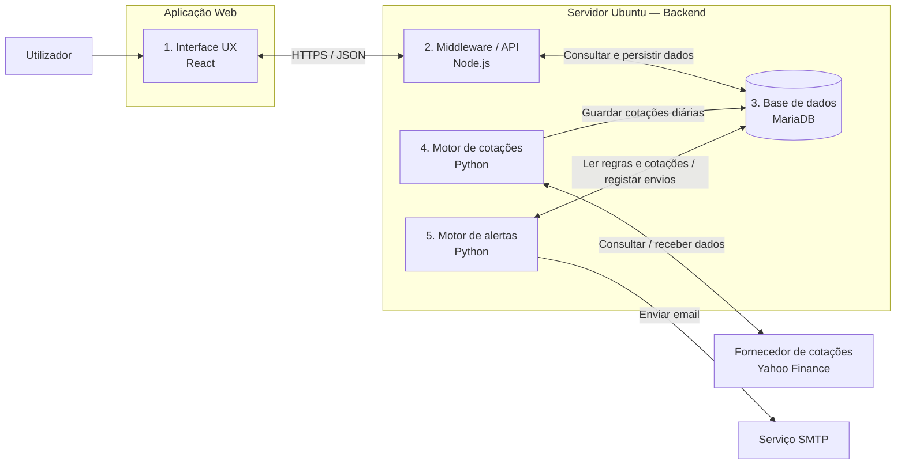

# Arquitectura de Software — Plataforma de Simulação e Acompanhamento de Acções

## 1. Objectivo e âmbito

A aplicação permite acompanhar acções, consultar cotações históricas, gerir uma carteira virtual, simular compras e vendas e receber alertas por email.

A negociação é exclusivamente simulada. Não estão previstas operações com dinheiro real, integração com corretoras ou execução de ordens em bolsa.

Este documento consolida os requisitos definidos, as decisões registadas em [Análise e decisões](analise_e_decisoes.md) (18 out. 2026) e as propostas de implementação. As opções identificadas como «decidido» estão fechadas; as identificadas como propostas deverão ser validadas antes do desenvolvimento.

## 2. Requisitos e parâmetros funcionais

| Parâmetro | Definição |
|---|---|
| Modalidade | Simulação e acompanhamento |
| Operações reais | Fora do âmbito |
| Histórico por ticker | Últimos dois anos |
| Granularidade histórica | Diária |
| Canal de alertas | Email |
| Limite de notificações | Um email de resumo por utilizador após cada recolha diária — decidido |
| Utilizadores | Grupo privado; contas criadas por comando de administração — decidido / proposta |
| Mercados e moeda | Instrumentos cotados em EUR (Euronext, Xetra, Madrid, Helsínquia, entre outros); carteira em EUR — decidido |
| Fonte de dados | Yahoo Finance via yfinance, atrás de um adaptador substituível e com versão fixada — decidido |
| Catálogo de instrumentos | Global e partilhado, preenchido à mão ou por importação de Excel — decidido |
| Recolha histórica | Dias úteis às 19h00 de Lisboa, depois do fecho das 17h30 CET — decidido |
| Retenção | Sem eliminação de cotações; os dois anos definem apenas a profundidade da carga inicial — adoptado na prova de conceito |

O requisito «frequência máxima de 1h» é cumprido com um único email de resumo por utilizador, enviado depois de cada recolha diária, com todos os alertas disparados nessa execução. Como só há uma recolha por dia, cada utilizador recebe no máximo um email de alertas por dia, em qualquer interpretação do limite. O requisito não estabelece uma obrigação de envio de hora a hora nem uma frequência de actualização das cotações.

## 3. Visão geral da arquitectura

A aplicação está organizada em cinco módulos:

1. Interface UX com o utilizador — React.
2. Middleware/API — Node.js.
3. Base de dados — MariaDB.
4. Motor de recolha de cotações — Python.
5. Motor de alertas por email — Python.

O backend é alojado num servidor Ubuntu. As integrações externas representadas no diagrama original são o Yahoo Finance e um serviço SMTP. O alojamento do frontend deverá ser definido na implantação.



O diagrama representa uma vista lógica. As setas indicam comunicações entre módulos, não processos de execução de ordens reais. O diagrama Mermaid requer um visualizador Markdown compatível para apresentação gráfica.

## 4. Descrição dos módulos

### 4.1. Interface UX com o utilizador

Tecnologia prevista: React.

Responsabilidades propostas:

- Autenticar o utilizador e apresentar a sessão.
- Pesquisar instrumentos e consultar gráficos diários dos últimos dois anos.
- Adicionar instrumentos ao catálogo, à mão ou por importação de um ficheiro Excel, e mostrar o estado de validação.
- Gerir listas de acompanhamento.
- Apresentar a data de referência das cotações.
- Criar uma carteira com capital virtual.
- Simular compras e vendas.
- Consultar posições, saldo e histórico de operações.
- Criar, editar, activar e desactivar regras de alerta.

A interface comunica apenas com a API, sem acesso directo à base de dados. Deve identificar claramente os valores e as operações como simulados.

### 4.2. Middleware/API

Tecnologia prevista: Node.js.

Responsabilidades propostas:

- Disponibilizar os endpoints utilizados pela interface.
- Gerir autenticação e autorização.
- Validar pedidos e aplicar regras de negócio.
- Gerir utilizadores, instrumentos, listas de acompanhamento e alertas.
- Consultar cotações históricas.
- Gerir carteiras, saldos e operações simuladas.
- Calcular posições e resultados.
- Registar operações relevantes para auditoria.

#### Regras iniciais propostas para simulação

- Cada operação utiliza o último preço diário disponível.
- O preço aplicado, a data da cotação e o instante do pedido ficam registados.
- O preço não é apresentado como cotação em tempo real.
- Uma compra não pode exceder o saldo virtual disponível.
- Uma venda não pode exceder a quantidade detida.
- Não são permitidas posições curtas na versão inicial.
- A actualização do saldo, da posição e do registo da operação é transaccional.
- A repetição técnica do mesmo pedido não deve originar operações duplicadas.

Estas regras constituem uma simulação simplificada, não uma reprodução da execução em mercado.

### 4.3. Base de dados

Tecnologia prevista: MariaDB.

Responsabilidades propostas:

- Persistir os dados funcionais da aplicação.
- Manter a integridade das relações entre entidades.
- Suportar as consultas da API e dos motores de processamento.
- Guardar informação de auditoria e resultados de notificações.

#### Estrutura lógica inicial

| Entidade | Conteúdo principal |
|---|---|
| Utilizadores | Identificação, autenticação e preferências |
| Instrumentos | Identificador, símbolo Yahoo, mercado, moeda, designação, estado de validação e cobertura |
| Cotações diárias | Instrumento, data de sessão, abertura, máximo, mínimo, fecho não ajustado, fecho ajustado, volume e origem |
| Pedidos de recolha | Instrumento, tipo (inicial ou incremental), estado, tentativas e último erro |
| Listas de acompanhamento | Instrumentos acompanhados por utilizador |
| Carteiras virtuais | Titular, moeda, capital inicial e saldo virtual |
| Operações simuladas | Compra/venda, quantidade, preço aplicado, moeda, data da cotação e instante do pedido |
| Regras de alerta | Instrumento, condição, utilizador e estado |
| Notificações | Evento, tentativa de envio, resultado e instante de envio |
| Auditoria | Acções relevantes e respectivos instantes |

As cotações diárias têm chave única por instrumento e data de sessão. O instrumento é identificado pelo símbolo Yahoo, que inclui o sufixo do mercado (ex.: `GALP.LS`, `SIE.DE`) e é por isso inequívoco.

O fecho não ajustado é usado nas operações simuladas, por ser o preço que efectivamente existiu; o fecho ajustado é usado nos gráficos.

O esquema é mantido por migrações versionadas em `db/migrations/`, no formato do dbmate, como fonte única para a API e para os motores Python.

A representação das posições e o método de cálculo de resultados deverão ser definidos no desenho detalhado.

### 4.4. Motor de recolha de cotações

Tecnologia prevista: Python.

Fonte decidida: Yahoo Finance via yfinance, com a versão fixada e isolada atrás da interface `QuoteProvider`, para poder ser substituída. O yfinance não é uma API oficial e destina-se a uso pessoal; o risco é aceite para um grupo privado, mas não deve ser assumido para um serviço aberto a terceiros.

Responsabilidades propostas:

1. Validar os instrumentos adicionados: confirmar que o símbolo existe e que a moeda é EUR, e preencher designação, mercado e moeda.
2. Recolher os últimos dois anos de dados diários quando um instrumento é adicionado.
3. Actualizar diariamente os instrumentos activos.
4. Validar e normalizar os dados recebidos.
5. Inserir novos registos e actualizar dados corrigidos pelo fornecedor.
6. Evitar duplicações em recolhas repetidas.
7. Registar falhas e permitir novas tentativas.

As cotações não são apagadas: dois anos por instrumento são cerca de 500 linhas, e mesmo milhares de instrumentos durante vários anos ficam num volume que o MariaDB gere sem esforço.

A granularidade diária corresponde a um registo por sessão com dados disponíveis, não a um registo obrigatório por dia de calendário. Quando não existirem dois anos de dados, a aplicação deve apresentar a cobertura efectivamente disponível, sem fabricar valores.

O preço e a data utilizados numa operação simulada ficam registados na própria operação, independentemente da tabela de cotações.

O motor recolhe dados de mercado; não executa operações simuladas nem ordens reais.

### 4.5. Motor de alertas por email

Tecnologia prevista: Python.

Responsabilidades propostas:

- Consultar regras activas e cotações disponíveis.
- Avaliar as condições configuradas.
- Agrupar os eventos de cada utilizador num único email de resumo.
- Registar o resultado de cada tentativa.
- Evitar notificações duplicadas para o mesmo evento.

#### Regra de envio

```text
Após cada recolha diária, para cada utilizador:
- reunir os eventos de regras activas cuja condição se verifica
  e que ainda não foram notificados;
- se existir pelo menos um, enviar um único email de resumo
  com todos esses eventos;
- marcar os eventos incluídos como notificados após envio bem-sucedido.
```

Cada evento é identificado pela regra, pela data da cotação e pela condição detectada. Uma cotação diária inalterada não gera emails repetidos.

Os alertas apenas notificam o utilizador; não desencadeiam compras ou vendas automáticas.

## 5. Fluxos de funcionamento

### 5.1. Activação de um instrumento

1. O utilizador adiciona um símbolo através da interface, à mão ou por importação de um ficheiro Excel.
2. Se o símbolo ainda não existir no catálogo, a API grava-o com o estado «A validar» e cria um pedido de carga inicial em `fetch_jobs`.
3. O motor de recolha reserva o pedido e consulta o fornecedor.
4. Se o símbolo existir e estiver cotado em EUR, o motor preenche designação, mercado e moeda, obtém até dois anos de histórico diário e passa o instrumento a «Activo»; caso contrário, passa-o a «Inválido», com o motivo.
5. Os dados são validados e persistidos.
6. A interface apresenta o estado de validação, o histórico disponível e a cobertura efectiva.

### 5.2. Actualização diária e alertas

1. O motor de recolha consulta o fornecedor externo.
2. Valida e guarda os dados disponibilizados para cada sessão.
3. O motor de alertas avalia as regras sobre os dados actualizados.
4. Exclui os eventos já notificados.
5. Envia um email de resumo por utilizador com eventos novos e regista os resultados.

Proposta de coordenação: o motor de alertas corre no fim da recolha diária, encadeado no mesmo timer systemd, sem fila externa nem sexto módulo funcional.

### 5.3. Consulta de cotações

1. A interface solicita dados à API.
2. A API consulta a base de dados.
3. A API devolve os valores, as datas de referência e a cobertura disponível.
4. A interface apresenta gráficos e tabelas.

### 5.4. Operação simulada

1. O utilizador prepara e confirma uma compra ou venda simulada.
2. A API valida permissões, quantidade, saldo e posição.
3. A API determina o preço diário aplicável segundo a regra de simulação.
4. A operação, o saldo e a posição são actualizados numa transacção.
5. A API devolve o resultado à interface.

## 6. Relação entre granularidade e frequência dos alertas

O histórico definido tem granularidade diária. Com uma cotação por sessão e desduplicação por evento, cada regra só pode disparar uma vez por dia; um limite de 60 minutos por regra ficaria, na prática, sem efeito. O email de resumo resolve o caso que realmente importa (várias regras a disparar na mesma noite) e cumpre o limite de uma hora em qualquer interpretação.

Na versão inicial, os alertas são avaliados após a actualização dos dados diários. Caso se pretenda detectar movimentos durante a sessão, será necessário especificar uma recolha intradiária separada. Essa evolução não altera necessariamente a retenção do histórico diário de dois anos.

## 7. Implantação e operação

Propostas para a implantação inicial:

- Backend e motores Python no servidor Ubuntu.
- API, motor de recolha e motor de alertas como processos independentes.
- API publicada através de HTTPS.
- Base de dados acessível apenas aos componentes autorizados.
- Contas de base de dados com permissões adequadas a cada componente.
- Segredos e credenciais fora do código-fonte.
- Registos centralizados e monitorização dos processos.
- Monitorização da última recolha bem-sucedida e dos erros SMTP.
- Cópias de segurança e testes de recuperação.
- Ambientes separados de desenvolvimento, testes e produção.

A localização do frontend, o mecanismo de agendamento, a gestão dos processos e os objectivos de recuperação deverão ser definidos no desenho de implantação. A concentração do backend num único servidor deve ficar registada como risco de indisponibilidade conjunta.

## 8. Critérios de aceitação

- A aplicação não envia ordens para corretoras.
- Ao adicionar um instrumento, procura carregar os últimos dois anos de histórico diário disponível.
- Instrumentos inexistentes ou não cotados em EUR ficam marcados como inválidos, com o motivo.
- A repetição de uma recolha não cria cotações duplicadas.
- A interface identifica a data de referência dos preços apresentados.
- A ausência de dados históricos é apresentada explicitamente.
- Uma compra simulada não excede o saldo virtual disponível.
- Uma venda simulada não excede a quantidade detida.
- Cada operação conserva o preço e a data da cotação utilizados.
- Cada utilizador recebe no máximo um email de alertas por recolha diária.
- O mesmo evento não gera notificações repetidas.
- As falhas de recolha e de envio são registadas.

## 9. Decisões ainda por validar

| Tema | Decisão necessária |
|---|---|
| Capital virtual | Valor inicial e possibilidade de reposição (proposta: configurável, ex.: 10 000 EUR, sem reposição no MVP) |
| Preço de simulação | Confirmar a utilização do último fecho diário não ajustado disponível |
| Custos | Inclusão ou exclusão de comissões e outros custos simulados |
| Resultados | Método de custo e cálculo de ganhos e perdas |
| Eventos societários | Tratamento de dividendos e desdobramentos |
| Dados desactualizados | Limite de antiguidade e política para bloquear operações simuladas |
| Alertas | Tipos de condição, reactivação e eventos temporariamente suprimidos pelo limite horário |
| Retenção | Definir retenção de operações e auditoria |
| Stack técnica | Framework Node, acesso à BD, bibliotecas React e versões |
| Contas e SMTP | Confirmar criação de contas por CLI e escolher o fornecedor SMTP |
| Operação | Backups e objectivos de recuperação |

Já decididos e reflectidos neste documento: utilizadores, fonte de dados, mercados e moeda, limite de alertas, catálogo, hora da recolha, retenção de cotações e preços ajustados. Ver [Análise e decisões](analise_e_decisoes.md).

## 10. Base documental

Documento elaborado a partir do diagrama fornecido, dos requisitos definidos e das decisões de 18 out. 2026. O motor de recolha e as tabelas `instruments`, `daily_quotes` e `fetch_jobs` já existem (prova de conceito); as restantes descrições de implementação são propostas de arquitectura e não uma confirmação de funcionalidades já existentes.
