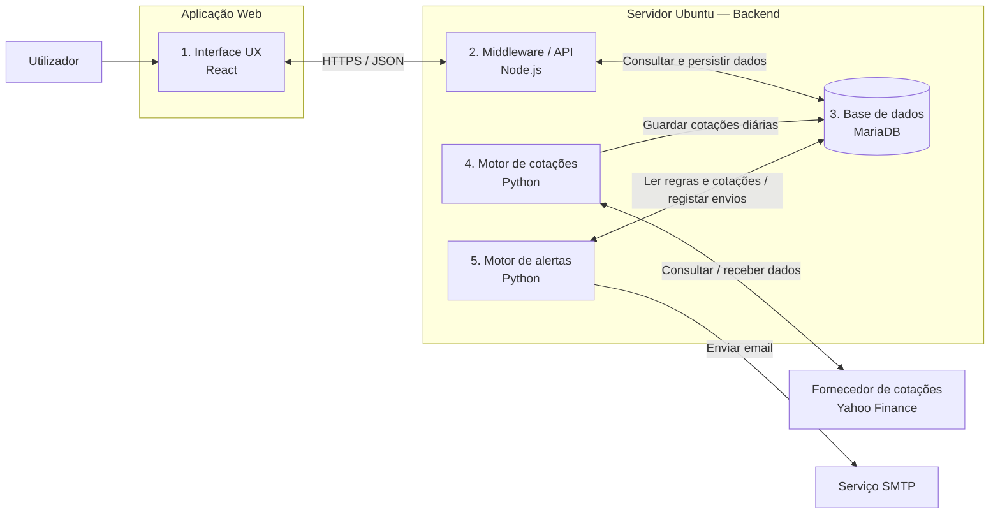

# Arquitectura de Software — Plataforma de Simulação e Acompanhamento de Acções

## 1. Objectivo e âmbito

A aplicação permite acompanhar acções, consultar cotações históricas, gerir uma carteira virtual, simular compras e vendas e receber alertas por email.

A negociação é exclusivamente simulada. Não estão previstas operações com dinheiro real, integração com corretoras ou execução de ordens em bolsa.

Este documento consolida os requisitos definidos e as propostas de implementação apresentadas na conversa. As opções identificadas como propostas deverão ser validadas antes do desenvolvimento.

## 2. Requisitos e parâmetros funcionais

| Parâmetro | Definição |
|---|---|
| Modalidade | Simulação e acompanhamento |
| Operações reais | Fora do âmbito |
| Histórico por ticker | Últimos dois anos |
| Granularidade histórica | Diária |
| Canal de alertas | Email |
| Limite de notificações | Uma por hora, por regra e por utilizador — interpretação adoptada |
| Recolha histórica | Diária, após disponibilização dos dados da sessão — proposta |
| Retenção | Janela móvel de dois anos — proposta |

A expressão «frequência máxima de 1h» é interpretada como um intervalo mínimo de 60 minutos entre notificações da mesma regra para o mesmo utilizador. Não estabelece uma obrigação de envio de hora a hora nem uma frequência de actualização das cotações.

## 3. Visão geral da arquitectura

A aplicação está organizada em cinco módulos:

1. Interface UX com o utilizador — React.
2. Middleware/API — Node.js.
3. Base de dados — MariaDB.
4. Motor de recolha de cotações — Python.
5. Motor de alertas por email — Python.

O backend é alojado num servidor Ubuntu. As integrações externas representadas no diagrama original são o Yahoo Finance e um serviço SMTP. O alojamento do frontend deverá ser definido na implantação.



O diagrama representa uma vista lógica. As setas indicam comunicações entre módulos, não processos de execução de ordens reais. O diagrama Mermaid requer um visualizador Markdown compatível para apresentação gráfica.

## 4. Descrição dos módulos

### 4.1. Interface UX com o utilizador

Tecnologia prevista: React.

Responsabilidades propostas:

- Autenticar o utilizador e apresentar a sessão.
- Pesquisar instrumentos e consultar gráficos diários dos últimos dois anos.
- Gerir listas de acompanhamento.
- Apresentar a data de referência das cotações.
- Criar uma carteira com capital virtual.
- Simular compras e vendas.
- Consultar posições, saldo e histórico de operações.
- Criar, editar, activar e desactivar regras de alerta.

A interface comunica apenas com a API, sem acesso directo à base de dados. Deve identificar claramente os valores e as operações como simulados.

### 4.2. Middleware/API

Tecnologia prevista: Node.js.

Responsabilidades propostas:

- Disponibilizar os endpoints utilizados pela interface.
- Gerir autenticação e autorização.
- Validar pedidos e aplicar regras de negócio.
- Gerir utilizadores, instrumentos, listas de acompanhamento e alertas.
- Consultar cotações históricas.
- Gerir carteiras, saldos e operações simuladas.
- Calcular posições e resultados.
- Registar operações relevantes para auditoria.

#### Regras iniciais propostas para simulação

- Cada operação utiliza o último preço diário disponível.
- O preço aplicado, a data da cotação e o instante do pedido ficam registados.
- O preço não é apresentado como cotação em tempo real.
- Uma compra não pode exceder o saldo virtual disponível.
- Uma venda não pode exceder a quantidade detida.
- Não são permitidas posições curtas na versão inicial.
- A actualização do saldo, da posição e do registo da operação é transaccional.
- A repetição técnica do mesmo pedido não deve originar operações duplicadas.

Estas regras constituem uma simulação simplificada, não uma reprodução da execução em mercado.

### 4.3. Base de dados

Tecnologia prevista: MariaDB.

Responsabilidades propostas:

- Persistir os dados funcionais da aplicação.
- Manter a integridade das relações entre entidades.
- Suportar as consultas da API e dos motores de processamento.
- Guardar informação de auditoria e resultados de notificações.

#### Estrutura lógica inicial

| Entidade | Conteúdo principal |
|---|---|
| Utilizadores | Identificação, autenticação e preferências |
| Instrumentos | Identificador, ticker, mercado, moeda e designação |
| Cotações diárias | Instrumento, data de sessão, abertura, máximo, mínimo, fecho, volume e origem |
| Listas de acompanhamento | Instrumentos acompanhados por utilizador |
| Carteiras virtuais | Titular, moeda, capital inicial e saldo virtual |
| Operações simuladas | Compra/venda, quantidade, preço aplicado, moeda, data da cotação e instante do pedido |
| Regras de alerta | Instrumento, condição, utilizador e estado |
| Notificações | Evento, tentativa de envio, resultado e instante de envio |
| Auditoria | Acções relevantes e respectivos instantes |

Propõe-se uma chave única por instrumento e data de sessão para as cotações diárias. O instrumento deve ser identificado de forma inequívoca, incluindo o mercado, e não apenas pelo texto do ticker.

A representação das posições e o método de cálculo de resultados deverão ser definidos no desenho detalhado.

### 4.4. Motor de recolha de cotações

Tecnologia prevista: Python.

Fonte representada no diagrama original: Yahoo Finance. A adequação técnica e as condições de utilização da fonte deverão ser validadas antes da implementação.

Responsabilidades propostas:

1. Recolher os últimos dois anos de dados diários quando um instrumento é adicionado.
2. Actualizar diariamente os instrumentos acompanhados.
3. Validar e normalizar os dados recebidos.
4. Inserir novos registos e actualizar dados corrigidos pelo fornecedor.
5. Evitar duplicações em recolhas repetidas.
6. Manter a janela móvel de dois anos.
7. Registar falhas e permitir novas tentativas.

A granularidade diária corresponde a um registo por sessão com dados disponíveis, não a um registo obrigatório por dia de calendário. Quando não existirem dois anos de dados, a aplicação deve apresentar a cobertura efectivamente disponível, sem fabricar valores.

O preço e a data utilizados numa operação simulada permanecem no histórico dessa operação, mesmo quando a cotação original sair da janela de retenção.

O motor recolhe dados de mercado; não executa operações simuladas nem ordens reais.

### 4.5. Motor de alertas por email

Tecnologia prevista: Python.

Responsabilidades propostas:

- Consultar regras activas e cotações disponíveis.
- Avaliar as condições configuradas.
- Verificar o intervalo desde a última notificação enviada com sucesso.
- Enviar o email quando a condição e as regras de frequência o permitirem.
- Registar o resultado de cada tentativa.
- Evitar notificações duplicadas para o mesmo evento.

#### Regra de envio

```text
Enviar uma notificação quando:
- a regra está activa;
- a condição se verifica;
- existe um evento ainda não notificado;
- não houve um envio bem-sucedido da mesma regra
  para o mesmo utilizador nos últimos 60 minutos.
```

Propõe-se identificar cada evento pela regra, pela data da cotação e pela condição detectada. Uma cotação diária inalterada não deve gerar emails repetidos de hora a hora.

Os alertas apenas notificam o utilizador; não desencadeiam compras ou vendas automáticas.

## 5. Fluxos de funcionamento

### 5.1. Activação de um instrumento

1. O utilizador adiciona um instrumento através da interface.
2. A API valida o instrumento e regista o acompanhamento.
3. O motor de recolha identifica a necessidade de carga inicial.
4. O motor obtém até dois anos de histórico diário disponível.
5. Os dados são validados e persistidos.
6. A interface apresenta o histórico disponível e o estado da actualização.

### 5.2. Actualização diária e alertas

1. O motor de recolha consulta o fornecedor externo.
2. Valida e guarda os dados disponibilizados para cada sessão.
3. O motor de alertas avalia as regras sobre os dados actualizados.
4. Verifica a existência de eventos já notificados e o intervalo de 60 minutos.
5. Envia os emails elegíveis e regista os resultados.

A forma de coordenação entre os motores deverá ser definida na implementação, sem introduzir obrigatoriamente um sexto módulo funcional.

### 5.3. Consulta de cotações

1. A interface solicita dados à API.
2. A API consulta a base de dados.
3. A API devolve os valores, as datas de referência e a cobertura disponível.
4. A interface apresenta gráficos e tabelas.

### 5.4. Operação simulada

1. O utilizador prepara e confirma uma compra ou venda simulada.
2. A API valida permissões, quantidade, saldo e posição.
3. A API determina o preço diário aplicável segundo a regra de simulação.
4. A operação, o saldo e a posição são actualizados numa transacção.
5. A API devolve o resultado à interface.

## 6. Relação entre granularidade e frequência dos alertas

O histórico definido tem granularidade diária. O limite de uma hora controla a frequência dos envios, não implica a existência de novas cotações de hora a hora.

Na versão inicial, propõe-se avaliar os alertas após a actualização dos dados diários. Caso se pretenda detectar movimentos durante a sessão, será necessário especificar uma recolha intradiária separada. Essa evolução não altera necessariamente a retenção do histórico diário de dois anos.

## 7. Implantação e operação

Propostas para a implantação inicial:

- Backend e motores Python no servidor Ubuntu.
- API, motor de recolha e motor de alertas como processos independentes.
- API publicada através de HTTPS.
- Base de dados acessível apenas aos componentes autorizados.
- Contas de base de dados com permissões adequadas a cada componente.
- Segredos e credenciais fora do código-fonte.
- Registos centralizados e monitorização dos processos.
- Monitorização da última recolha bem-sucedida e dos erros SMTP.
- Cópias de segurança e testes de recuperação.
- Ambientes separados de desenvolvimento, testes e produção.

A localização do frontend, o mecanismo de agendamento, a gestão dos processos e os objectivos de recuperação deverão ser definidos no desenho de implantação. A concentração do backend num único servidor deve ficar registada como risco de indisponibilidade conjunta.

## 8. Critérios de aceitação

- A aplicação não envia ordens para corretoras.
- Ao adicionar um instrumento, procura carregar os últimos dois anos de histórico diário disponível.
- A repetição de uma recolha não cria cotações duplicadas.
- A interface identifica a data de referência dos preços apresentados.
- A ausência de dados históricos é apresentada explicitamente.
- Uma compra simulada não excede o saldo virtual disponível.
- Uma venda simulada não excede a quantidade detida.
- Cada operação conserva o preço e a data da cotação utilizados.
- A mesma regra não envia mais de um email ao mesmo utilizador num período de 60 minutos.
- O mesmo evento não gera notificações repetidas.
- As falhas de recolha e de envio são registadas.

## 9. Decisões ainda por validar

| Tema | Decisão necessária |
|---|---|
| Limite de alertas | Confirmar se é por regra e utilizador ou global por utilizador |
| Capital virtual | Valor inicial e possibilidade de reposição |
| Mercados | Bolsas e instrumentos suportados |
| Moedas | Carteira numa só moeda ou suporte multimoeda |
| Preço de simulação | Confirmar a utilização do último fecho diário disponível |
| Custos | Inclusão ou exclusão de comissões e outros custos simulados |
| Resultados | Método de custo e cálculo de ganhos e perdas |
| Eventos societários | Tratamento de dividendos e desdobramentos |
| Cotações | Utilização de valores ajustados ou não ajustados |
| Dados desactualizados | Limite de antiguidade e política para bloquear operações simuladas |
| Alertas | Tipos de condição, reactivação e eventos temporariamente suprimidos pelo limite horário |
| Fonte de dados | Adequação, disponibilidade e condições de utilização |
| Retenção | Confirmar a janela móvel de dois anos para cotações e definir retenção de operações e auditoria |
| Operação | Agendamento, novas tentativas, backups e objectivos de recuperação |

## 10. Base documental

Documento elaborado a partir do diagrama fornecido e dos requisitos definidos na conversa. As descrições de implementação são propostas de arquitectura e não uma confirmação de funcionalidades já existentes.
