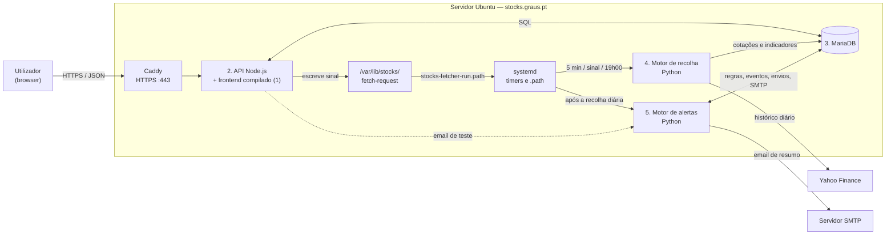

# Arquitectura de Software — Plataforma de Simulação e Acompanhamento de Acções

Estado: versão 1 em produção em https://stocks.graus.pt (actualizado a 18 out. 2026).

## 1. Objectivo e âmbito

A aplicação permite acompanhar acções, consultar o histórico diário com indicadores técnicos e momento, simular uma estratégia de momento no histórico, ver o mapa de calor e o momento do mercado, gerir uma carteira virtual, simular compras e vendas e receber alertas por email.

A negociação é exclusivamente simulada. Não há operações com dinheiro real, integração com corretoras nem execução de ordens em bolsa.

Este documento descreve a arquitectura implementada. O módulo de livro de ofertas segue a [especificação euronext-orderbook](orderbook-spec.md). As decisões que lhe deram origem estão em [Análise e decisões](analise_e_decisoes.md); a execução, em [Plano de implementação](plano_implementacao.md); a interface, no [Guia de estilos](guia_estilos.md); a operação do servidor, em [deploy/README.md](../../deploy/README.md).

## 2. Requisitos e parâmetros funcionais

| Parâmetro | Definição |
|---|---|
| Modalidade | Simulação e acompanhamento |
| Operações reais | Fora do âmbito |
| Utilizadores | Grupo privado; contas criadas por administradores (página Utilizadores ou CLI); sem registo público |
| Autenticação | Palavra-passe e código TOTP de uma aplicação de autenticação (obrigatório para todos; configurado no primeiro login) |
| Mercados e moeda | Instrumentos cotados em EUR (Euronext, Xetra, Madrid, Milão, Helsínquia, Viena, entre outros), verificado pela moeda devolvida pelo fornecedor; carteira em EUR |
| Fonte de dados | Yahoo Finance via yfinance, versão fixada, atrás de um adaptador substituível |
| Catálogo | Global e partilhado; preenchido à mão ou por importação de Excel/CSV; cada utilizador escolhe os instrumentos que acompanha |
| Granularidade | Diária: um registo por sessão de bolsa |
| Histórico | Carga inicial de três anos (para a SMA200 estar completa nos dois anos mostrados); actualização diária; as cotações nunca são apagadas |
| Indicadores | EMA9, SMA10, SMA50, SMA125 e SMA200 por sessão, guardados na BD; momento SMA10/SMA200 e SMA8/SMA125 |
| Recolha diária | Dias úteis às 19h00 de Lisboa, depois do fecho das bolsas europeias (17h30 CET) |
| Alertas | Email; um resumo por utilizador após cada recolha diária, nunca mais do que um email por hora |
| Simulação | Último fecho diário não ajustado; sem comissões; quantidades inteiras; sem posições curtas; custo médio ponderado |
| Capital virtual | 1 000 000 EUR por omissão nas contas novas (configurável por conta); sem reposição |
| Estratégias | Registo de estratégias simuladas no histórico, por instrumento (secção 5.4): A-Momentum, B-Opus e C-AI. Não executam operações nem alteram a carteira |
| Email | Servidor SMTP configurado pelos administradores em Definições (hoje OVH, `ssl0.ovh.net:465`, remetente `stocks@graus.pt`); sem configuração, os alertas não enviam emails |

O requisito «frequência máxima de 1h» é cumprido com um único email de resumo por utilizador, enviado depois de cada recolha diária, e com um intervalo mínimo de 60 minutos entre emails ao mesmo utilizador. Como os dados são diários, o caso relevante é o de várias regras a disparar na mesma noite, que o resumo agrupa numa só mensagem.

## 3. Visão geral da arquitectura

A aplicação mantém os cinco módulos do desenho original:

| # | Módulo | Tecnologia | Pasta |
|---|---|---|---|
| 1 | Interface | React 19, Vite, TanStack Query, React Router, Recharts | `frontend/` |
| 2 | Middleware / API | Node.js 22, Fastify 5, Zod, mysql2 (SQL directo) | `api/` |
| 3 | Base de dados | MariaDB 11.8; migrações dbmate | `db/migrations/` |
| 4 | Motor de recolha | Python 3, yfinance, PyMySQL | `engines/fetcher/` |
| 5 | Motor de alertas | Python 3, PyMySQL, smtplib, cryptography | `engines/alerts/` |

Tudo corre num único servidor Ubuntu (`stocks.graus.pt`). O Caddy termina o HTTPS e encaminha para a API, que serve também o frontend compilado na mesma origem. Os motores Python são processos de curta duração lançados pelo systemd.



A interface nunca acede à base de dados: fala só com a API. A API nunca fala com o Yahoo: pede ao motor de recolha, através da fila `fetch_jobs` e do ficheiro de sinal. A API também não envia emails: para o email de teste em Definições, invoca o motor de alertas (`python -m alerts test`). Os motores não comunicam entre si; coordenam-se pela base de dados e pela ordem de execução no systemd.

## 4. Descrição dos módulos

### 4.1. Interface

Aplicação de página única em React, servida pela API em produção e pelo Vite em desenvolvimento (com `/api` encaminhado para a API local). Segue o [guia de estilos](guia_estilos.md): temas claro, escuro e «Sistema» sem flash no carregamento, navegação lateral (desktop), lateral recolhível (tablet) e inferior (telemóvel), e estados de carregamento, vazio, erro e dados desactualizados em todos os ecrãs.

| Ecrã | Função |
|---|---|
| Entrar | Login por email e palavra-passe |
| Visão geral | Valor da carteira, saldo e resultado; momento do mercado (distribuição do SMA10/SMA200 e os 5 mais fortes e mais fracos); cruzamentos da SMA10 com a SMA50 nas últimas 5 sessões, ascendentes e descendentes |
| Acompanhar | Lista do utilizador e, com o botão «Catálogo», o catálogo partilhado (último fecho e sessão, volume, variação, mid e desequilíbrio do livro Euronext com o botão «Mostrar OB», ISIN-MIC com edição directa; ordenação por instrumento, volume, variação e desequilíbrio), adicionar símbolos ou importar Excel/CSV (colunas `ticker` e `isin_mic`) com pré-visualização, botão «Validar agora» |
| Orderbook | Livro de ofertas Euronext (atraso 15 min) dos instrumentos com ISIN-MIC: melhor compra/venda, spread, mid, desequilíbrio, tabela com nº de ordens e totais, gráfico de profundidade cumulativa, actualização a cada 30 s |
| Instrumento | Último fecho e variação, gráfico diário (1M a 2A) com indicadores opcionais, gráfico de momento sincronizado, tabela de dados, criar alerta, simular operação, menu «Estratégia» (Nenhuma, A-Momentum; B-Opus em preparação) |
| HeatMap | Mapa de calor dos 20 instrumentos com maior valor negociado (catálogo ou lista): tamanho pelo valor negociado, cor pela variação; período de 1, 5, 10 ou 20 sessões |
| Carteira | Valor total, resultados realizado e não realizado, posições ao custo médio ponderado |
| Operações | Histórico filtrável por tipo, instrumento e datas |
| Sinais | Compras, reforços e vendas da estratégia escolhida (A-Momentum, B-Opus ou C-AI) aplicada virtualmente a todos os instrumentos, nas últimas 1 a 10 sessões, com o motivo das vendas, filtro por tipo e botões Comprar e Vender (operação na carteira virtual) |
| BackTest | Resultado da estratégia em cada instrumento nos últimos 2 anos (resultado em € e %, operações, taxa de acerto, posição aberta, comparação com comprar e manter), com resumo, filtro «Todos / A minha lista», pesquisa e ordenação; o símbolo abre o gráfico com a estratégia aplicada |
| WinnersLoosers | Instrumentos em que todas as estratégias disponíveis ganham, e em que todas perdem, nos últimos 2 anos: resumo (quantos e soma), filtro «Todos / A minha lista», pesquisa e duas tabelas ordenáveis com o resultado de cada estratégia, o total e comprar e manter; cada resultado abre o gráfico com essa estratégia |
| Promessas | Instrumentos que nos últimos 3 meses mostram os sinais que no passado anunciaram ganhadores nos 12 meses seguintes ([método e validação](promessas.md)): elegíveis com a tendência intacta, pontuação 0–100 (M2, volatilidade baixa, SMA200 a subir), top 30 ou todos, se foram ganhadores nas 3 estratégias, e a validação histórica com aviso |
| Alertas | Regras com pré-visualização em linguagem natural, activação e eventos com o estado do envio |
| Entrar | Palavra-passe e, a seguir, código de 6 dígitos ou código de recuperação; no primeiro login, configuração do 2.º factor com QR code, chave manual e 10 códigos de recuperação |
| Utilizadores | Só administradores: listar (com o estado do 2.º factor), adicionar, redefinir palavra-passe, repor o 2.º factor e remover contas |
| Definições | Tema, transparência, regras da simulação, estado dos dados, palavra-passe, autenticação em dois passos (códigos de recuperação, trocar de aplicação), terminar sessão; para administradores, configuração SMTP com email de teste |

Regras da interface:
- Os valores monetários chegam como strings decimais e só passam a número para apresentação. Formatação pt-PT («12 345,67 €», «16 out. 2026»).
- Cada preço mostra a data da sessão. Operações e saldos aparecem sempre como simulados.
- Não há actualizações optimistas do saldo: a interface espera pela confirmação do servidor.
- Enquanto há instrumentos «A validar», as listas actualizam-se a cada 5 segundos; caso contrário não há polling, porque os dados são diários.
- O gráfico (Recharts) é carregado só na página do instrumento.
- O momento e as estratégias são módulos JavaScript puros em `shared/` (`momentum.js` e `strategies/`, com o registo em `strategies/index.js`), usados pelo browser (gráfico e menu «Estratégia») e pela API (Sinais e BackTest); assim o servidor e o browser calculam exactamente o mesmo. Têm testes próprios.
- As cores das séries do gráfico foram validadas para daltonismo nos dois temas; as cores do HeatMap têm contraste de pelo menos 4,98:1 com o texto branco.

### 4.2. Middleware / API

API REST em Fastify, com prefixo `/api/v1`. Cada rota declara esquemas Zod para o pedido e a resposta; o contrato OpenAPI ([api/openapi.yaml](../../api/openapi.yaml)) é gerado a partir deles, e o CI falha se não estiver actualizado. A documentação interactiva fica em `/api/docs`.

| Área | Rotas |
|---|---|
| Sessão | `POST /auth/login`, `POST /auth/logout`, `GET /me`, `PUT /me/password` |
| 2.º factor | `POST /auth/mfa/verify`, `POST /auth/mfa/setup`, `POST /auth/mfa/enable`, `GET /me/mfa`, `POST /me/mfa/recovery-codes`, `POST /me/mfa/reset`, `DELETE /admin/users/{id}/mfa` |
| Instrumentos | `GET /instruments` (`sort` = symbol, volume ou change, `dir`), `GET /instruments/{id}`, `POST /instruments`, `POST /instruments/import/preview`, `GET /instruments/import/template`, `POST /instruments/fetch` |
| Histórico | `GET /instruments/{id}/quotes` (cotações e indicadores) |
| ISIN-MIC e livro de ofertas | `PUT /instruments/{id}/isin-mic`, `GET /instruments?withIsinMic=true`, `GET /instruments/{id}/orderbook`, `GET /instruments/orderbook-summary?ids=…` (mid e desequilíbrio de até 50 instrumentos) |
| Lista | `GET /watchlist`, `POST /watchlist/items`, `DELETE /watchlist/items/{id}` |
| Carteira e operações | `GET /portfolio`, `GET /portfolio/positions`, `GET /simulated-trades/preview`, `POST /simulated-trades`, `GET /simulated-trades` |
| Alertas | `GET/POST /alerts`, `PATCH/DELETE /alerts/{id}`, `GET /alerts/events` |
| Mapa de calor | `GET /heatmap?period=1\|5\|15\|30&scope=all\|watchlist&limit=20` |
| Mercado | `GET /market/momentum?top=5` (distribuição do SMA10/SMA200 na última sessão e extremos), `GET /market/crossovers?sessions=5` (cruzamentos SMA10/SMA50: ascendente se SMA10 ≤ SMA50 na sessão anterior e > na seguinte, descendente o inverso; conta o mais recente por instrumento); cache 10 min |
| Sinais | `GET /signals?strategy=a-momentum&sessions=5` (estratégia aplicada a todos os instrumentos activos; a A-Momentum com todo o histórico, a B-Opus na janela de 2 anos com aquecimento; preço e motivo da operação; cache 10 min por estratégia) |
| Estratégias e BackTest | `GET /strategies` (registo); `GET /backtest?strategy=a-momentum&scope=all\|watchlist` (estratégia em cada instrumento activo sobre os últimos 2 anos; cache 10 min por estratégia) |
| WinnersLoosers | `GET /winners-losers?scope=all\|watchlist` (resultados do BackTest de todas as estratégias disponíveis, agrupados em gain, loss e mixed; usa a cache do BackTest) |
| Promessas | `GET /promessas?scope=all\|watchlist` (sinais por instrumento, um de cada vez, cache 10 min; `pastWinner` a partir do BackTest; tabela de validação) |
| Estado | `GET /status` |
| Administração | `GET/POST /admin/users`, `PUT /admin/users/{id}/password`, `DELETE /admin/users/{id}`, `GET/PUT /admin/smtp`, `POST /admin/smtp/test` |
| Saúde | `GET /health/live`, `GET /health/ready` (fora de `/api/v1`) |

Erros no formato comum `{ "error": { "code", "message", "details" } }`, com códigos estáveis (`INSUFFICIENT_FUNDS`, `PRICE_CHANGED`, `STALE_QUOTE`, `FORBIDDEN`…).

#### Regras da simulação

- Preço: último fecho diário **não ajustado** disponível (o preço que efectivamente existiu); a data da cotação fica registada na operação.
- Compra limitada ao saldo; venda limitada à quantidade detida; sem posições curtas; quantidades inteiras; sem comissões.
- Saldo, posição, operação e movimento de saldo são actualizados numa só transacção, com a carteira bloqueada (`SELECT … FOR UPDATE`). Duas compras simultâneas não gastam o mesmo saldo.
- Cada pedido traz uma chave de idempotência: repeti-lo devolve a operação original em vez de criar outra.
- O cliente envia o preço e a data que mostrou na pré-visualização; se a cotação tiver mudado, a API responde `409 PRICE_CHANGED` e a interface pede nova confirmação.
- Só instrumentos activos e em EUR. Cotações com mais de 7 dias de calendário (`STOCKS_MAX_QUOTE_AGE_DAYS`) bloqueiam a operação.
- Custo médio ponderado: a posição guarda o custo total; numa venda retira-se a fracção proporcional e a última unidade leva o resto, para o custo chegar exactamente a zero.
- Aritmética decimal exacta com BigInt; arredondamento meio para longe de zero, a 2 casas nos montantes.

#### Mapa de calor

Por instrumento activo e para N ∈ {1, 5, 10, 20} sessões:
- variação = fecho ajustado da última sessão ÷ fecho ajustado N sessões antes − 1;
- valor negociado = Σ fecho × volume das N sessões.

Só são devolvidos os N instrumentos com maior valor negociado (20 por omissão), com o total disponível. A cor é verde acima de +1%, cinzenta entre −1% e +1% e vermelha abaixo de −1%. O resultado do catálogo fica em memória durante 10 minutos, porque as cotações só mudam com a recolha diária.

### 4.3. Base de dados

MariaDB 11.8 (mínimo 10.6, por causa de `SKIP LOCKED`), InnoDB, `utf8mb4`. O esquema é definido só pelas migrações em `db/migrations/` (formato dbmate), partilhadas pela API e pelos motores. Instantes técnicos em UTC; datas de sessão em `DATE`; valores em `DECIMAL`.

| Tabela | Conteúdo |
|---|---|
| `instruments` | Catálogo global: símbolo Yahoo (único), mercado, moeda, nome, ISIN e MIC Euronext (opcionais; preenchidos a partir da lista oficial `ISIN.xlsx` na raiz do repositório), estado (`pending`/`active`/`invalid`) e motivo, primeira e última sessão |
| `daily_quotes` | Uma linha por (instrumento, sessão): abertura, máximo, mínimo, fecho, fecho ajustado, volume, origem, e os indicadores `ema9`, `sma10`, `sma50`, `sma125`, `sma200` |
| `fetch_jobs` | Fila de recolha: tipo (inicial ou incremental), estado, tentativas, próxima tentativa, último erro |
| `job_runs` | Execuções da recolha diária e dos alertas, para diagnóstico |
| `users`, `sessions` | Contas (hash scrypt, perfil de administrador, desactivação, segredo TOTP cifrado e último passo aceite) e sessões (só o SHA-256 do token; fase `mfa_setup`, `mfa_verify` ou `full`; códigos errados) |
| `user_recovery_codes` | Códigos de recuperação do 2.º factor (só o SHA-256), cada um de uso único |
| `watchlist_items` | Uma lista por utilizador sobre o catálogo |
| `portfolios`, `cash_movements` | Carteira em EUR com capital inicial e saldo; movimentos de saldo |
| `simulated_trades` | Operações com preço, montante, data da cotação, resultado realizado e chave de idempotência (única por carteira) |
| `positions` | Quantidade, custo total e resultado realizado por instrumento |
| `alert_rules`, `alert_events` | Regras e eventos detectados (únicos por regra e sessão) |
| `email_deliveries` | Resumos enviados e o seu estado (`sending`, `sent`, `failed`, `uncertain`) |
| `smtp_settings` | Configuração SMTP global (servidor, porta, segurança, utilizador, palavra-passe cifrada, remetente) |
| `audit_log` | Acções relevantes, sem palavras-passe, tokens ou credenciais |

Remover um utilizador apaga em cascata as sessões, os códigos de recuperação, a carteira, as operações, as posições, a lista, os alertas e os envios; a auditoria mantém-se.

As cotações não são apagadas: 295 instrumentos com três anos são cerca de 224 000 sessões, que ocupam cerca de 51 MB com os indicadores e os índices (medido a 20 out. 2026), e crescem cerca de 75 000 sessões (≈ 17 MB) por ano.

### 4.4. Motor de recolha de cotações

Comandos `python -m fetcher add | run | update | status | indicators`. O yfinance fica isolado em `provider.py`, atrás da interface `QuoteProvider`.

1. **Validação assíncrona:** um símbolo novo fica `pending` com um pedido `initial`. O motor confirma no fornecedor que existe e que a moeda é EUR, preenche nome e mercado e passa-o a `active`, ou a `invalid` com o motivo.
2. **Carga inicial:** três anos de sessões diárias (`STOCKS_HISTORY_YEARS`, 3 por omissão). A SMA200 só tem valor a partir da 200.ª sessão (cerca de 10 meses), por isso com três anos os dois anos mostrados nos gráficos e usados na estratégia têm sempre as médias completas. Depois de aumentar o valor, `python -m fetcher backfill` volta a pedir a carga dos instrumentos activos com menos histórico; as sessões existentes são actualizadas, sem duplicados. Executado em produção a 20 out. 2026: 288 dos 295 instrumentos activos passaram a começar a 20 out. 2023, sem sessões sem SMA200 nos dois anos mostrados; os outros 7 (SYENS.BR, R3NK.DE, CVC.AS, PUIG.MC, AMV0.DE, MICC.AS, CSG.AS) foram admitidos à cotação depois disso, e a página do instrumento avisa que a cobertura é inferior a três anos.
3. **Actualização diária:** um pedido `incremental` por instrumento activo, relendo os últimos 7 dias para apanhar correcções do fornecedor.
4. **Gravação idempotente:** `INSERT … ON DUPLICATE KEY UPDATE` sobre a chave (instrumento, sessão).
5. **Validação dos dados:** sessões com preços não positivos ou incoerentes são descartadas, não corrigidas.
6. **Indicadores:** depois de cada recolha, a série completa do instrumento é recalculada sobre o fecho ajustado, porque os ajustes do fornecedor alteram os fechos do passado. SMA de N sessões; EMA9 iniciada com a SMA das primeiras 9 sessões e α = 0,2. Os valores ficam `NULL` enquanto não houver sessões suficientes.
7. **Falhas:** falhas de rede e limite de pedidos voltam à fila com espera progressiva (2, 4, 8… minutos, até 5 tentativas). Uma falha num instrumento não pára os restantes, e uma falha de rede nunca invalida um instrumento.
8. **Concorrência:** os pedidos são reservados com `SELECT … FOR UPDATE SKIP LOCKED`, e o mesmo instrumento nunca é recolhido por dois processos ao mesmo tempo.

Os símbolos são descarregados um a um, porque o Yahoo só serve o histórico por símbolo e o pedido individual devolve também a moeda e o nome. A carga de 293 símbolos demorou cerca de 1,5 minutos.

### 4.5. Motor de alertas por email

Comandos `python -m alerts run [--dry-run | --dry-run-if-unconfigured]` (a recolha diária usa o segundo modo) e `python -m alerts test --to EMAIL`.

| Tipo | Limite | Quando dispara |
|---|---|---|
| `close_above` | EUR | O fecho passa a estar acima do limite (transição; não repete enquanto se mantém) |
| `close_below` | EUR | O fecho passa a estar abaixo do limite (transição) |
| `change_up` | % | Subida face à sessão anterior de pelo menos o limite; avaliado em cada sessão |
| `change_down` | % | Descida face à sessão anterior de pelo menos o limite; avaliado em cada sessão |

Regra de envio:

```text
Após cada recolha diária, para cada utilizador:
- reunir os eventos ainda não notificados de regras activas (até 7 dias);
- se o utilizador recebeu um email há menos de 60 minutos, adiar;
- caso contrário, enviar um único email de resumo com todos esses eventos.
```

- **Desduplicação:** a chave única (regra, sessão) impede notificar o mesmo evento duas vezes.
- **Envio recusado** pelo servidor SMTP: os eventos voltam ao resumo seguinte.
- **Ligação perdida** durante a transmissão: o envio fica `uncertain` e não é repetido automaticamente.
- **Edição de regras:** criar, editar ou reactivar uma regra repõe o estado da avaliação.
- **Configuração SMTP:** lida da tabela `smtp_settings` (Definições), com a palavra-passe decifrada com a chave do servidor; na falta dela, das variáveis `STOCKS_SMTP_*`; sem nenhuma, corre em `--dry-run`, mostra os resumos no registo e não grava nada.
- **Email de teste:** `python -m alerts test --to …`, chamado pela API em Definições, usa exactamente o mesmo código de envio.

Os alertas apenas notificam; nunca desencadeiam operações.

### 4.6. Livro de ofertas (euronext-orderbook)

Biblioteca em `api/src/orderbook/` que implementa a [especificação](orderbook-spec.md) v0.1, usada pela API e por um CLI (`npm run orderbook -- <ISIN> <MIC>`).

- **Fonte:** `GET https://live.euronext.com/{lang}/ajax/getOrderBookCanvas/{ISIN}-{MIC}`, endpoint público e não documentado, com 15 minutos de atraso. O pedido é sempre feito pelo servidor.
- **Identificação:** ISIN validado com o dígito de controlo (Luhn) e MIC com 4 caracteres, antes de qualquer pedido. Guardados em `instruments.isin`/`mic`; o MIC é sugerido a partir da bolsa (Lisbon → XLIS, Paris → XPAR, Amsterdam → XAMS, Brussels → XBRU, Milan → MTAA, Irish → XMSM, Oslo → XOSL). XETRA, Madrid, Helsínquia e Viena não são Euronext e não têm livro.
- **Parsing:** `chart_data` dá preço e quantidade (positiva = venda, negativa = compra); a tabela HTML é lida com `node-html-parser` para o nº de ordens por (lado, preço), o carimbo «Updated» (hora do mercado, convertida para UTC) e os totais. Preços como decimais exactos (BigInt, 8 casas) e devolvidos como string. As ordens ao mercado (`price: "MKT"`) não têm preço e são ignoradas sem aviso. Acima de 1000 a Euronext envia `,` de milhares (`"1,475.00"`), contra o que a especificação previa; só se aceitam grupos de milhares bem formados (corrigido a 20 out. 2026, depois de a ASML aparecer como livro vazio).
- **Robustez:** níveis malformados descartados com aviso; totais divergentes e ordens não associáveis geram avisos, não erros; livro vazio não é erro; resposta cifrada (`ct`/`iv`/`s`) → `EncryptedResponseError`; HTML ou 404 → `InstrumentNotFoundError`; 429, 5xx e falhas de rede com 2 novas tentativas (1 s, 2 s ± 25%) → `UpstreamError`.
- **Cortesia:** cache em memória de 30 s por instrumento, partilhada pelo processo, e pedidos simultâneos ao mesmo instrumento partilham um só pedido HTTP. A Euronext recebe no máximo um pedido a cada 30 s por instrumento, qualquer que seja o número de utilizadores.
- **Resumo nas listas:** em Acompanhar, as colunas Mid e Desequilíbrio só aparecem com o botão «Mostrar OB» (desligado sempre que a página abre, para não se fazerem pedidos à Euronext sem necessidade). Vêm de `GET /instruments/orderbook-summary`, que o browser pede em lotes de 50 para todos os instrumentos Euronext da lista, uma vez quando o botão é ligado (sem actualização automática; considerado actual durante 60 s no browser). Os valores aparecem à medida que cada lote chega. A API faz no máximo 4 pedidos simultâneos à Euronext, num limite global partilhado por todos os lotes e utilizadores, e usa a mesma cache de 30 s: uma lista com 163 instrumentos Euronext custa 163 pedidos (cerca de 7 s), e nenhum se repetida dentro de 30 s. Um livro que falhe mostra «—» com o motivo, sem afectar os restantes.
- **Actualização só a pedido:** não há processo em segundo plano nem persistência (especificação §2). Com a página Orderbook aberta e o interruptor ligado, o browser pede o livro a cada 30 s; com o separador em segundo plano os pedidos param e retomam ao voltar. Sem ninguém a consultar, não se faz nenhum pedido à Euronext e nada fica guardado. O CLI com `--watch` é a única outra forma de actualização contínua, só enquanto o comando corre.
- **Atraso efectivo:** os dados chegam com 15 minutos de atraso e o carimbo «Updated» tem precisão ao minuto, por isso pedidos seguidos devolvem muitas vezes o mesmo livro. Guardar instantâneos ao longo do dia exigiria um processo agendado e uma tabela nova (evolução prevista na especificação §12).
- **Configuração:** `EURONEXT_BASE_URL`, `EURONEXT_LANG`, `EURONEXT_TIMEOUT_MS`, `EURONEXT_USER_AGENT`.
- **Decisões face à especificação:** o CLI aceita também `--layout ladder`; o fuso de Dublin aplica-se a `XDUB` e a `XMSM` (o MIC da Euronext Dublin). Continua em aberto (especificação §13) se o carimbo vem na hora do mercado ou na de Paris.

## 5. Fluxos de funcionamento

### 5.1. Adicionar um instrumento

1. O utilizador introduz símbolos ou importa um ficheiro; a importação mostra antes uma pré-visualização (novos, existentes, repetidos, com erro).
2. A API grava os símbolos novos como `pending`, cria os pedidos `initial`, associa-os à lista do utilizador e escreve em `/var/lib/stocks/fetch-request`.
3. A unit `stocks-fetcher-run.path` arranca o motor de imediato; o timer de 5 minutos é a rede de segurança.
4. O motor valida, carrega três anos e calcula os indicadores; a interface vê o estado passar a «Activo» ou «Inválido».
5. «Validar agora» volta a pôr na fila, sem espera, os pendentes (incluindo os que falharam) e sinaliza o motor.

### 5.2. Actualização diária e alertas

1. `stocks-daily.timer` (dias úteis, 19h00 de Lisboa) executa `deploy/bin/daily.sh`.
2. O motor de recolha pede a actualização de todos os activos, processa-os, recalcula os indicadores e regista a execução em `job_runs`.
3. Mesmo que a recolha tenha falhas, o motor de alertas corre a seguir (`--dry-run-if-unconfigured`): avalia cada regra uma vez por sessão, regista os eventos e envia um resumo por utilizador, ou só mostra os resumos no registo se não houver SMTP configurado.

### 5.3. Consulta do histórico

A API devolve, por omissão, os últimos dois anos de sessões, com os indicadores já calculados sobre os três anos guardados. A interface recorta o período escolhido, desenha o fecho ajustado e os indicadores pedidos, e calcula o momento (SMA10/SMA200 − 1 e SMA8/SMA125 − 1) sobre o histórico completo carregado.

### 5.4. Estratégias (simulação no histórico)

As estratégias estão num registo partilhado (`shared/strategies/index.js`): cada uma tem um id, um nome, as regras em texto, o orçamento por compra e uma função `run(quotes)` que devolve sempre o mesmo formato (operações, posição aberta, sinais para o gráfico e resumo). O menu «Estratégia» da página do instrumento (Nenhuma ou uma estratégia; `?estrategia=<id>` no endereço), a página BackTest (`GET /backtest?strategy=<id>`) e `GET /strategies` usam esse registo. Uma estratégia registada como não disponível aparece nos menus como «em preparação» e é recusada pela API.

- **C-AI** (`shared/strategies/c-ai.js`, especificação em [C-AI.md](C-AI.md), implementada a 24 out. 2026): estratégia por instrumento, definida a partir da análise de todos os instrumentos. Sem posição, compra 15 000 € na abertura seguinte quando o fecho ajustado está acima da SMA200 e o M2 é positivo; sai só pelo stop chandelier (máximo desde a compra − 5 × ATR22, só sobe), todos os dias, sobre a posição inteira; reforça com mais 15 000 € quando o fecho sobe mais de 10% face ao último lote e o M2 é superior a 2, até 5 reforços; reentra sem arrefecimento. Reutiliza `prepare`, `atrWilder` e `m2Series` da B-Opus; `warmupYears: 1`, como a B-Opus. Resultado (296 instrumentos, 2 anos): +1 491 k€, 182 instrumentos com ganho e 106 com perda (o maior número de ganhadores e o menor de perdedores das três estratégias), 15,6% sobre o capital máximo investido, maior perda de 11 k€, positiva nos dois anos em separado (+901 k€, 160/109; +402 k€, 152/115). Os valores do BackTest e da página do instrumento coincidem (testado).
- **B-Opus** (`shared/strategies/b-opus.js`, especificação em [B-Opus.md](B-Opus.md)): estratégia por instrumento, como a A-Momentum, com regras e indicadores próprios. Em cada revisão semanal, sem posição, compra 15 000 € na abertura seguinte quando o fecho e a SMA50 estão acima da SMA200, M1 = (SMA10 − SMA125)/ATR22 e M2 (momentum 12-1 / volatilidade) são positivos, o valor negociado médio de 50 sessões é ≥ 5 M€ e não houve stop nas últimas 10 sessões (cancela se a abertura subir mais de 1 ATR). Reforça com mais 15 000 € na abertura seguinte sempre que o fecho sobe mais de 10% face ao último lote (até 5 reforços). Sai pelo stop chandelier diário (máximo desde a compra − 4 × ATR22, só sobe, sobre a posição inteira) ou, na revisão semanal, por liquidez, quebra de tendência, perda de momento ou stop temporal (20 sessões sem ganhar 1 ATR). Sem comissões. Indicadores sobre a série ajustada (OHLC × fecho ajustado/fecho), execução e resultados a preços reais. Precisa de 253 sessões de aquecimento: o registo declara `warmupYears: 1`, e a página do instrumento, o BackTest e os Sinais passam-lhe 3 anos de histórico com `from` = início da janela de 2 anos (os valores do BackTest e da página do instrumento coincidem; testado).

  **Versão B (24 out. 2026).** As regras originais da especificação (filtro do Efficiency Ratio ≥ 0,25, stop de 3 × ATR, sem reforços) somavam +126 k€ nos 296 instrumentos, com a estratégia investida só 9% do tempo. A análise de todas as operações levou à versão B, escolhida pelo utilizador: sem o filtro do Efficiency Ratio (bloqueava a maior parte das entradas boas), stop de 4 × ATR (o de 3 × ATR vendia cedo: em 56% dos stops o preço estava mais alto 20 sessões depois) e reforços. Resultado: +841 k€ (×6,7), 135 instrumentos com ganho e 149 com perda, perda máxima por instrumento de 8 k€, 18,8% ao ano sobre o capital usado (11,2% na A-Momentum), positivo nos dois anos medidos em separado (+267 k€ e +512 k€). Pormenor em [B-Opus.md](B-Opus.md), secção 15; ablação e sensibilidade em [b-opus-ablacao.md](b-opus-ablacao.md).
- **A-Momentum** (`shared/strategies/a-momentum.js`), corrida no browser sobre o histórico carregado, sem alterar a carteira:

- estado de cada sessão = cor do momento (SMA10/SMA200 «a subir» ou «a descer»);
- compra 15 000 € (quantidade inteira) quando as três últimas sessões foram descer, subir, subir **e o fecho ajustado está acima da SMA200** (filtro de tendência: não compra acções em queda);
- vende tudo quando foram subir, descer, descer e o SMA8/SMA125 está abaixo de 1% nessa sessão (caso contrário mantém a posição);
- **protecção dos reforços:** com a posição reforçada, vende tudo quando o fecho cai mais de 15% abaixo do preço do último reforço (sem esperar pelo padrão de venda);
- ignora os sinais quando, na sessão do sinal, o SMA10/SMA200 está entre −1% e +1% (inclusive);
- reforça com mais 15 000 € sempre que o fecho sobe mais de 10% face ao preço da compra mais recente (o seguinte exige outros +10%); numa sessão com venda executada não há reforço;
- executa ao fecho real do dia do sinal, uma posição de cada vez, sem comissões; uma posição aberta no fim é valorizada ao último fecho;
- o resultado em % é calculado sobre o capital máximo investido em simultâneo;
- compara com comprar e manter 15 000 € desde a primeira sessão com estado conhecido.

O gráfico marca as compras (C), os reforços (R) e as vendas (V); um painel mostra o resultado, as operações (com «protecção» nas vendas pelo limite de 15%), os sinais ignorados, as compras bloqueadas pelo filtro e as vendas não executadas pela condição do SMA8/SMA125.

**Filtro e protecção (24 out. 2026).** Acrescentados depois de a análise do BackTest mostrar que as maiores perdas vinham de acções em queda com sinais falsos repetidos e de posições muito reforçadas vendidas tarde. Comparação sobre os 296 instrumentos, últimos 2 anos:

| | Antes | Com filtro e protecção |
|---|---|---|
| Soma dos resultados | +4 817 k€ | +2 130 k€ |
| Instrumentos com ganho / perda | 178 / 117 | 142 / 153 |
| Os 10 piores de antes | −172 k€ | −48 k€ |
| Maior perda num instrumento | −26 k€ | −13 k€ |
| Os 10 melhores de antes | +1 914 k€ | +516 k€ |
| Operações fechadas | 1 812 | 694 |

As perdas ficam muito menores, mas o lucro nas tendências fortes também: as pausas de 15–25% dentro dessas tendências accionam a protecção, e o filtro bloqueia compras feitas no início de uma recuperação (ABVX.PA, o melhor resultado antes, com +519 k€, passa a −13 k€ por a compra a 6 € ter ficado abaixo da SMA200). As regras anteriores continuam disponíveis no código (`ORIGINAL_OPTIONS`) para comparação, assim como outras variantes testadas (SMA200 a subir, stop móvel, limite de reforços).

A página **Sinais** aplica a mesma estratégia, no servidor, a todos os instrumentos activos com todo o histórico (para reconstruir a posição virtual de cada um) e lista os sinais das últimas N sessões. Os botões Comprar e Vender abrem uma operação simulada normal na carteira do utilizador, já com a quantidade preenchida (a que cabe em 15 000 € ao último fecho, ou todas as unidades em carteira); os sinais nunca executam operações sozinhos.

A página **BackTest** aplica a estratégia escolhida (A-Momentum por omissão) a cada instrumento activo sobre exactamente os dados que a página do instrumento carrega (os últimos 2 anos até à última sessão), por isso os resultados coincidem com os do menu «Estratégia» da página do instrumento (testado). A página Sinais usa sempre a A-Momentum. Mostra o resultado (realizado + posição aberta ao último fecho), a percentagem sobre o capital máximo investido em simultâneo, as operações e reforços, a taxa de acerto e a diferença para comprar e manter uma compra desde o início do período. O cálculo para todos os instrumentos demora cerca de 2 s e fica em cache 10 min.

### 5.5. Operação simulada

1. A interface pede a pré-visualização (preço, data, total, saldo e unidades após a operação).
2. O utilizador confirma; o pedido leva a chave de idempotência e o preço pré-visualizado.
3. A API bloqueia a carteira, valida instrumento, moeda, idade da cotação, saldo ou quantidade, e grava tudo numa transacção.
4. A interface mostra um recibo com o preço efectivamente aplicado.

### 5.6. Gestão de utilizadores

Um administrador cria contas (com carteira e capital inicial), redefine palavras-passe (o que termina as sessões do utilizador), repõe a autenticação em dois passos de quem perdeu o telemóvel e os códigos de recuperação, e remove contas com todos os dados. Não pode remover a própria conta, e a aplicação nunca fica sem administradores activos. Tudo fica na auditoria. O CLI `api/src/cli.js` faz o mesmo a partir do servidor; `reset-mfa` é também o recurso de um administrador sem acesso ao 2.º factor.

### 5.7. Entrada com autenticação em dois passos

O 2.º factor é obrigatório: TOTP (RFC 6238; HMAC-SHA1, 6 dígitos, passos de 30 s, tolerância de ±1 passo), compatível com Google Authenticator, Microsoft Authenticator, 1Password, Bitwarden e semelhantes.

1. `POST /auth/login` verifica a palavra-passe e cria uma sessão **restrita** de 15 minutos, sem renovação. A resposta indica o passo em falta (`mfa.pending`).
2. Com o 2.º factor activo (`verify`), o utilizador introduz o código da aplicação ou um código de recuperação em `POST /auth/mfa/verify`.
3. Sem ele (`setup`: contas novas, contas anteriores à funcionalidade ou 2.º factor reposto), `POST /auth/mfa/setup` gera um segredo pendente e o QR code (`otpauth://`, emissor «Stocks»), e `POST /auth/mfa/enable` activa-o com o primeiro código. São mostrados 10 códigos de recuperação uma única vez, e as outras sessões do utilizador terminam.
4. Em ambos os casos a sessão restrita é substituída por uma completa, com token novo.

Enquanto a sessão não é completa, só `/me`, `/auth/logout` e `/auth/mfa/*` respondem; as restantes rotas devolvem `401 MFA_REQUIRED`. Uma sessão completa de uma conta sem 2.º factor (sessões abertas antes da migração) recebe `403 MFA_SETUP_REQUIRED` e é levada à configuração. Em Definições, o utilizador vê os códigos de recuperação por usar, gera novos (pede um código) e troca de aplicação (pede palavra-passe e código, termina as sessões e mostra um QR code novo).

## 6. Segurança

- HTTPS com certificado Let's Encrypt renovado pelo Caddy; HTTP redirecciona para HTTPS; HSTS.
- Cookie de sessão `HttpOnly`, `Secure` e `SameSite=Strict`; na BD guarda-se só o SHA-256 do token; renovação com o uso.
- Defesa adicional contra CSRF: pedidos de escrita com `Origin` diferente de `https://stocks.graus.pt` são recusados; a API não aceita `text/plain`.
- Palavras-passe com scrypt (N = 2^17, r = 8, p = 1), mínimo de 8 caracteres; login com limite de 10 tentativas por IP em 15 minutos e tempo de resposta igual para emails inexistentes.
- Autenticação em dois passos obrigatória (secção 5.7):
  - segredo TOTP cifrado com AES-256-GCM e a chave de `/etc/stocks/secret.key`; sem a chave, a configuração responde `503 NO_SECRET_KEY` em vez de guardar o segredo em claro;
  - cada código só é aceite uma vez (último passo guardado, actualização condicional contra pedidos simultâneos);
  - 5 códigos errados terminam a sessão restrita; limite adicional de 20 pedidos por IP em 15 minutos nas rotas do 2.º factor;
  - códigos de recuperação guardados só como SHA-256;
  - o token de sessão muda ao passar a sessão completa;
  - risco aceite: quem conheça a palavra-passe de uma conta que ainda não configurou o 2.º factor pode configurá-lo primeiro; o administrador repõe-no e redefine a palavra-passe.
- Autorização por recurso: cada utilizador só vê a sua carteira, lista, operações e alertas; a administração exige perfil de administrador.
- Content-Security-Policy sem scripts inline além do script de tema, permitido pelo seu hash.
- Serviços systemd com utilizador próprio (`stocks`), sistema de ficheiros só de leitura e escrita apenas onde é necessária (`/var/lib/stocks`, `/var/backups/stocks`).
- Segredos em `/etc/stocks/stocks.env` (`root:stocks`, modo 640), fora do código; registos sem cookies nem credenciais.
- Palavra-passe SMTP cifrada na BD com AES-256-GCM; chave em `/etc/stocks/secret.key` (`root:stocks`, 640), partilhada pela API e pelo motor de alertas; a API nunca a devolve e a auditoria só regista se foi alterada.
- MariaDB e API só escutam em `127.0.0.1`.

## 7. Implantação e operação

Instalação e actualização com `sudo deploy/install.sh`, que é idempotente: dependências, código em `/opt/stocks`, chave de cifra `/etc/stocks/secret.key` (criada uma vez, nunca substituída), ambientes Python, build do frontend, migrações, units systemd e Caddy. O serviço da API recebe `STOCKS_FETCH_TRIGGER_FILE` e `STOCKS_ALERTS_PYTHON` para sinalizar o motor de recolha e enviar o email de teste.

| Unit | Quando | Função |
|---|---|---|
| `stocks-api.service` | sempre | API e frontend |
| `stocks-fetcher-run.path` | quando a API escreve o sinal | Arranca o motor de recolha de imediato |
| `stocks-fetcher-run.timer` | a cada 5 min | Rede de segurança para a fila de recolha |
| `stocks-daily.timer` | dias úteis, 19h00 de Lisboa | Recolha diária seguida dos alertas |
| `stocks-backup.timer` | diariamente, 03h30 UTC | `mariadb-dump` para `/var/backups/stocks` (modo 600, 14 dias); a cópia fora do servidor é feita por snapshots EBS do volume, geridos na AWS |

Testes automáticos em cada componente: API com Vitest contra uma BD de testes (103, incluindo 10 da autenticação em dois passos com os vectores do RFC 6238 e 23 do módulo de livro de ofertas com fixtures; o teste de contrato com rede só corre com `EURONEXT_CONTRACT=1`), motor de recolha (22) e motor de alertas (18) com pytest e fornecedor ou mailer simulados, e cálculos do frontend com `node --test` (33: 11 da B-Opus, 5 da C-AI e 3 das Promessas). O CI no GitHub Actions corre-os com MariaDB 10.11 em cada push para `main`. Os testes nunca contactam o Yahoo nem enviam emails.

Riscos aceites ou pendentes:
- **Servidor único:** indisponibilidade conjunta da aplicação, da BD e dos motores; mitigado por dumps diários da BD e snapshots EBS do volume (cópia fora do servidor, geridos na AWS), com restauro testado pelo administrador.
- **Fonte não oficial:** o yfinance pode mudar ou ser limitado pelo Yahoo; a versão está fixada e o adaptador é substituível.
- **Ambientes:** desenvolvimento e produção partilham o servidor e a base `stocks`; os testes usam a base `stocks_test`.

## 8. Critérios de aceitação

| Critério | Estado |
|---|---|
| A aplicação não envia ordens para corretoras | Cumprido |
| Ao adicionar um instrumento, carrega até três anos de histórico diário | Cumprido |
| Instrumentos inexistentes ou não cotados em EUR ficam inválidos, com o motivo | Cumprido |
| Repetir uma recolha não cria cotações duplicadas | Cumprido (testado) |
| A interface identifica a data de referência dos preços | Cumprido |
| A ausência ou insuficiência de dados históricos é apresentada explicitamente | Cumprido |
| Uma compra simulada não excede o saldo; uma venda não excede a quantidade | Cumprido (testado, incluindo concorrência) |
| Cada operação conserva o preço e a data da cotação utilizados | Cumprido |
| Cada utilizador recebe no máximo um email de alertas por hora | Cumprido (testado); SMTP da OVH configurado |
| O mesmo evento não gera notificações repetidas | Cumprido (testado) |
| As falhas de recolha e de envio são registadas | Cumprido |
| O acesso exige palavra-passe e código TOTP | Cumprido (testado) |

## 9. Decisões ainda em aberto

| Tema | Situação |
|---|---|
| Eventos societários | Dividendos e desdobramentos não alteram as posições simuladas; um desdobramento numa acção detida distorce o resultado |
| Comissões e custos | Excluídos; podem ser acrescentados à regra de simulação |
| Reposição de capital | Não existe; o capital inicial (1 000 000 EUR por omissão) é definido na criação da conta |
| Contas de BD por componente | Uma única conta `stocks`; separar API e motores reduziria o impacto de uma falha de segurança |
| Retenção de operações e auditoria | Sem eliminação; definir se for necessário |
| Ambiente de testes separado | Hoje partilha o servidor de produção |
| Execução da estratégia | Ao fecho do próprio dia do sinal (optimista); a execução ao fecho do dia seguinte seria mais realista |
| Livro de ofertas | Endpoint interno da Euronext, sem garantia de estabilidade; dados sujeitos aos termos de uso da Euronext (a página mostra sempre a fonte e o atraso) |
| Alerta operacional | Falhas da recolha ou dos alertas só ficam em `job_runs` e no `journalctl`; não há notificação ao administrador |

## 10. Base documental

Documento elaborado a partir do diagrama original, dos requisitos e das decisões de 18 out. 2026, e actualizado para a implementação publicada. O código de referência é o do ramo `main`; o contrato da API está em [api/openapi.yaml](../../api/openapi.yaml). Os próximos passos estão na secção 8 do [plano de implementação](plano_implementacao.md). Especificações: [livro de ofertas](orderbook-spec.md), [estratégia B-Opus](B-Opus.md), [estratégia C-AI](C-AI.md) e [Promessas](promessas.md).
