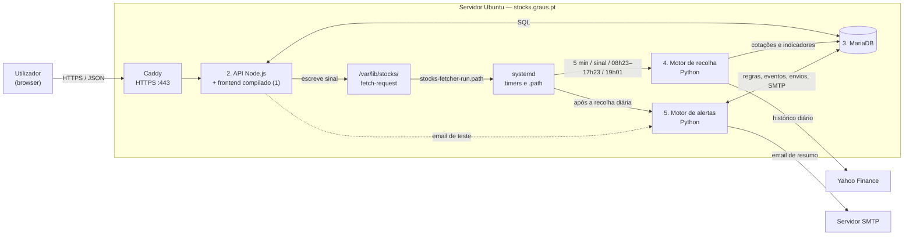

# Arquitectura de Software — Plataforma de Simulação e Acompanhamento de Acções

Estado: versão 1 em produção em https://stocks.graus.pt (actualizado a 2 nov. 2026; desde essa data num servidor novo, instalado de raiz, ver [deploy/README.md](../../deploy/README.md)).

## 1. Objectivo e âmbito

A aplicação permite acompanhar acções, consultar o histórico diário com indicadores técnicos e momento, simular uma estratégia de momento no histórico, ver o mapa de calor e o momento do mercado, operar a partir da carteira da conta de simulação da SAXO Bank e receber alertas por email. Por agora, a aplicação tem um só utilizador.

A **carteira da aplicação é a conta de simulação (SIM) da SAXO Bank**, ligada por cada utilizador (secção 4.7): saldo, posições, execuções e valor vêm da SAXO, e as ordens não usam dinheiro real. A carteira virtual própria foi retirada a 6 nov. 2026, por decisão do utilizador, e os seus dados foram apagados: sem ligação à SAXO, a aplicação continua a acompanhar o mercado e a simular estratégias no histórico, mas não opera. A conta real da SAXO está recusada por omissão (`STOCKS_SAXO_ALLOW_LIVE=false`) e só se activa por decisão expressa.

Este documento descreve a arquitectura implementada. O módulo de livro de ofertas segue a [especificação euronext-orderbook](orderbook-spec.md). As decisões que lhe deram origem estão em [Análise e decisões](analise_e_decisoes.md); a execução, em [Plano de implementação](plano_implementacao.md); a interface, no [Guia de estilos](guia_estilos.md); a operação do servidor, em [deploy/README.md](../../deploy/README.md).

## 2. Requisitos e parâmetros funcionais

| Parâmetro | Definição |
|---|---|
| Modalidade | Simulação e acompanhamento |
| Operações reais | Fora do âmbito |
| Utilizadores | Grupo privado; contas criadas por administradores (página Utilizadores ou CLI); sem registo público |
| Autenticação | Palavra-passe e código TOTP de uma aplicação de autenticação (obrigatório para todos; configurado no primeiro login) |
| Mercados e moeda | Instrumentos cotados em EUR (Euronext, Xetra, Madrid, Milão, Helsínquia, Viena, entre outros), verificado pela moeda devolvida pelo fornecedor; conta SAXO em EUR |
| Fonte de dados | Yahoo Finance via yfinance, versão fixada, atrás de um adaptador substituível |
| Catálogo | Global e partilhado; preenchido à mão ou por importação de Excel/CSV; cada utilizador escolhe os instrumentos que acompanha |
| Granularidade | Diária: um registo por sessão de bolsa |
| Histórico | Carga inicial de três anos (para a SMA200 estar completa nos dois anos mostrados); actualização diária; as cotações nunca são apagadas |
| Indicadores | EMA9, SMA10, SMA50, SMA125 e SMA200 por sessão, guardados na BD; momento SMA10/SMA200 e SMA8/SMA125 |
| Recolha | Nos dias úteis, de hora a hora entre as 08h23 e as 17h23 de Lisboa (sessão em curso, valores provisórios com cerca de 20 min de atraso do Yahoo) e às 19h00, depois do fecho das bolsas europeias (17h30 CET), com os fechos definitivos |
| Alertas | Email; um resumo por utilizador após cada recolha diária, nunca mais do que um email por hora; condições de preço, de variação diária e sinais de uma estratégia |
| Simulação | Último preço não ajustado disponível (durante a sessão, a vela provisória da recolha horária; depois do fecho, o fecho do dia); sem comissões; quantidades inteiras; sem posições curtas; custo médio ponderado |
| Capital | O da conta de simulação da SAXO: 1 000 000 EUR à partida (`STOCKS_SAXO_INITIAL_CAPITAL`, base do resultado acumulado; a SAXO não o indica) |
| Estratégias | Registo de estratégias simuladas no histórico, por instrumento (secção 5.4): A-Momentum, B-Opus, C-AI e D-Reversão; a melhor de cada instrumento aparece em Acompanhar e é a aplicada por omissão na página do instrumento. Não executam operações nem alteram a carteira |
| Email | Servidor SMTP configurado pelos administradores em Definições (hoje OVH, `ssl0.ovh.net:465`, remetente `stocks@graus.pt`); sem configuração, os alertas não enviam emails |

O requisito «frequência máxima de 1h» é cumprido com um único email de resumo por utilizador, enviado depois de cada recolha diária, e com um intervalo mínimo de 60 minutos entre emails ao mesmo utilizador. Como os dados são diários, o caso relevante é o de várias regras a disparar na mesma noite, que o resumo agrupa numa só mensagem.

## 3. Visão geral da arquitectura

A aplicação mantém os cinco módulos do desenho original:

| # | Módulo | Tecnologia | Pasta |
|---|---|---|---|
| 1 | Interface | React 19, Vite, TanStack Query, React Router, Recharts | `frontend/` |
| 2 | Middleware / API | Node.js 22, Fastify 5, Zod, mysql2 (SQL directo) | `api/` |
| 3 | Base de dados | MariaDB 11.8; migrações dbmate | `db/migrations/` |
| 4 | Motor de recolha | Python 3, yfinance, PyMySQL | `engines/fetcher/` |
| 5 | Motor de alertas | Python 3, PyMySQL, smtplib, cryptography | `engines/alerts/` |

Tudo corre num único servidor Ubuntu (`stocks.graus.pt`, um VPS com Ubuntu, 4 vCPU, 8 GB de RAM e 100 GB de disco, desde 2 nov. 2026). O Caddy termina o HTTPS e encaminha para a API, que serve também o frontend compilado na mesma origem. Os motores Python são processos de curta duração lançados pelo systemd.



A interface nunca acede à base de dados: fala só com a API. A API nunca fala com o Yahoo: pede ao motor de recolha, através da fila `fetch_jobs` e do ficheiro de sinal. A API também não envia emails: para o email de teste em Definições, invoca o motor de alertas (`python -m alerts test`). Os motores não comunicam entre si; coordenam-se pela base de dados e pela ordem de execução no systemd.

## 4. Descrição dos módulos

### 4.1. Interface

Aplicação de página única em React, servida pela API em produção e pelo Vite em desenvolvimento (com `/api` encaminhado para a API local). Segue o [guia de estilos](guia_estilos.md): temas claro, escuro e «Sistema» sem flash no carregamento, navegação lateral (desktop), lateral recolhível (tablet) e inferior (telemóvel), e estados de carregamento, vazio, erro e dados desactualizados em todos os ecrãs.

| Ecrã | Função |
|---|---|
| Visão geral | Painel do dia: valor da conta SAXO, saldo disponível, montante investido (custo) e resultado acumulado face ao capital inicial, com a mini-evolução guardada; sem ligação à SAXO, um aviso com ligação às Definições; sinais das estratégias na última sessão nos instrumentos da minha lista; alertas recentes; maiores subidas e descidas da lista; momento do mercado (distribuição do SMA10/SMA200 e os 5 mais fortes e mais fracos); cruzamentos da SMA10 com a SMA50 nas últimas 5 sessões, ascendentes e descendentes |
| Acompanhar | Lista do utilizador e, com o botão «Catálogo», o catálogo partilhado (último fecho e sessão, volume, variação, melhor estratégia nos últimos 2 anos (com o resultado e ligação para o gráfico com ela aplicada), mid e desequilíbrio do livro Euronext com o botão «Mostrar OB», ISIN-MIC com edição directa; ordenação por instrumento, volume, variação e desequilíbrio), adicionar símbolos ou importar Excel/CSV (colunas `ticker` e `isin_mic`) com pré-visualização, botão «Validar agora» |
| Charts | O sítio único do instrumento: gráfico diário (linha ou velas com preços ajustados, volume por baixo, 1M a 2A com o último período e o tipo guardados no browser, indicadores opcionais, momento sincronizado, linha de mira sincronizada com os valores da sessão (abertura, máximo, mínimo, fecho, variação, volume, médias e momento) por cima dos painéis, atalhos de teclado, tabela de dados, menu «Estratégia» com a melhor do instrumento por omissão), ações (adicionar ou remover da lista, criar alerta, enviar ordem à SAXO, livro de ofertas), avisos de validação e de cobertura dos dados, e à direita uma lista (acompanhamento, carteira, Carteira SAXO ou catálogo, com pesquisa e ordenação) para passar de um instrumento a outro sem mudar de página, com as setas ↑/↓ ou os botões anterior/seguinte; os vizinhos são pré-carregados e um instrumento fora da lista também é mostrado. `?instrumento=`, `?estrategia=`, `?fonte=` e `?ordem=` no endereço; por baixo do gráfico, o painel **Empresa** (fonte: Yahoo): nome, sector e indústria, local, trabalhadores e sítio, descrição da actividade (em inglês, com «Mostrar tudo»), indicadores (capitalização, P/E, preço/valor contabilístico, dividendo, resultado por acção, margem líquida, ROE, dívida/capitais próprios, beta, intervalo de 52 semanas com a posição do último preço; a capitalização, os P/E, o preço/valor contabilístico e o dividendo são recalculados ao último preço e o intervalo de 52 semanas alarga-se com os extremos desde a recolha; cada P/E mostra o resultado por acção em que assenta e o estimado o seu ano fiscal, o seguinte ao corrente, porque o `forwardEps` do Yahoo é a estimativa «+1y») a secção **Valorização** (indicativa, com o último fecho: veredicto global «barato», «em linha» ou «caro» por maioria de quatro critérios: múltiplos face ao sector em percentil, P/E face à própria história com gráfico e faixa do 1.º ao 3.º quartil, preço-alvo médio dos analistas e número de Graham; mais um DCF invertido só informativo) e as contas anuais em dois mini-gráficos (receitas e resultado líquido, um eixo cada) |
| Orderbook | Livro de ofertas Euronext (atraso 15 min) dos instrumentos com ISIN-MIC: melhor compra/venda, spread, mid, desequilíbrio, tabela com nº de ordens e totais, gráfico de profundidade cumulativa, actualização a cada 30 s |
| Instrumento | `/instrumentos/:id` redirecciona para o Charts nesse instrumento (as ligações antigas e as dos outros módulos continuam a funcionar, com `?estrategia=`) |
| HeatMap | Mapa de calor dos 20 instrumentos com maior valor negociado (catálogo ou lista): tamanho pelo valor negociado, cor pela variação; período de 1, 5, 10 ou 20 sessões |
| Comparar | As estratégias lado a lado nos últimos 2 anos (resultado, instrumentos com ganho e perda, capital máximo, resultado sobre o capital, tempo investido, operações, acerto, piores casos, cada ano, em quantos é a melhor), com comprar e manter como referência e o melhor valor de cada linha a negrito; filtro «Todos / A minha lista»; persistência dos ganhadores e perdedores (recálculo semanal) |
| Carteira SAXO | A carteira da aplicação: saldo, valor total, montante investido, evolução do valor (uma leitura por sessão, com o capital inicial como referência), posições abertas (valorizadas ao último preço da aplicação, com «Vender» em cada uma) e posições fechadas com o resultado realizado. `/carteira` redirecciona para aqui e `/operacoes` para Ordens SAXO |
| Alertas SAXO | Avisos das ordens SAXO executadas (quantidade e preço), expiradas ou canceladas, e interruptor de email |
| Automação | Interruptor geral «Enable» (desligado por omissão), cartão «Estratégias» com um interruptor por estratégia, última execução e cartão «Ordens enviadas» com o estado real na SAXO (à espera, executada com quantidade e preço, cancelada, expirada, recusada); sinais não enviados à parte, com o motivo (secção 4.7) |
| Correspondência SAXO | Só administradores. Instrumento da SAXO que corresponde a cada instrumento do catálogo: resumo por estado (ligado, por procurar, ambíguo, só noutra bolsa, não encontrado, não negociável, erro), «Ligar o catálogo» e «Ligar e revalidar todos» (em segundo plano, com progresso), última ligação (manual ou semanal), tabela filtrável («Por resolver», «Ligados», «Todos») com o símbolo e a descrição da SAXO, a semelhança dos nomes, «Desligar» e a escolha manual (lista de candidatos ou Uic à mão) |
| Ordens SAXO | Ordens enviadas à conta de simulação da SAXO, com o estado real (aberta, executada com quantidade e preço, expirada, cancelada), os stops associados às compras, «Alterar» (quantidade e preço limite, ou preço do stop fixo) e «Cancelar»; faixa «Conta de simulação — não é dinheiro real» |
| Sinais | Compras, reforços e vendas da estratégia escolhida (A-Momentum, B-Opus, C-AI ou D-Reversão) aplicada virtualmente a todos os instrumentos, nas últimas 1 a 10 sessões, com o motivo das vendas, filtro por tipo e botões «Comprar na SAXO» e, nos sinais de venda, «Vender na SAXO» com as unidades que a conta tem |
| BackTest | Resultado da estratégia em cada instrumento nos últimos 2 anos (resultado em € e %, operações, taxa de acerto, posição aberta, comparação com comprar e manter), com resumo, filtro «Todos / A minha lista», pesquisa e ordenação; o símbolo abre o gráfico com a estratégia aplicada |
| WinnersLoosers | Instrumentos em que todas as estratégias disponíveis ganham, e em que todas perdem, nos últimos 2 anos: resumo (quantos e soma), filtro «Todos / A minha lista», pesquisa e duas tabelas ordenáveis com o resultado de cada estratégia, o total e comprar e manter; cada resultado abre o gráfico com essa estratégia; ícone por linha e botões em massa para adicionar os ganhadores à lista de acompanhamento e remover os perdedores |
| Promessas | Instrumentos que nos últimos 3 meses mostram os sinais que no passado anunciaram ganhadores nos 12 meses seguintes ([método e validação](promessas.md)): elegíveis com a tendência intacta, pontuação 0–100 (M2, volatilidade baixa, SMA200 a subir), top 30 ou todos, se foram ganhadores nas 3 estratégias, e a validação histórica com aviso |
| Pechinchas | Instrumentos com o veredicto «Barato» na valorização do painel Empresa (maioria dos critérios com dados: sector, P/E histórico, analistas, Graham), com filtro por sector (`?sector=`) e tabela ordenável (critérios, fecho, P/E e mediana do sector, dividendo, alvo dos analistas, Graham); cada linha abre o Charts |
| Timelapse | Grupo Mercado. Os 30 instrumentos com mais valor negociado nas últimas 1, 5 ou 10 sessões (lista «Sessões somadas», por omissão 5, `?sessoes=`; volume × (abertura + mínimo + máximo + fecho) / 4, como na Calor), animado sessão a sessão nas últimas 22 sessões, uma sessão a cada 2 s: barras que deslizam para a nova posição, com a variação de posição (▲, ▼, novo); cor da barra pela variação do preço (fecho ajustado) nessas sessões, com legenda: verdes sobe, cinzento quase não mexe, vermelhos desce, em 3 intensidades por lado (`--div-up-1…3`, `--div-flat`, `--div-down-1…3`, tons claros e escuros validados); a faixa «quase não mexeu» é ±1 % numa sessão, ±2 % em 5 e ±3 % em 10, e as intensidades vão até 2×, até 4× e acima; a variação aparece também em texto ao lado do valor, porque verde e vermelho se confundem no daltonismo mais comum; a data da sessão por cima do gráfico; clicar numa barra destaca esse instrumento e esbate os outros, e o duplo clique abre-o no Charts (`/charts?instrumento=…&fonte=<universo>`); universo à escolha (a minha lista, Saxo, catálogo; `?universo=`); reproduzir, pausa, sessão anterior e seguinte, primeira e última, barra de tempo entre a data de início e a de fim; quem mais subiu e desceu no período; tabela da sessão; sem animação com «reduzir movimento». A sessão em curso só entra depois da recolha das 19:00 |
| Calor | Valor negociado diário de todo o catálogo nos últimos 2 anos, a partir do dia 1 do mês, para o primeiro mês ficar completo (VN de cada instrumento = volume × (abertura + mínimo + máximo + fecho) / 4, somado por sessão) com a SMA200, resumo (última sessão completa, média, diferença face à média, máximo da janela, sessão em curso à parte) e o histograma **Valor mensal negociado** (soma das sessões de cada mês, cor pelo quartil entre os meses completos de «Frio» a «Muito quente», meses incompletos a cinzento, rótulo nos 3 mais quentes, tabela com sessões e média por sessão) e o gráfico **Capitalização Mercado** (soma de fecho × número de acções de cada instrumento, com o número de acções actual do Yahoo aplicado a todo o período; num feriado local o instrumento conta com a última capitalização, até 10 dias; SMA200, resumo como o do valor negociado mais a variação na janela; eixo ajustado aos dados) |
| Alertas | Regras com pré-visualização em linguagem natural (preço, variação diária ou sinal de compra/reforço/venda de uma estratégia), activação e eventos com o estado do envio |
| Entrar | Palavra-passe e, a seguir, código de 6 dígitos ou código de recuperação; no primeiro login, configuração do 2.º factor com QR code, chave manual e 10 códigos de recuperação |
| Utilizadores | Só administradores: listar (com o estado do 2.º factor), adicionar, redefinir palavra-passe, repor o 2.º factor e remover contas |
| Definições | Tema, transparência, regras da simulação, estado dos dados, palavra-passe, cartão «SAXO Bank» com «App Key» e «App Secret» da aplicação SAXO (o segredo é guardado cifrado e nunca mostrado de novo), «Ligar à SAXO», «Testar ligação», «Desligar» e o distintivo «Simulação (SIM)», autenticação em dois passos (códigos de recuperação, trocar de aplicação), terminar sessão; para administradores, configuração SMTP com email de teste |

Regras da interface:
- Os valores monetários chegam como strings decimais e só passam a número para apresentação. Formatação pt-PT («12 345,67 €», «16 out. 2026»).
- Cada preço mostra a data da sessão. A conta SAXO aparece sempre como conta de simulação.
- Não há actualizações optimistas do saldo: a interface espera pela confirmação do servidor.
- Enquanto há instrumentos «A validar», as listas actualizam-se a cada 5 segundos; caso contrário não há polling, porque os dados são diários.
- O gráfico (Recharts) é carregado só na página do instrumento.
- O momento e as estratégias são módulos JavaScript puros em `shared/` (`momentum.js` e `strategies/`, com o registo em `strategies/index.js`), usados pelo browser (gráfico e menu «Estratégia») e pela API (Sinais e BackTest); assim o servidor e o browser calculam exactamente o mesmo. Têm testes próprios.
- As cores das séries do gráfico foram validadas para daltonismo nos dois temas; as cores do HeatMap têm contraste de pelo menos 4,98:1 com o texto branco.

### 4.2. Middleware / API

API REST em Fastify, com prefixo `/api/v1`. Cada rota declara esquemas Zod para o pedido e a resposta; o contrato OpenAPI ([api/openapi.yaml](../../api/openapi.yaml)) é gerado a partir deles, e o CI falha se não estiver actualizado. A documentação interactiva fica em `/api/docs`.

| Área | Rotas |
|---|---|
| Sessão | `POST /auth/login`, `POST /auth/logout`, `GET /me`, `PUT /me/password` |
| 2.º factor | `POST /auth/mfa/verify`, `POST /auth/mfa/setup`, `POST /auth/mfa/enable`, `GET /me/mfa`, `POST /me/mfa/recovery-codes`, `POST /me/mfa/reset`, `DELETE /admin/users/{id}/mfa` |
| Instrumentos | `GET /instruments` (`sort` = symbol, volume ou change, `dir`), `GET /instruments/{id}`, `DELETE /instruments/{id}` (administradores; recusado com ordens enviadas à SAXO), `POST /instruments`, `POST /instruments/import/preview`, `GET /instruments/import/template`, `POST /instruments/fetch`; `GET /instruments/{id}/profile` (perfil da empresa: `profile` null enquanto não houver dados; `profile.live` traz os indicadores de preço ao último preço, os resultados por acção de cada P/E e o ano fiscal da estimativa), `GET /instruments/{id}/valuation` (valorização indicativa calculada a pedido em `src/valuation.js`: os rácios do Yahoo são reescalados por último fecho / preço de referência da recolha; bancos sem EV/EBITDA nem fluxo de caixa livre; P/E histórico só com as contas na moeda da cotação) |
| Histórico | `GET /instruments/{id}/quotes` (cotações e indicadores) |
| ISIN-MIC e livro de ofertas | `PUT /instruments/{id}/isin-mic`, `GET /instruments?withIsinMic=true`, `GET /instruments/{id}/orderbook`, `GET /instruments/orderbook-summary?ids=…` (mid e desequilíbrio de até 50 instrumentos) |
| Lista | `GET /watchlist`, `POST /watchlist/items`, `DELETE /watchlist/items/{id}` |
| Alertas | `GET/POST /alerts` (`kind` = close_above, close_below, change_up, change_down ou signal com `strategy`), `PATCH/DELETE /alerts/{id}`, `GET /alerts/events` |
| Comparar | `GET /strategies/compare?scope=all\|watchlist` (agregados do BackTest por estratégia, comprar e manter e persistência) |
| Mapa de calor | `GET /heatmap?period=1\|5\|10\|20&scope=all\|watchlist&limit=20` |
| Mercado | `GET /market/momentum?top=5` (distribuição do SMA10/SMA200 na última sessão e extremos), `GET /market/crossovers?sessions=5` (cruzamentos SMA10/SMA50: ascendente se SMA10 ≤ SMA50 na sessão anterior e > na seguinte, descendente o inverso; conta o mais recente por instrumento); cache 10 min |
| Sinais | `GET /signals/watchlist?sessions=1` (sinais de todas as estratégias só nos instrumentos da lista do utilizador, para a Visão geral); a página Sinais cria alertas de sinal com «Avisar-me» (`POST /alerts`, `kind: signal`); `GET /signals?strategy=a-momentum&sessions=5` (estratégia aplicada a todos os instrumentos activos; a A-Momentum com todo o histórico, a B-Opus na janela de 2 anos com aquecimento; preço e motivo da operação; cache 10 min por estratégia) |
| Estratégias e BackTest | `GET /strategies` (registo); `GET /strategies/best` (melhor estratégia de cada instrumento, a partir dos resultados do BackTest); `GET /backtest?strategy=a-momentum&scope=all\|watchlist` (estratégia em cada instrumento activo sobre os últimos 2 anos; cache 10 min por estratégia) |
| WinnersLoosers | `GET /winners-losers?scope=all\|watchlist` (resultados do BackTest de todas as estratégias disponíveis, agrupados em gain, loss e mixed, com `inWatchlist` por utilizador; usa a cache do BackTest) |
| Promessas | `GET /promessas?scope=all\|watchlist` (sinais por instrumento, um de cada vez, cache 10 min; `pastWinner` a partir do BackTest; tabela de validação) |
| Valorizações | `GET /valuations?verdict=cheap\|fair\|expensive\|insufficient` (valorização resumida de todos os instrumentos activos com perfil, mesmas regras de `/instruments/{id}/valuation`; cache em memória refeita quando muda a última sessão ou um perfil) |
| Timelapse | `GET /market/timelapse?universe=lista|saxo|catalogo&window=1|5|10` (top 30 por valor negociado de 1, 5 ou 10 sessões, por omissão 5, com a variação do preço `change` de cada um em cada uma das últimas 22 sessões; sem a sessão em curso; dados do catálogo 10 min em cache; Saxo sem ligação: erros `SAXO_*`) |
| Calor | `GET /market/turnover` (série diária desde o dia 1 do mês de há 2 anos, com SMA200 calculada sobre o histórico anterior; a sessão em curso vem em `partial`, fora da série; cache 10 min); `GET /market/cap` (capitalização total na mesma janela, com SMA200, `partial` e `coverage` — instrumentos activos com número de acções; cache 10 min) |
| Estado | `GET /status` |
| Integrações | `GET /me/integrations/saxo` (estado: se está ligado, tipo `oauth`, ambiente, se expirou, chave da aplicação e o URL de retorno; nunca devolve segredos); `PUT/DELETE /me/integrations/saxo/app` (chave e segredo da aplicação SAXO; o segredo fica cifrado); `POST /me/integrations/saxo/connect` (devolve o endereço de autorização da SAXO); `GET /integrations/saxo/callback` (retorno da SAXO: pública, o utilizador vem do `state` assinado; redirecciona para `/definicoes?saxo=ok|erro`); `DELETE /me/integrations/saxo` (desliga). 409 `NO_SECRET_KEY` sem a chave de cifra, `NO_SAXO_APP`, `NO_PUBLIC_ORIGIN` |
| SAXO | `GET /saxo/portfolio` (saldo com o que está por liquidar, valor total, custo das posições, posições abertas valorizadas ao último preço da aplicação e posições fechadas); `GET /saxo/portfolio/history` (valor da conta em cada sessão e capital inicial); `GET /saxo/alerts`, `PUT /saxo/alerts/settings`, `POST /saxo/alerts/read` (avisos de ordens executadas, expiradas ou canceladas e preferência de email); `GET /saxo/connection` (conta e saldo); `POST /saxo/orders/preview` (resolve o instrumento, pré-valida na SAXO, com o stop associado opcional `stop: {type: stop|trailing, price|distance}`, e devolve um código de confirmação de 5 min ligado aos parâmetros); `POST /saxo/instruments/{id}/match` (escolha manual quando há várias correspondências); `GET/PUT /saxo/automation`, `PUT /saxo/automation/strategies/{id}` e `GET /saxo/automation/orders` (automação de cada utilizador); `GET /saxo/catalog`, `POST /saxo/catalog/sync` (`{recheck}`, 202, em segundo plano; 409 `SAXO_SYNC_RUNNING`) e `DELETE /saxo/instruments/{id}/match` (correspondência do catálogo, só administradores); `POST /saxo/orders` (envia com o código e uma `idempotencyKey`; cria também a ordem do stop); `GET /saxo/orders` (com o estado real vindo do histórico da SAXO); `PATCH /saxo/orders/{id}` (altera quantidade e preço de uma limitada, ou o preço de um stop fixo); `DELETE /saxo/orders/{id}` (cancela, e com ela o stop associado). Erros `SAXO_*` (sem ligação, ligação expirada, conta real bloqueada, limite de pedidos, duplicado, recusada, passo de preço com sugestão e campo, stop inválido, indisponível) |
| Administração | `GET/POST /admin/users`, `PUT /admin/users/{id}/password`, `DELETE /admin/users/{id}`, `GET/PUT /admin/smtp`, `POST /admin/smtp/test` |
| Saúde | `GET /health/live`, `GET /health/ready` (fora de `/api/v1`) |

Erros no formato comum `{ "error": { "code", "message", "details" } }`, com códigos estáveis (`INSUFFICIENT_FUNDS`, `PRICE_CHANGED`, `STALE_QUOTE`, `FORBIDDEN`…).

#### Regras da simulação

- Preço: último preço **não ajustado** disponível (o preço que efectivamente existiu): durante a sessão, o valor provisório da recolha horária (cerca de 20 min de atraso); depois do fecho, o fecho do dia. A data da cotação fica registada na operação.
- Compra limitada ao saldo; venda limitada à quantidade detida; sem posições curtas; quantidades inteiras; sem comissões.
- Cada pedido traz uma chave de idempotência: repeti-lo devolve a operação original em vez de criar outra.
- O cliente envia o preço e a data que mostrou na pré-visualização; se a cotação tiver mudado, a API responde `409 PRICE_CHANGED` e a interface pede nova confirmação.
- Só instrumentos activos e em EUR. Cotações com mais de 7 dias de calendário (`STOCKS_MAX_QUOTE_AGE_DAYS`) bloqueiam a operação.
- Custo médio ponderado: a posição guarda o custo total; numa venda retira-se a fracção proporcional e a última unidade leva o resto, para o custo chegar exactamente a zero.
- Aritmética decimal exacta com BigInt; arredondamento meio para longe de zero, a 2 casas nos montantes.

#### Mapa de calor

Por instrumento activo e para N ∈ {1, 5, 10, 20} sessões:
- variação = fecho ajustado da última sessão ÷ fecho ajustado N sessões antes − 1;
- valor negociado = Σ fecho × volume das N sessões.

Só são devolvidos os N instrumentos com maior valor negociado (20 por omissão), com o total disponível. A cor é verde acima de +1%, cinzenta entre −1% e +1% e vermelha abaixo de −1%. O resultado do catálogo fica em memória durante 10 minutos, porque as cotações só mudam com a recolha diária.

### 4.3. Base de dados

MariaDB 11.8 (mínimo 10.6, por causa de `SKIP LOCKED`), InnoDB, `utf8mb4`. O esquema é definido só pelas migrações em `db/migrations/` (formato dbmate), partilhadas pela API e pelos motores. Instantes técnicos em UTC; datas de sessão em `DATE`; valores em `DECIMAL`.

| Tabela | Conteúdo |
|---|---|
| `instruments` | Catálogo global: símbolo Yahoo (único), mercado, moeda, nome, ISIN e MIC Euronext (opcionais; preenchidos a partir de `euronext_isins`: pelo motor de recolha quando valida um instrumento novo, e para todo o catálogo por `scripts/isin-mic-from-xlsx.mjs`), estado (`pending`/`active`/`invalid`) e motivo, primeira e última sessão |
| `daily_quotes` | Uma linha por (instrumento, sessão): abertura, máximo, mínimo, fecho, fecho ajustado, volume, `provisional` (vela do próprio dia gravada antes das 18:00 de Lisboa), origem, e os indicadores `ema9`, `sma10`, `sma50`, `sma125`, `sma200` |
| `euronext_isins` | Lista oficial de instrumentos da Euronext (`ISIN.xlsx` na raiz do repositório): ISIN, MIC, símbolo Euronext, símbolo Yahoo correspondente (ex.: `GALP.LS`), nome e mercado; carregada por `scripts/isin-mic-from-xlsx.mjs` |
| `fetch_jobs` | Fila de recolha: tipo (inicial ou incremental), estado, tentativas, próxima tentativa, último erro |
| `job_runs` | Execuções da recolha diária e dos alertas, para diagnóstico |
| `users`, `sessions` | Contas (hash scrypt, perfil de administrador, desactivação, segredo TOTP cifrado e último passo aceite) e sessões (só o SHA-256 do token; fase `mfa_setup`, `mfa_verify` ou `full`; códigos errados) |
| `user_integration_tokens` | Ligação de cada utilizador à SAXO Bank (`provider = 'saxo'`): access e refresh tokens da ligação OAuth, cifrados com AES-256-GCM e a chave do servidor; nunca devolvidos pela API. Guarda o ambiente (`sim`), o tipo (`oauth`), as validades e se a SAXO recusou a ligação |
| `user_saxo_apps` | Chave e segredo (cifrado) da aplicação SAXO de cada utilizador |
| `saxo_instruments` | Correspondência instrumento da aplicação → instrumento da SAXO (Uic, símbolo, bolsa, tipos de ordem, quantidade mínima, passo de preço, origem `auto/manual`, semelhança dos nomes, `tradable` e data da última verificação), preenchida na primeira ordem ou pela ligação do catálogo |
| `saxo_match_issues` | Instrumentos sem correspondência clara (`ambiguous`, `other_market`, `not_found`, `not_tradable`, `error`), com a mensagem e os candidatos da SAXO em JSON para a escolha manual |
| `saxo_automation_settings` / `saxo_automation_strategies` | Interruptores da automação de cada utilizador: o geral e um por estratégia, desligados por omissão |
| `saxo_automation_orders` | Um registo único por sinal tratado (`pending/sent/skipped/failed`), ligado à ordem em `saxo_orders`: um sinal nunca se envia duas vezes |
| `saxo_automation_runs` | Uma execução por utilizador e dia, com o estado, as contagens e o motivo de uma falha |
| `saxo_account_history` | Valor da conta SAXO no fim de cada sessão (total, saldo, posições), por utilizador e ambiente: base do gráfico da evolução da carteira |
| `saxo_catalog_runs` | Ligações do catálogo inteiro (quem, ambiente, com ou sem revalidação, `manual/weekly`, progresso, contagens por resultado, estado) |
| `saxo_notifications` / `saxo_alert_settings` | Avisos de ordens terminadas (`filled`, `expired`, `cancelled`, ou `ended` sem histórico), um por ordem, com a data de envio do email; e a preferência de email de cada utilizador (ligada por omissão) |
| `saxo_orders` | Ordens enviadas à SAXO por cada utilizador (lado, quantidade, tipo `market/limit/stop/trailing_stop`, preço limite, preço e distância do stop, preço da aplicação, id na SAXO, estado `sending/working/filled/expired/cancelled/rejected/ended/unknown`, quantidade e preço executados, data de fim; `parent_id` liga o stop à compra), com chave de idempotência única por utilizador |
| `company_profiles` | Perfil da empresa de cada instrumento (fonte: Yahoo, via yfinance): descrição da actividade (em inglês), sector, indústria, país, sítio, trabalhadores, capitalização, P/E, preço/valor contabilístico, dividendo, beta, resultado por acção, margem líquida, ROE, dívida/capitais próprios, intervalo de 52 semanas, campos da valorização (preço de referência do Yahoo na recolha, valor da empresa e EV/EBITDA, EBITDA, dívida, caixa, acções, fluxo de caixa livre, valor contabilístico por acção, crescimentos, payout, preços-alvo e número de analistas, recomendação média) e contas anuais (receitas, resultado operacional, resultado líquido, EBITDA, resultado diluído por acção, fluxo de caixa livre, capitais próprios, acções) em JSON; `status` `ok`/`missing` e o último erro transitório |
| `user_recovery_codes` | Códigos de recuperação do 2.º factor (só o SHA-256), cada um de uso único |
| `watchlist_items` | Uma lista por utilizador sobre o catálogo |
| `alert_rules`, `alert_events` | Regras e eventos detectados (únicos por regra e sessão) |
| `email_deliveries` | Resumos enviados e o seu estado (`sending`, `sent`, `failed`, `uncertain`) |
| `smtp_settings` | Configuração SMTP global (servidor, porta, segurança, utilizador, palavra-passe cifrada, remetente) |
| `analysis_results` | Resultados das análises recalculadas semanalmente (JSON por nome): `promessas_validation` e `winner_persistence` |
| `audit_log` | Acções relevantes, sem palavras-passe, tokens ou credenciais |

Remover um utilizador apaga em cascata as sessões, os códigos de recuperação, a ligação, as ordens e o histórico da SAXO Bank, a lista, os alertas e os envios; a auditoria mantém-se.

As cotações não são apagadas: 295 instrumentos com três anos são cerca de 224 000 sessões, que ocupam cerca de 51 MB com os indicadores e os índices (medido a 20 out. 2026), e crescem cerca de 75 000 sessões (≈ 17 MB) por ano.

### 4.4. Motor de recolha de cotações

Comandos `python -m fetcher add | run | update [--intraday] | status | indicators | backfill | profiles [--all] [--limit N]`. `profiles` recolhe o perfil da empresa (`ticker.info`, `ticker.income_stmt`, `ticker.cashflow` e `ticker.balance_sheet` do yfinance) dos instrumentos activos sem perfil ou com mais de 7 dias, com 1 s entre instrumentos; uma falha transitória guarda o erro e mantém os dados anteriores; sem dados no Yahoo fica `missing`. A carga inicial de um instrumento novo recolhe logo o perfil (melhor esforço). Corre ao domingo às 08:00 (`stocks-profiles.timer`) e fica registado em `job_runs` como `fetch_profiles`. O yfinance fica isolado em `provider.py`, atrás da interface `QuoteProvider`.

1. **Validação assíncrona:** um símbolo novo fica `pending` com um pedido `initial`. O motor confirma no fornecedor que existe e que a moeda é EUR, preenche nome e mercado e passa-o a `active`, ou a `invalid` com o motivo. Ao activá-lo, preenche o ISIN-MIC a partir de `euronext_isins`, se o símbolo constar da lista e o instrumento ainda não o tiver.
2. **Carga inicial:** três anos de sessões diárias (`STOCKS_HISTORY_YEARS`, 3 por omissão). A SMA200 só tem valor a partir da 200.ª sessão (cerca de 10 meses), por isso com três anos os dois anos mostrados nos gráficos e usados na estratégia têm sempre as médias completas. Depois de aumentar o valor, `python -m fetcher backfill` volta a pedir a carga dos instrumentos activos com menos histórico; as sessões existentes são actualizadas, sem duplicados. Executado em produção a 20 out. 2026: 288 dos 295 instrumentos activos passaram a começar a 20 out. 2023, sem sessões sem SMA200 nos dois anos mostrados; os outros 7 (SYENS.BR, R3NK.DE, CVC.AS, PUIG.MC, AMV0.DE, MICC.AS, CSG.AS) foram admitidos à cotação depois disso, e a página do instrumento avisa que a cobertura é inferior a três anos. Repetido a 5 nov. 2026: 287 instrumentos com os três anos completos (desde 2 nov. 2023; 754 a 768 sessões conforme os feriados de cada bolsa); os 8 com menos histórico pediram-se de novo ao Yahoo, que não tem mais: os 7 acima e INPST.AS (InPost), com sessões só de 17 jul. a 22 out. 2026 no Yahoo, provavelmente retirada da bolsa depois da oferta de aquisição; apagada do catálogo no mesmo dia (294 instrumentos activos).
3. **Actualização:** um pedido `incremental` por instrumento activo, relendo os últimos 7 dias para apanhar correcções do fornecedor. Corre de hora a hora durante a sessão (`update --intraday`, registada em `job_runs` como `fetch_intraday`), em que a vela do próprio dia é provisória (o «fecho» é o último preço, com o atraso do Yahoo, e o volume é parcial), e às 19h00 (`update`, `fetch_update`), que grava o fecho definitivo por cima.
4. **Gravação idempotente:** `INSERT … ON DUPLICATE KEY UPDATE` sobre a chave (instrumento, sessão).
5. **Validação dos dados:** sessões com preços não positivos ou incoerentes são descartadas, não corrigidas.
6. **Indicadores:** depois de cada recolha, a série completa do instrumento é recalculada sobre o fecho ajustado, porque os ajustes do fornecedor alteram os fechos do passado; só se gravam as sessões cujos valores mudaram (normalmente as poucas relidas). SMA de N sessões; EMA9 iniciada com a SMA das primeiras 9 sessões e α = 0,2. Os valores ficam `NULL` enquanto não houver sessões suficientes.
7. **Falhas:** falhas de rede, limite de pedidos e erros inesperados voltam à fila com espera progressiva (2, 4, 8… minutos, até 5 tentativas). Uma falha num instrumento não pára os restantes, e uma falha de rede nunca invalida um instrumento.
8. **Concorrência:** os pedidos são reservados com `SELECT … FOR UPDATE SKIP LOCKED`, e o mesmo instrumento nunca é recolhido por dois processos ao mesmo tempo.

Os símbolos são descarregados um a um, porque o Yahoo só serve o histórico por símbolo e o pedido individual devolve também a moeda e o nome. A carga de 293 símbolos demorou cerca de 1,5 minutos.

### 4.5. Motor de alertas por email

Comandos `python -m alerts run [--dry-run | --dry-run-if-unconfigured]` (a recolha diária usa o segundo modo) e `python -m alerts test --to EMAIL`.

| Tipo | Limite | Quando dispara |
|---|---|---|
| `close_above` | EUR | O fecho passa a estar acima do limite (transição; não repete enquanto se mantém) |
| `close_below` | EUR | O fecho passa a estar abaixo do limite (transição) |
| `change_up` | % | Subida face à sessão anterior de pelo menos o limite; avaliado em cada sessão |
| `change_down` | % | Descida face à sessão anterior de pelo menos o limite; avaliado em cada sessão |

Regra de envio:

```text
Após cada recolha diária, para cada utilizador:
- reunir os eventos ainda não notificados de regras activas (até 7 dias);
- se o utilizador recebeu um email há menos de 60 minutos, adiar;
- caso contrário, enviar um único email de resumo com todos esses eventos.
```

- **Só fechos definitivos:** as velas provisórias da recolha horária são ignoradas. Cada sessão definitiva posterior à última avaliada é avaliada por ordem (até 10), por isso um fecho que chegue depois da execução (ex.: recolha das 19:01 repetida mais tarde pelo timer de 5 minutos) é avaliado na execução seguinte; uma regra nova é avaliada só na última sessão.
- **Desduplicação:** a chave única (regra, sessão) impede notificar o mesmo evento duas vezes.
- **Envio recusado** pelo servidor SMTP: os eventos voltam ao resumo seguinte.
- **Ligação perdida** durante a transmissão: o envio fica `uncertain` e não é repetido automaticamente. Um erro ao terminar a ligação (`QUIT`) depois de a mensagem ser aceite não conta como falha.
- **Edição de regras:** criar, editar ou reactivar uma regra repõe o estado da avaliação.
- **Configuração SMTP:** lida da tabela `smtp_settings` (Definições), com a palavra-passe decifrada com a chave do servidor; na falta dela, das variáveis `STOCKS_SMTP_*`; sem nenhuma, corre em `--dry-run`, mostra os resumos no registo e não grava nada.
- **Email de teste:** `python -m alerts test --to …`, chamado pela API em Definições, usa exactamente o mesmo código de envio.

**Alertas de sinais** (`kind = 'signal'`, com `strategy`): avisam quando a estratégia indicada dá um sinal de compra, reforço ou venda no instrumento, numa sessão definitiva. Como as estratégias estão em JavaScript, o motor de alertas chama `scripts/strategy-signals.mjs` (Node, a partir de `api/`), que corre o registo das estratégias como `GET /signals`, só sobre velas definitivas, para os pares (instrumento, estratégia) das regras activas; só é chamado quando há regras de sinal. O evento guarda o lado do sinal (`alert_events.signal_side`) e entra no mesmo resumo por email.

**Aviso operacional** (`python -m alerts ops`, `stocks-ops.timer`, dias úteis às 21:00 de Lisboa, independente da recolha diária): verifica execuções falhadas nas últimas 24 h ou presas há mais de 3 h, a recolha diária do dia em falta, instrumentos activos com a recolha falhada e dados parados há 2 ou mais dias úteis; havendo problemas, envia um email aos administradores activos, no máximo um por dia (`email_deliveries` com o assunto «Stocks: aviso operacional»).

Os alertas apenas notificam; nunca desencadeiam operações.

### 4.6. Livro de ofertas (euronext-orderbook)

Biblioteca em `api/src/orderbook/` que implementa a [especificação](orderbook-spec.md) v0.1, usada pela API e por um CLI (`npm run orderbook -- <ISIN> <MIC>`).

- **Fonte:** `GET https://live.euronext.com/{lang}/ajax/getOrderBookCanvas/{ISIN}-{MIC}`, endpoint público e não documentado, com 15 minutos de atraso. O pedido é sempre feito pelo servidor.
- **Identificação:** ISIN validado com o dígito de controlo (Luhn) e MIC com 4 caracteres, antes de qualquer pedido. Guardados em `instruments.isin`/`mic`; o MIC é sugerido a partir da bolsa (Lisbon → XLIS, Paris → XPAR, Amsterdam → XAMS, Brussels → XBRU, Milan → MTAA, Irish → XMSM, Oslo → XOSL). XETRA, Madrid, Helsínquia e Viena não são Euronext e não têm livro.
- **Parsing:** `chart_data` dá preço e quantidade (positiva = venda, negativa = compra); a tabela HTML é lida com `node-html-parser` para o nº de ordens por (lado, preço), o carimbo «Updated» (hora do mercado, convertida para UTC) e os totais. Preços como decimais exactos (BigInt, 8 casas) e devolvidos como string. As ordens ao mercado (`price: "MKT"`) não têm preço e são ignoradas sem aviso. Acima de 1000 a Euronext envia `,` de milhares (`"1,475.00"`), contra o que a especificação previa; só se aceitam grupos de milhares bem formados (corrigido a 20 out. 2026, depois de a ASML aparecer como livro vazio).
- **Robustez:** níveis malformados descartados com aviso; totais divergentes e ordens não associáveis geram avisos, não erros; livro vazio não é erro; resposta cifrada (`ct`/`iv`/`s`) → `EncryptedResponseError`; HTML ou 404 → `InstrumentNotFoundError`; 429, 5xx e falhas de rede com 2 novas tentativas (1 s, 2 s ± 25%) → `UpstreamError`.
- **Cortesia:** cache em memória de 30 s por instrumento, partilhada pelo processo, e pedidos simultâneos ao mesmo instrumento partilham um só pedido HTTP. A Euronext recebe no máximo um pedido a cada 30 s por instrumento, qualquer que seja o número de utilizadores.
- **Resumo nas listas:** em Acompanhar, as colunas Mid e Desequilíbrio só aparecem com o botão «Mostrar OB» (desligado sempre que a página abre, para não se fazerem pedidos à Euronext sem necessidade). Vêm de `GET /instruments/orderbook-summary`, que o browser pede em lotes de 50 para todos os instrumentos Euronext da lista, uma vez quando o botão é ligado (sem actualização automática; considerado actual durante 60 s no browser). Os valores aparecem à medida que cada lote chega. A API faz no máximo 4 pedidos simultâneos à Euronext, num limite global partilhado por todos os lotes e utilizadores, e usa a mesma cache de 30 s: uma lista com 163 instrumentos Euronext custa 163 pedidos (cerca de 7 s), e nenhum se repetida dentro de 30 s. Um livro que falhe mostra «—» com o motivo, sem afectar os restantes.
- **Actualização só a pedido:** não há processo em segundo plano nem persistência (especificação §2). Com a página Orderbook aberta e o interruptor ligado, o browser pede o livro a cada 30 s; com o separador em segundo plano os pedidos param e retomam ao voltar. Sem ninguém a consultar, não se faz nenhum pedido à Euronext e nada fica guardado. O CLI com `--watch` é a única outra forma de actualização contínua, só enquanto o comando corre.
- **Atraso efectivo:** os dados chegam com 15 minutos de atraso e o carimbo «Updated» tem precisão ao minuto, por isso pedidos seguidos devolvem muitas vezes o mesmo livro. Guardar instantâneos ao longo do dia exigiria um processo agendado e uma tabela nova (evolução prevista na especificação §12).
- **Configuração:** `EURONEXT_BASE_URL`, `EURONEXT_LANG`, `EURONEXT_TIMEOUT_MS`, `EURONEXT_USER_AGENT`.
- **Decisões face à especificação:** o CLI aceita também `--layout ladder`; o fuso de Dublin aplica-se a `XDUB` e a `XMSM` (o MIC da Euronext Dublin). Continua em aberto (especificação §13) se o carimbo vem na hora do mercado ou na de Paris.

### 4.7. Ligação à SAXO Bank (simulação)

- **Código:** `api/src/saxo/` (`client.js`: cliente HTTP com tempo limite, 401/403/409/429/5xx tipados e espaçamento de 1 ordem/s por utilizador; `service.js`: sessão, conta, resolução de instrumentos, pré-validação, envio, lista, cancelamento) e `api/src/routes/saxo.js`. O browser nunca fala com a SAXO e o token nunca sai do servidor, nem é registado em logs, erros ou auditoria.
- **Ambientes:** SIM `https://gateway.saxobank.com/sim/openapi`. A conta real (`/openapi`) está bloqueada por `STOCKS_SAXO_ALLOW_LIVE=false`: com um token `live`, todas as chamadas dão 409 `SAXO_LIVE_BLOCKED` sem contactar a SAXO. A aplicação SAXO de cada utilizador é de SIM; um 401 marca a ligação como recusada.
- **Factos do SIM (spike de 3 nov. 2026, fixtures em `api/test/fixtures/saxo/`):** conta em EUR com 1 000 000 €; símbolos `RAIZ:mic`; a pesquisa por palavra-chave aceita o ISIN; `ExchangeId` → MIC por `/ref/v1/exchanges`; sem preços de mercado; *precheck* e envio partilham 1 pedido/s.
- **Testes:** `api/test/saxo.test.js` usa um servidor SAXO falso montado com as fixtures reais (`cfg.saxo.fetchImpl`); nenhum teste chama a SAXO.
- **Carteira da aplicação (6 nov. 2026):** é a conta SIM. O valor total (`TotalValue` de `/port/v1/balances/me`) vem da SAXO, que valoriza as posições: numa comparação de 6 nov. deu 691 706 € de posições, contra 691 811 € com os preços da aplicação. O saldo mostrado soma `CashBalance` e `TransactionsNotBooked`, para bater certo com o valor total. O capital inicial não vem da SAXO (`STOCKS_SAXO_INITIAL_CAPITAL`, 1 000 000 €).
- **Evolução da carteira** (`api/src/saxo/history.js`): a vigia da SAXO guarda em `saxo_account_history` uma leitura por utilizador ligado e por sessão, depois de a recolha diária fechar essa sessão. As leituras de 3 a 5 nov. 2026 são uma estimativa, reconstruída das ordens executadas e dos fechos (a reconstrução de 6 nov. diferia 0,08 % do valor da SAXO, por não incluir custos).
- **Menu:** grupo «SAXO» com Carteira SAXO (`/saxo/carteira`), Ordens SAXO (`/saxo/ordens`), Alertas SAXO (`/saxo/alertas`) e Automação (`/saxo/automacao`). A Correspondência SAXO (`/saxo/correspondencia`), de manutenção e só para administradores, fica no grupo «Administração» (com Utilizadores e Definições), por cima de Definições.
- **Automação** (`api/src/saxo/automation.js`, pedido do utilizador de 6 nov. 2026): lê os sinais das estratégias ligadas e envia as ordens à conta de simulação, sem confirmação. Só corre com o interruptor geral e o da estratégia ligados, e recusa a conta real mesmo que esta seja activada.
  - **Quando:** de hora a hora nos dias úteis, 10 minutos depois de cada recolha horária do Yahoo (recolhas das 08:23 às 17:23, execuções das 08:33 às 17:33 de Lisboa; a recolha demora em média 73 s, no máximo 130 s). A vigia da SAXO (60 s) lança uma execução por utilizador e hora, e precisa da recolha dessa hora: sem ela até aos :50, a hora fica sem execução, com o motivo. Uma execução que falhe (ligação expirada, SAXO indisponível) repete-se de 5 em 5 min até aos :53.
  - **Que sinais:** os mesmos da página Sinais, recalculados a cada execução com os últimos dados: os da sessão em curso e os da última sessão, desde que a recolha diária a tenha confirmado (sem isso não envia nada). Decisão do utilizador (6 nov. 2026): usar a sessão em curso também nas estratégias que dependem do fecho (A-Momentum), por isso um sinal pode desaparecer até ao fecho, mas a ordem enviada fica.
  - **Bolsas fechadas (execuções das 16:33 e 17:33):** nas 13 ordens limitadas do dia enviadas fora de horas na conta de simulação (3 a 5 nov. 2026), a SAXO manteve-as para a sessão seguinte: 8 executadas nessa sessão e 5 expiradas no seu fecho (16:35 de Lisboa). Ainda não houve nenhuma ordem a mercado para confirmar o mesmo nas vendas.
  - **Ordens:** compra (e reforço) limitada ao último preço + 1 %, no passo de preço do instrumento, com o orçamento da estratégia a dividir pelo último preço; venda a mercado. Todas `DayOrder`, sem stop associado e com `ManualOrder: false`. A venda é a das unidades executadas pela automação nessa estratégia, no máximo o que a conta tem: não toca em posições manuais nem de outra estratégia; sem posição, o sinal fica `skipped` com o motivo.
  - **Sem duplicados:** cada sinal tem um registo único em `saxo_automation_orders` e a chave de idempotência da ordem deriva do sinal (`auto-<estratégia>-<instrumento>-<data>-<lado>`). Uma ordem recusada ou sem resposta fica com esse estado e não se repete; se nada chegou a ser enviado por uma falha temporária, o sinal repete-se na tentativa seguinte. As ordens aparecem também em Ordens SAXO e geram os Alertas SAXO habituais.
- **Correspondência do catálogo (Yahoo → SAXO)** (`api/src/saxo/matching.js`, regras puras; `catalog.js`, pesquisa e gravação; `catalog-runner.js`, ligação do catálogo inteiro). Os símbolos do Yahoo não coincidem sempre com os da SAXO (DSY.PA é `DAST:xpar`, NDA-FI.HE é Nordea em Helsínquia) e só os instrumentos da Euronext têm ISIN no catálogo. Regras, por ordem:
  1. **Bolsa esperada pelo `ExchangeId` da SAXO**, por uma tabela fixa da bolsa do Yahoo (Paris→PAR, Amsterdam→AMS, Brussels→BRU, Lisbon→LISB, Milan→MIL, XETRA→FSE, MCE→SIBE, Helsinki→HSE, Vienna→VIE, Irish→ISE) e, sem ela, pelo MIC do catálogo via `/ref/v1/exchanges`. Comparar por MIC falhava: a Euronext Milão é `MTAA` no catálogo e `XMIL` na SAXO, e XETRA, Madrid, Helsínquia e Viena não tinham MIC.
  2. **ISIN** (pesquisa por palavra-chave): um só candidato na bolsa esperada → ligado.
  3. **Raiz do símbolo** (BAYN de BAYN.DE, NDA de NDA-FI.HE) na bolsa esperada, com o nome da SAXO pelo menos 34 % parecido com o do Yahoo.
  4. **Nome da empresa** (as duas primeiras palavras significativas) na bolsa esperada: o candidato mais parecido, se tiver ≥ 60 % e não houver empate.
  A semelhança dos nomes conta as palavras em comum sobre as do nome mais curto, sem acentos nem formas jurídicas (SA, AG, NV, plc, Oyj, Aktiengesellschaft…), aceita palavras truncadas (≥ 5 letras), o trema alemão escrito por extenso (Börse = Boerse, Rück = Rueck) e siglas de 3 ou mais letras (BBVA = Banco Bilbao Vizcaya Argentaria, WDP = Warehouses De Pauw). Antes de gravar, os detalhes da SAXO confirmam que é negociável e na mesma moeda. Sem correspondência clara, o instrumento fica em `saxo_match_issues`: **ambíguo** (vários candidatos na bolsa certa, ou símbolo igual com nome diferente), **só noutra bolsa** (ex.: Glanbia, cotada em Dublin, que a SAXO só tem em Londres em GBP), **não encontrado**, **não negociável** ou **erro**; um administrador escolhe na página Correspondência SAXO (ou indica o Uic à mão) e a escolha fica `manual`.
  - **ISIN de outras fontes, avaliado e posto de parte (6 nov. 2026):** o `Ticker.isin` do yfinance devolve «-» em quase todos os instrumentos de XETRA, Helsínquia, Viena e Madrid, e para SAB.MC (Sabadell) devolveu o ISIN de outra empresa (DE0005146807). Os detalhes e a pesquisa da SAXO também não trazem ISIN. Por isso, fora da Euronext, a correspondência faz-se pelo símbolo e pelo nome, sempre na bolsa certa e com a verificação do nome.
  - **Ligação do catálogo inteiro:** «Ligar o catálogo» (ou `npm run cli -- saxo-sync --email <admin> [--recheck]`) percorre os instrumentos activos em segundo plano com o token SAXO do administrador, até 4 pedidos por instrumento e uma pausa de 1,2 s entre instrumentos (`STOCKS_SAXO_CATALOG_PAUSE_MS`); um 429 da SAXO espera 1 min e repete o instrumento uma vez; um token caducado pára a ligação. Uma de cada vez; o progresso fica em `saxo_catalog_runs`. Com «revalidar», os já ligados são confirmados nos detalhes da SAXO (negociável, mesma moeda); os que deixaram de o ser ficam `tradable = 0` e a pré-validação de ordens recusa-os (409 `SAXO_NOT_TRADABLE`).
  - **Revalidação semanal:** a vigia da SAXO (60 s) corre uma ligação com revalidação quando a última concluída tem mais de 7 dias, com o token do administrador que a fez; sem nenhuma ligação manual anterior não faz nada; se falhar (ex.: ligação SAXO expirada), tenta de novo no dia seguinte. `STOCKS_SAXO_CATALOG_WEEKLY=false` desliga.
  - A primeira ordem de um instrumento ainda sem correspondência usa as mesmas regras (e regista o problema, se houver).
  - **Primeira ligação em produção (5 nov. 2026, SIM):** 262 instrumentos ligados automaticamente, mais os 25 que já estavam (287 de 294, 98 %): todos os de Paris, Amesterdão, Lisboa, Milão, Madrid, Helsínquia e Viena, 69 de 70 em XETRA e 14 de 15 em Bruxelas. Deutsche Börse e WDP ficaram ambíguos e levaram às regras do trema e das siglas. A Euronext Dublin não existe na SAXO: dos 6 irlandeses, a SAXO tem AIB e Kerry só em Londres («Reduce Only»), Ryanair em Xetra e Londres, e não encontra Bank of Ireland nem Kingspan; ficam sem ligação ou com escolha manual.
- **Autenticação (OAuth «Authorization Code»):** o utilizador guarda em Definições a chave e o segredo da sua aplicação SAXO (grant type «Code») e carrega em «Ligar à SAXO». `POST …/connect` devolve o endereço `https://sim.logonvalidation.net/authorize` com `client_id`, `redirect_uri` (`STOCKS_PUBLIC_ORIGIN/api/v1/integrations/saxo/callback`, a registar na aplicação) e um `state` assinado (HMAC, 10 min) ligado ao utilizador. O cookie de sessão é `SameSite=Strict` e não acompanha a navegação vinda da SAXO, por isso o callback é público e o utilizador vem do `state`. O callback troca o código em `/token` (HTTP Basic chave:segredo) e guarda os tokens cifrados.
- **Renovação:** o access token dura minutos e o refresh token é de **uso único** (cada renovação invalida o anterior). `refreshUserToken` bloqueia a linha (`FOR UPDATE`), faz o pedido e grava os dois tokens novos na mesma transacção, por isso pedidos em simultâneo gastam o refresh token uma só vez; é chamada ao abrir uma sessão SAXO quando o token está a acabar e, de forma antecipada, pela vigia (a cada 60 s renova o que expira em menos de 5 min, mantendo vivo o refresh token). Rede ou 5xx não gastam nada; uma recusa (`invalid_grant`) marca a ligação como expirada e o utilizador tem de voltar a ligar. Se o servidor ficar parado mais do que a validade do refresh token, é preciso voltar a ligar.
- **Sem token de 24 h:** a ligação é só por OAuth (API Key da aplicação SAXO); os tokens colados à mão foram retirados (a migração `20261104000005` apagou os que existiam e a API já não os aceita).
- **Estado real das ordens:** quando uma ordem sai das abertas (`/port/v1/orders/me`, incluindo as associadas em `RelatedOpenOrders`), o histórico `/cs/v1/audit/orderactivities?ClientKey&OrderId` dá o estado final (`FinalFill` com `FilledAmount`/`AveragePrice`, `Expired`, `Cancelled`); sem estado final, a ordem continua aberta (até 3 dias); sem histórico, fica «já não está aberta». As ordens antigas só «já não está aberta» completam-se ao consultar a lista.
- **Stop associado:** nas compras, `Orders: [{ OrderType: StopIfTraded | TrailingStopIfTraded, BuySell: Sell, GoodTillCancel }]` no mesmo pedido (a SAXO activa-o quando a compra é executada); o stop móvel usa `TrailingStopDistanceToMarket` e um passo igual ao tick. O código de confirmação cobre o stop. Cancelar a compra cancela o stop.
- **Alterar ordens:** `PATCH /trade/v2/orders` com o mesmo espaçamento de 1 pedido/s; preços validados contra o passo de preço.
- **Streaming:** para cada utilizador com ordens abertas, a vigia mantém um WebSocket (`wss://sim-streaming.saxobank.com/sim/oapi/streaming/ws/connect?contextId&authorization=BEARER …`, WebSocket nativo do Node 22) com uma subscrição de ordens (`POST /port/v1/orders/subscriptions`); cada mensagem actualiza as ordens desse utilizador (avisos e email no momento). Liga de novo quando o token é renovado e fecha quando já não há ordens abertas; a vigia de 60 s continua de reserva. `STOCKS_SAXO_STREAMING=false` desliga.
- **Sinais → SAXO em lote:** nos Sinais, «Enviar sinais à SAXO» monta uma ordem limitada por instrumento (compras e reforços pelo orçamento da estratégia, vendas de tudo o que a conta SAXO tem), opcionalmente com stop fixo, e «Confirmar e enviar» envia as escolhidas uma a uma, sem pré-validação (um preço fora do passo de preço é corrigido com a sugestão e enviado de novo; as recusadas pela SAXO ficam «Não enviada» com o motivo).
- **Por fazer:** conta real (decisão expressa).

## 5. Fluxos de funcionamento

### 5.1. Adicionar um instrumento

1. O utilizador introduz símbolos ou importa um ficheiro; a importação mostra antes uma pré-visualização (novos, existentes, repetidos, com erro).
2. A API grava os símbolos novos como `pending`, cria os pedidos `initial`, associa-os à lista do utilizador e escreve em `/var/lib/stocks/fetch-request`.
3. A unit `stocks-fetcher-run.path` arranca o motor de imediato; o timer de 5 minutos é a rede de segurança.
4. O motor valida, carrega três anos e calcula os indicadores; a interface vê o estado passar a «Activo» ou «Inválido».
5. «Validar agora» volta a pôr na fila, sem espera, os pendentes (incluindo os que falharam) e sinaliza o motor.

### 5.2a. Cálculos antecipados

O BackTest, o Comparar, o WinnersLoosers, as Promessas, os Sinais, a melhor estratégia e os sinais da Visão geral dependem de cálculos sobre todo o catálogo (cerca de 3 s). Para abrirem de imediato:
- **No arranque da API** e **sempre que uma recolha (diária ou horária) termina** (verificação a cada 2 minutos), as caches são recalculadas em segundo plano (`services/warmup.js`), uma de cada vez: estratégias (em worker threads), Promessas e sinais de cada estratégia.
- **Stale-while-revalidate:** com resultado em cache, mesmo com mais de 10 minutos, o pedido responde logo e o recálculo corre em segundo plano; só o primeiro pedido, se o cálculo antecipado ainda não terminou, espera.

### 5.2. Actualizações e alertas

0. `stocks-intraday.timer` (dias úteis, de hora a hora das 08h23 às 17h23 de Lisboa) executa `fetcher update --intraday`: actualiza as cotações, incluindo a sessão em curso (provisória), e recalcula os indicadores, sem alertas. A interface indica «sessão em curso» com a hora da última actualização, e as estratégias, o BackTest, os Sinais e as Promessas passam a usar a vela provisória (cache de 10 minutos).
1. `stocks-daily.timer` (dias úteis, 19h00 de Lisboa) executa `deploy/bin/daily.sh`.
2. O motor de recolha pede a actualização de todos os activos, processa-os, recalcula os indicadores e regista a execução em `job_runs`.
3. Mesmo que a recolha tenha falhas, o motor de alertas corre a seguir (`--dry-run-if-unconfigured`): avalia cada regra uma vez por sessão, regista os eventos e envia um resumo por utilizador, ou só mostra os resumos no registo se não houver SMTP configurado.

### 5.3. Consulta do histórico

A API devolve, por omissão, os últimos dois anos de sessões, com os indicadores já calculados sobre os três anos guardados. A interface recorta o período escolhido, desenha o fecho ajustado e os indicadores pedidos, e calcula o momento (SMA10/SMA200 − 1 e SMA8/SMA125 − 1) sobre o histórico completo carregado.

### 5.4. Estratégias (simulação no histórico)

As estratégias estão num registo partilhado (`shared/strategies/index.js`): cada uma tem um id, um nome, as regras em texto, o orçamento por compra e uma função `run(quotes)` que devolve sempre o mesmo formato (operações, posição aberta, sinais para o gráfico e resumo). O menu «Estratégia» da página do instrumento (Nenhuma ou uma estratégia; `?estrategia=<id>` no endereço), a página BackTest (`GET /backtest?strategy=<id>`) e `GET /strategies` usam esse registo. Uma estratégia registada como não disponível aparece nos menus como «em preparação» e é recusada pela API.

- **D-Reversão** (`shared/strategies/d-reversao.js`, especificação em [D-Reversao.md](D-Reversao.md), implementada a 2 nov. 2026): reversão à média, definida a partir da análise dos instrumentos que perdem com as estratégias de tendência (sem tendência: muitos cruzamentos da SMA200 e falsas recuperações). Sem posição, compra 15 000 € na abertura seguinte quando o fecho ajustado fica mais de 2,5 desvios-padrão abaixo da média de 20 sessões; vende tudo na abertura seguinte quando o RSI de 2 sessões passa 70 (ressalto) ou ao fim de 10 sessões. Sem stop nem reforços. Resultado (295 instrumentos, 2 anos): +250 k€, 215 com ganho e 78 com perda, 1 268 operações com 66% de acerto; +42 k€ nos 75 perdedores das outras três (−722 k€); positiva em cada ano separado e com comissões de 0,1% por lado. Investida só cerca de 5% do tempo: complementa as estratégias de tendência. `warmupYears: 1`.
- **C-AI** (`shared/strategies/c-ai.js`, especificação em [C-AI.md](C-AI.md), implementada a 24 out. 2026): estratégia por instrumento, definida a partir da análise de todos os instrumentos. Sem posição, compra 15 000 € na abertura seguinte quando o fecho ajustado está acima da SMA200 e o M2 é positivo; sai só pelo stop chandelier (máximo desde a compra − 5 × ATR22, só sobe), todos os dias, sobre a posição inteira; reforça com mais 15 000 € quando o fecho sobe mais de 10% face ao último lote e o M2 é superior a 2, até 5 reforços; reentra sem arrefecimento. Reutiliza `prepare`, `atrWilder` e `m2Series` da B-Opus; `warmupYears: 1`, como a B-Opus. Resultado (296 instrumentos, 2 anos): +1 491 k€, 182 instrumentos com ganho e 106 com perda (o maior número de ganhadores e o menor de perdedores das três estratégias), 15,6% sobre o capital máximo investido, maior perda de 11 k€, positiva nos dois anos em separado (+901 k€, 160/109; +402 k€, 152/115). Os valores do BackTest e da página do instrumento coincidem (testado).
- **B-Opus** (`shared/strategies/b-opus.js`, especificação em [B-Opus.md](B-Opus.md)): estratégia por instrumento, como a A-Momentum, com regras e indicadores próprios. Em cada revisão semanal, sem posição, compra 15 000 € na abertura seguinte quando o fecho e a SMA50 estão acima da SMA200, M1 = (SMA10 − SMA125)/ATR22 e M2 (momentum 12-1 / volatilidade) são positivos, o valor negociado médio de 50 sessões é ≥ 5 M€ e não houve stop nas últimas 10 sessões (cancela se a abertura subir mais de 1 ATR). Reforça com mais 15 000 € na abertura seguinte sempre que o fecho sobe mais de 10% face ao último lote (até 5 reforços). Sai pelo stop chandelier diário (máximo desde a compra − 4 × ATR22, só sobe, sobre a posição inteira) ou, na revisão semanal, por liquidez, quebra de tendência, perda de momento ou stop temporal (20 sessões sem ganhar 1 ATR). Sem comissões. Indicadores sobre a série ajustada (OHLC × fecho ajustado/fecho), execução e resultados a preços reais. Precisa de 253 sessões de aquecimento: o registo declara `warmupYears: 1`, e a página do instrumento, o BackTest e os Sinais passam-lhe 3 anos de histórico com `from` = início da janela de 2 anos (os valores do BackTest e da página do instrumento coincidem; testado).

  **Versão B (24 out. 2026).** As regras originais da especificação (filtro do Efficiency Ratio ≥ 0,25, stop de 3 × ATR, sem reforços) somavam +126 k€ nos 296 instrumentos, com a estratégia investida só 9% do tempo. A análise de todas as operações levou à versão B, escolhida pelo utilizador: sem o filtro do Efficiency Ratio (bloqueava a maior parte das entradas boas), stop de 4 × ATR (o de 3 × ATR vendia cedo: em 56% dos stops o preço estava mais alto 20 sessões depois) e reforços. Resultado: +841 k€ (×6,7), 135 instrumentos com ganho e 149 com perda, perda máxima por instrumento de 8 k€, 18,8% ao ano sobre o capital usado (11,2% na A-Momentum), positivo nos dois anos medidos em separado (+267 k€ e +512 k€). Pormenor em [B-Opus.md](B-Opus.md), secção 15; ablação e sensibilidade em [b-opus-ablacao.md](b-opus-ablacao.md).
- **A-Momentum** (`shared/strategies/a-momentum.js`), corrida no browser sobre o histórico carregado, sem enviar ordens:

- estado de cada sessão = cor do momento (SMA10/SMA200 «a subir» ou «a descer»);
- compra 15 000 € (quantidade inteira) quando as três últimas sessões foram descer, subir, subir **e o fecho ajustado está acima da SMA200** (filtro de tendência: não compra acções em queda);
- vende tudo quando foram subir, descer, descer e o SMA8/SMA125 está abaixo de 1% nessa sessão (caso contrário mantém a posição);
- **protecção dos reforços:** com a posição reforçada, vende tudo quando o fecho cai mais de 15% abaixo do preço do último reforço (sem esperar pelo padrão de venda);
- ignora os sinais quando, na sessão do sinal, o SMA10/SMA200 está entre −1% e +1% (inclusive);
- reforça com mais 15 000 € sempre que o fecho sobe mais de 10% face ao preço da compra mais recente (o seguinte exige outros +10%); numa sessão com venda executada não há reforço;
- executa ao fecho real do dia do sinal, uma posição de cada vez, sem comissões; uma posição aberta no fim é valorizada ao último fecho;
- o resultado em % é calculado sobre o capital máximo investido em simultâneo;
- compara com comprar e manter 15 000 € desde a primeira sessão com estado conhecido.

O gráfico marca as compras (C), os reforços (R) e as vendas (V); um painel mostra o resultado, as operações (com «protecção» nas vendas pelo limite de 15%), os sinais ignorados, as compras bloqueadas pelo filtro e as vendas não executadas pela condição do SMA8/SMA125.

**Filtro e protecção (24 out. 2026).** Acrescentados depois de a análise do BackTest mostrar que as maiores perdas vinham de acções em queda com sinais falsos repetidos e de posições muito reforçadas vendidas tarde. Comparação sobre os 296 instrumentos, últimos 2 anos:

| | Antes | Com filtro e protecção |
|---|---|---|
| Soma dos resultados | +4 817 k€ | +2 130 k€ |
| Instrumentos com ganho / perda | 178 / 117 | 142 / 153 |
| Os 10 piores de antes | −172 k€ | −48 k€ |
| Maior perda num instrumento | −26 k€ | −13 k€ |
| Os 10 melhores de antes | +1 914 k€ | +516 k€ |
| Operações fechadas | 1 812 | 694 |

As perdas ficam muito menores, mas o lucro nas tendências fortes também: as pausas de 15–25% dentro dessas tendências accionam a protecção, e o filtro bloqueia compras feitas no início de uma recuperação (ABVX.PA, o melhor resultado antes, com +519 k€, passa a −13 k€ por a compra a 6 € ter ficado abaixo da SMA200). As regras anteriores continuam disponíveis no código (`ORIGINAL_OPTIONS`) para comparação, assim como outras variantes testadas (SMA200 a subir, stop móvel, limite de reforços).

A página **Sinais** aplica a mesma estratégia, no servidor, a todos os instrumentos activos com todo o histórico (para reconstruir a posição virtual de cada um) e lista os sinais das últimas N sessões. Os botões abrem uma ordem para a conta SAXO, já com a quantidade preenchida (a que cabe em 15 000 € ao último fecho, ou, nas vendas, as unidades que a conta tem); fora da Automação, os sinais nunca enviam ordens sozinhos.

A página **BackTest** aplica a estratégia escolhida (A-Momentum por omissão) a cada instrumento activo sobre exactamente os dados que a página do instrumento carrega (os últimos 2 anos até à última sessão), por isso os resultados coincidem com os do menu «Estratégia» da página do instrumento (testado). A página Sinais tem o mesmo menu «Estratégia». Mostra o resultado (realizado + posição aberta ao último fecho), a percentagem sobre o capital máximo investido em simultâneo, as operações e reforços, a taxa de acerto e a diferença para comprar e manter uma compra desde o início do período. O cálculo para todos os instrumentos demora cerca de 2 s e fica em cache 10 min.

### 5.5. Ordem para a SAXO Bank (simulação)

1. O utilizador guarda a App Key e o App Secret da sua aplicação SAXO em Definições e carrega em «Ligar à SAXO» («Testar ligação» mostra a conta e o saldo da simulação). Nos Charts e nos Sinais aparece «Enviar à SAXO».
2. **Confirmar e enviar (um só passo, desde 5 nov. 2026, a pedido do utilizador):** o diálogo mostra o resumo enquanto se preenche (ordem, preço limite, stop, valor aproximado ao preço da aplicação) e «Confirmar e enviar» chama logo `POST /saxo/orders` sem código de confirmação. A API usa a correspondência guardada ou resolve o instrumento (ISIN, raiz do símbolo e nome, na bolsa certa, secção 4.7; várias correspondências → 409 `SAXO_AMBIGUOUS` e o utilizador escolhe), escolhe a conta activa em EUR, aplica as verificações da aplicação (negociável, tipo de ordem aceite, passo de preço com sugestão, quantidade mínima, stop abaixo do preço), grava a ordem como `sending`, envia (`ManualOrder`, validade do dia, `x-request-id` = chave de idempotência) e passa-a a `working`. A SAXO valida a ordem ao recebê-la: uma recusa fica `rejected` com a mensagem da SAXO. Pedidos de ordens são espaçados 1,1 s por utilizador (a SAXO aceita 1 por segundo); um 429 espera e repete uma vez; um 409 (ordem idêntica em 15 s) nunca é repetido. Sem resposta da SAXO, a ordem fica `unknown` para o utilizador confirmar na SAXO.
3. **Pré-validação opcional (API):** `POST /saxo/orders/preview` continua disponível: faz as mesmas verificações, corre o *precheck* da SAXO nas ordens a mercado, com stop ou na conta real (`STOCKS_SAXO_ALWAYS_PRECHECK=true`: em todas) e devolve um código assinado (HMAC, 5 min) ligado aos parâmetros; enviado em `confirmation`, o envio é recusado se os parâmetros mudarem. **Na conta real a pré-validação é obrigatória** (sem `confirmation`, 409 `SAXO_CONFIRMATION_REQUIRED`); a conta real continua bloqueada por `STOCKS_SAXO_ALLOW_LIVE=false`.
4. **Alertas SAXO:** quando uma ordem termina (streaming ou vigia de 60 s), o estado real vem do histórico da SAXO e gera um aviso único por ordem; a API corre `python -m alerts saxo`, que envia um email por utilizador com os avisos pendentes («Executada: 10 a 9,48», «Expirada», «Cancelada»); falha certa volta a tentar durante 2 dias, resultado incerto nunca se reenvia.
5. **Ordens SAXO:** lista as ordens com o estado real; as abertas podem ser alteradas ou canceladas.

O preço limite tem de respeitar o passo de preço do instrumento (`TickSizeScheme` dos detalhes, guardado em `saxo_instruments.tick_scheme`): se não respeitar, 422 `SAXO_TICK_SIZE` com o valor válido mais próximo, que a interface oferece num botão. O valor mostrado vem do preço da aplicação: a conta de simulação da SAXO não tem preços de mercado. Um 401 marca o token como expirado.

### 5.6. Gestão de utilizadores

Um administrador cria contas, redefine palavras-passe (o que termina as sessões do utilizador), repõe a autenticação em dois passos de quem perdeu o telemóvel e os códigos de recuperação, e remove contas com todos os dados. Não pode remover a própria conta, e a aplicação nunca fica sem administradores activos. Tudo fica na auditoria. O CLI `api/src/cli.js` faz o mesmo a partir do servidor; `reset-mfa` é também o recurso de um administrador sem acesso ao 2.º factor.

### 5.7. Entrada com autenticação em dois passos

O 2.º factor é obrigatório: TOTP (RFC 6238; HMAC-SHA1, 6 dígitos, passos de 30 s, tolerância de ±1 passo), compatível com Google Authenticator, Microsoft Authenticator, 1Password, Bitwarden e semelhantes.

1. `POST /auth/login` verifica a palavra-passe e cria uma sessão **restrita** de 15 minutos, sem renovação. A resposta indica o passo em falta (`mfa.pending`).
2. Com o 2.º factor activo (`verify`), o utilizador introduz o código da aplicação ou um código de recuperação em `POST /auth/mfa/verify`.
3. Sem ele (`setup`: contas novas, contas anteriores à funcionalidade ou 2.º factor reposto), `POST /auth/mfa/setup` gera um segredo pendente e o QR code (`otpauth://`, emissor «Stocks»), e `POST /auth/mfa/enable` activa-o com o primeiro código. São mostrados 10 códigos de recuperação uma única vez, e as outras sessões do utilizador terminam.
4. Em ambos os casos a sessão restrita é substituída por uma completa, com token novo.

Enquanto a sessão não é completa, só `/me`, `/auth/logout` e `/auth/mfa/*` respondem; as restantes rotas devolvem `401 MFA_REQUIRED`. Uma sessão completa de uma conta sem 2.º factor (sessões abertas antes da migração) recebe `403 MFA_SETUP_REQUIRED` e é levada à configuração. Em Definições, o utilizador vê os códigos de recuperação por usar, gera novos (pede um código) e troca de aplicação (pede palavra-passe e código, termina as sessões e mostra um QR code novo).

## 6. Segurança

- HTTPS com certificado Let's Encrypt renovado pelo Caddy; HTTP redirecciona para HTTPS; HSTS.
- Cookie de sessão `HttpOnly`, `Secure` e `SameSite=Strict`; na BD guarda-se só o SHA-256 do token; renovação com o uso.
- Defesa adicional contra CSRF: pedidos de escrita com `Origin` diferente de `https://stocks.graus.pt` são recusados; a API não aceita `text/plain`.
- Palavras-passe com scrypt (N = 2^17, r = 8, p = 1), mínimo de 8 caracteres; login com limite de 10 tentativas por IP em 15 minutos e tempo de resposta igual para emails inexistentes.
- Autenticação em dois passos obrigatória (secção 5.7):
  - segredo TOTP cifrado com AES-256-GCM e a chave de `/etc/stocks/secret.key`; sem a chave, a configuração responde `503 NO_SECRET_KEY` em vez de guardar o segredo em claro;
  - cada código só é aceite uma vez (último passo guardado, actualização condicional contra pedidos simultâneos);
  - 5 códigos errados terminam a sessão restrita; limite adicional de 20 pedidos por IP em 15 minutos nas rotas do 2.º factor;
  - códigos de recuperação guardados só como SHA-256;
  - o token de sessão muda ao passar a sessão completa;
  - risco aceite: quem conheça a palavra-passe de uma conta que ainda não configurou o 2.º factor pode configurá-lo primeiro; o administrador repõe-no e redefine a palavra-passe.
- Autorização por recurso: cada utilizador só vê a sua ligação e ordens SAXO, lista e alertas; a administração exige perfil de administrador.
- Content-Security-Policy sem scripts inline além do script de tema, permitido pelo seu hash.
- Serviços systemd com utilizador próprio (`stocks-svc`), sistema de ficheiros só de leitura e escrita apenas onde é necessária (`/var/lib/stocks`, `/var/backups/stocks`).
- Segredos em `/etc/stocks/stocks.env` (`root:stocks-svc`, modo 640), fora do código; registos sem cookies nem credenciais.
- Segredo da aplicação SAXO, access e refresh tokens de cada utilizador e palavra-passe SMTP cifrados na BD com AES-256-GCM (só são gravados com a chave do servidor, nunca registados na auditoria, em logs ou erros, nem devolvidos); o `state` do OAuth é assinado com HMAC derivado dessa chave; chave em `/etc/stocks/secret.key` (`root:stocks-svc`, 640), partilhada pela API e pelo motor de alertas; a API nunca a devolve e a auditoria só regista se foi alterada.
- MariaDB e API só escutam em `127.0.0.1`.
- `fail2ban` no SSH: bloqueia 1 hora o IP que falhe 5 vezes em 10 minutos (duplica nos bloqueios repetidos), com regras `nftables` próprias.
- Firewall `ufw`: entrada só nas portas 22/tcp (SSH), 80/tcp, 443/tcp e 443/udp (HTTP/3); saída livre.

## 7. Implantação e operação

Instalação e actualização com `sudo deploy/install.sh`, que é idempotente: dependências, código em `/opt/stocks`, chave de cifra `/etc/stocks/secret.key` (criada uma vez, nunca substituída), ambientes Python, build do frontend, migrações, units systemd e Caddy. O serviço da API recebe `STOCKS_FETCH_TRIGGER_FILE` e `STOCKS_ALERTS_PYTHON` para sinalizar o motor de recolha e enviar o email de teste.

| Unit | Quando | Função |
|---|---|---|
| `stocks-api.service` | sempre | API e frontend |
| `stocks-fetcher-run.path` | quando a API escreve o sinal | Arranca o motor de recolha de imediato |
| `stocks-fetcher-run.timer` | a cada 5 min | Rede de segurança para a fila de recolha |
| `stocks-intraday.timer` | dias úteis, de hora a hora das 08h23 às 17h23 de Lisboa | Actualização das cotações durante a sessão (provisória), sem alertas |
| `stocks-daily.timer` | dias úteis, 19h01 de Lisboa (ao minuto 1, para não coincidir com o timer de 5 minutos) | Recolha diária com os fechos definitivos, seguida dos alertas |
| `stocks-ops.timer` | dias úteis, 21h00 de Lisboa | Aviso operacional aos administradores (falhas, recolha em falta, dados parados) |
| `stocks-analysis.timer` | sábado, 09h00 de Lisboa | Recálculo da validação das Promessas e da persistência dos ganhadores (`analysis_results`) |
| `stocks-profiles.timer` | domingo, 08h00 de Lisboa | Perfis das empresas (`python -m fetcher profiles`, Yahoo) |
| `stocks-backup.timer` | diariamente, 03h30 UTC | `mariadb-dump` para `/var/backups/stocks` (modo 600, 30 dias); a cópia fora do servidor é o autobackup do VPS, feito pelo fornecedor |

Testes automáticos em cada componente: API com Vitest contra uma BD de testes (233 e 1 ignorado, incluindo um que percorre todas as rotas de leitura sem erros internos, incluindo 17 da valorização, incluindo 10 da autenticação em dois passos com os vectores do RFC 6238, 23 do módulo de livro de ofertas com fixtures e 92 da ligação à SAXO (incluindo o OAuth, o streaming, os stops, a correspondência do catálogo e a automação) com um servidor SAXO falso montado com respostas reais gravadas; o teste de contrato com rede só corre com `EURONEXT_CONTRACT=1`), motor de recolha (33, 6 dos perfis das empresas) e motor de alertas (34, 5 dos avisos SAXO) com pytest e fornecedor ou mailer simulados, e cálculos do frontend com `node --test` (75, incluindo as funções puras da SAXO e do perfil da empresa). Há ainda testes no navegador (`e2e/`, Playwright com Chromium sem interface, 10): a aplicação real contra a base de testes e uma SAXO falsa, com entrada, Visão geral, menu, Carteira SAXO, ordens pelos Charts e pelos Sinais, Timelapse, todas as páginas sem erros de JavaScript e telemóvel; correm à mão (`cd e2e && npm test`), não no CI. O CI no GitHub Actions corre-os com MariaDB 10.11 em cada push para `main`. Os testes nunca contactam o Yahoo nem a SAXO nem enviam emails.

Riscos aceites ou pendentes:
- **Servidor único:** indisponibilidade conjunta da aplicação, da BD e dos motores; mitigado por dumps diários da BD e pelo autobackup do VPS (cópia fora do servidor, feita pelo fornecedor). Falta testar o restauro a partir do autobackup.
- **Fonte não oficial:** o yfinance pode mudar ou ser limitado pelo Yahoo; a versão está fixada e o adaptador é substituível.
- **Ambientes:** desenvolvimento e produção partilham o servidor e a base `stocks`; os testes usam a base `stocks_test`.
- **Memória e CPU da API:** o serviço tem `MemoryMax=1536M` e heap de 1 GB (até 3 nov. 2026: 512 MB). Os cálculos das estratégias sobre todo o catálogo correm em worker threads, um por núcleo, com o catálogo dividido entre eles, e não bloqueiam a API (4,9 s → 3,1 s). Antes: A 24 out. 2026, o WinnersLoosers calculava as três estratégias em paralelo com todas as cotações em memória, esgotou o heap e a API reiniciou em ciclo (502) durante alguns minutos. Corrigido: o BackTest, o WinnersLoosers, as Promessas e os Sinais percorrem o catálogo um instrumento de cada vez e partilham os cálculos entre pedidos simultâneos (pico medido de 44 MB com sete pedidos em simultâneo). Novos cálculos sobre todo o catálogo devem seguir o mesmo modelo.

## 8. Critérios de aceitação

| Critério | Estado |
|---|---|
| A aplicação só envia ordens para a conta de simulação da SAXO (a real está bloqueada e, se for activada, exige pré-validação), depois das verificações da aplicação | Cumprido (testado) |
| Ao adicionar um instrumento, carrega até três anos de histórico diário | Cumprido |
| Instrumentos inexistentes ou não cotados em EUR ficam inválidos, com o motivo | Cumprido |
| Repetir uma recolha não cria cotações duplicadas | Cumprido (testado) |
| A interface identifica a data de referência dos preços | Cumprido |
| A ausência ou insuficiência de dados históricos é apresentada explicitamente | Cumprido |
| Cada operação conserva o preço e a data da cotação utilizados | Cumprido |
| Cada utilizador recebe no máximo um email de alertas por hora | Cumprido (testado); SMTP da OVH configurado |
| O mesmo evento não gera notificações repetidas | Cumprido (testado) |
| As falhas de recolha e de envio são registadas | Cumprido |
| O acesso exige palavra-passe e código TOTP | Cumprido (testado) |

## 9. Decisões ainda em aberto

| Tema | Situação |
|---|---|
| Eventos societários | O tratamento de dividendos e desdobramentos nas posições é o da SAXO; as estratégias simuladas não creditam dividendos |
| Comissões e custos | Excluídos; podem ser acrescentados à regra de simulação |
| Reposição de capital | Não existe; o capital inicial (1 000 000 EUR por omissão) é definido na criação da conta |
| Contas de BD por componente | Uma única conta `stocks`; separar API e motores reduziria o impacto de uma falha de segurança |
| Retenção de ordens e auditoria | Sem eliminação; definir se for necessário |
| Ambiente de testes separado | Hoje partilha o servidor de produção |
| Execução da estratégia | Ao fecho do próprio dia do sinal (optimista); a execução ao fecho do dia seguinte seria mais realista |
| Livro de ofertas | Endpoint interno da Euronext, sem garantia de estabilidade; dados sujeitos aos termos de uso da Euronext (a página mostra sempre a fonte e o atraso) |

## 10. Base documental

Documento elaborado a partir do diagrama original, dos requisitos e das decisões de 18 out. 2026, e actualizado para a implementação publicada. O código de referência é o do ramo `main`; o contrato da API está em [api/openapi.yaml](../../api/openapi.yaml). Os próximos passos estão na secção 8 do [plano de implementação](plano_implementacao.md). Especificações: [livro de ofertas](orderbook-spec.md), [estratégia B-Opus](B-Opus.md), [estratégia C-AI](C-AI.md), [estratégia D-Reversão](D-Reversao.md) e [Promessas](promessas.md).
