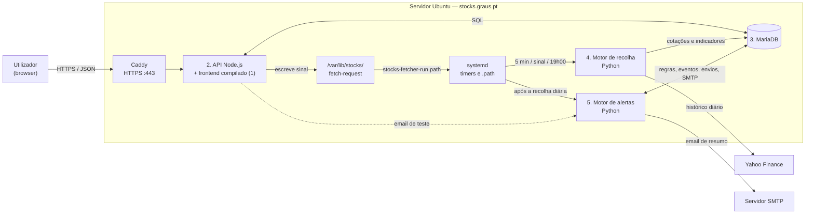

# Arquitectura de Software — Plataforma de Simulação e Acompanhamento de Acções

Estado: versão 1 em produção em https://stocks.graus.pt (actualizado a 18 out. 2026).

## 1. Objectivo e âmbito

A aplicação permite acompanhar acções, consultar o histórico diário com indicadores técnicos e momento, simular uma estratégia de momento no histórico, ver o mapa de calor e o momento do mercado, gerir uma carteira virtual, simular compras e vendas e receber alertas por email.

A negociação é exclusivamente simulada. Não há operações com dinheiro real, integração com corretoras nem execução de ordens em bolsa.

Este documento descreve a arquitectura implementada. As decisões que lhe deram origem estão em [Análise e decisões](analise_e_decisoes.md); a execução, em [Plano de implementação](plano_implementacao.md); a interface, no [Guia de estilos](guia_estilos.md); a operação do servidor, em [deploy/README.md](../../deploy/README.md).

## 2. Requisitos e parâmetros funcionais

| Parâmetro | Definição |
|---|---|
| Modalidade | Simulação e acompanhamento |
| Operações reais | Fora do âmbito |
| Utilizadores | Grupo privado; contas criadas por administradores (página Utilizadores ou CLI); sem registo público |
| Mercados e moeda | Instrumentos cotados em EUR (Euronext, Xetra, Madrid, Milão, Helsínquia, Viena, entre outros), verificado pela moeda devolvida pelo fornecedor; carteira em EUR |
| Fonte de dados | Yahoo Finance via yfinance, versão fixada, atrás de um adaptador substituível |
| Catálogo | Global e partilhado; preenchido à mão ou por importação de Excel/CSV; cada utilizador escolhe os instrumentos que acompanha |
| Granularidade | Diária: um registo por sessão de bolsa |
| Histórico | Carga inicial de dois anos; actualização diária; as cotações nunca são apagadas |
| Indicadores | EMA9, SMA10, SMA50, SMA125 e SMA200 por sessão, guardados na BD; momento SMA10/SMA200 e SMA8/SMA125 |
| Recolha diária | Dias úteis às 19h00 de Lisboa, depois do fecho das bolsas europeias (17h30 CET) |
| Alertas | Email; um resumo por utilizador após cada recolha diária, nunca mais do que um email por hora |
| Simulação | Último fecho diário não ajustado; sem comissões; quantidades inteiras; sem posições curtas; custo médio ponderado |
| Capital virtual | 1 000 000 EUR por omissão nas contas novas (configurável por conta); sem reposição |
| Estratégia | Simulação no histórico de uma estratégia de momento (secção 5.4); não executa operações nem altera a carteira |
| Email | Servidor SMTP configurado pelos administradores em Definições (hoje OVH, `ssl0.ovh.net:465`, remetente `stocks@graus.pt`); sem configuração, os alertas não enviam emails |

O requisito «frequência máxima de 1h» é cumprido com um único email de resumo por utilizador, enviado depois de cada recolha diária, e com um intervalo mínimo de 60 minutos entre emails ao mesmo utilizador. Como os dados são diários, o caso relevante é o de várias regras a disparar na mesma noite, que o resumo agrupa numa só mensagem.

## 3. Visão geral da arquitectura

A aplicação mantém os cinco módulos do desenho original:

| # | Módulo | Tecnologia | Pasta |
|---|---|---|---|
| 1 | Interface | React 19, Vite, TanStack Query, React Router, Recharts | `frontend/` |
| 2 | Middleware / API | Node.js 22, Fastify 5, Zod, mysql2 (SQL directo) | `api/` |
| 3 | Base de dados | MariaDB 11.8; migrações dbmate | `db/migrations/` |
| 4 | Motor de recolha | Python 3, yfinance, PyMySQL | `engines/fetcher/` |
| 5 | Motor de alertas | Python 3, PyMySQL, smtplib, cryptography | `engines/alerts/` |

Tudo corre num único servidor Ubuntu (`stocks.graus.pt`). O Caddy termina o HTTPS e encaminha para a API, que serve também o frontend compilado na mesma origem. Os motores Python são processos de curta duração lançados pelo systemd.



A interface nunca acede à base de dados: fala só com a API. A API nunca fala com o Yahoo: pede ao motor de recolha, através da fila `fetch_jobs` e do ficheiro de sinal. A API também não envia emails: para o email de teste em Definições, invoca o motor de alertas (`python -m alerts test`). Os motores não comunicam entre si; coordenam-se pela base de dados e pela ordem de execução no systemd.

## 4. Descrição dos módulos

### 4.1. Interface

Aplicação de página única em React, servida pela API em produção e pelo Vite em desenvolvimento (com `/api` encaminhado para a API local). Segue o [guia de estilos](guia_estilos.md): temas claro, escuro e «Sistema» sem flash no carregamento, navegação lateral (desktop), lateral recolhível (tablet) e inferior (telemóvel), e estados de carregamento, vazio, erro e dados desactualizados em todos os ecrãs.

| Ecrã | Função |
|---|---|
| Entrar | Login por email e palavra-passe |
| Visão geral | Valor da carteira, saldo e resultado; momento do mercado (distribuição do SMA10/SMA200 e os 5 mais fortes e mais fracos); cruzamentos da SMA10 com a SMA50 nas últimas 5 sessões, ascendentes e descendentes |
| Acompanhar | Catálogo partilhado e lista do utilizador (último fecho, volume, variação, sessão), adicionar símbolos ou importar Excel/CSV com pré-visualização, botão «Validar agora» |
| Instrumento | Último fecho e variação, gráfico diário (1M a 2A) com indicadores opcionais, gráfico de momento sincronizado, tabela de dados, criar alerta, simular operação, aplicar estratégia |
| HeatMap | Mapa de calor dos 20 instrumentos com maior valor negociado (catálogo ou lista): tamanho pelo valor negociado, cor pela variação; período de 1, 5, 15 ou 30 sessões |
| Carteira | Valor total, resultados realizado e não realizado, posições ao custo médio ponderado |
| Operações | Histórico filtrável por tipo, instrumento e datas |
| Sinais | Compras, reforços e vendas da estratégia aplicada virtualmente a todos os instrumentos, nas últimas 1 a 10 sessões, com filtro por tipo e botões Comprar e Vender (operação na carteira virtual) |
| Alertas | Regras com pré-visualização em linguagem natural, activação e eventos com o estado do envio |
| Utilizadores | Só administradores: listar, adicionar, redefinir palavra-passe e remover contas |
| Definições | Tema, transparência, regras da simulação, estado dos dados, palavra-passe, terminar sessão; para administradores, configuração SMTP com email de teste |

Regras da interface:
- Os valores monetários chegam como strings decimais e só passam a número para apresentação. Formatação pt-PT («12 345,67 €», «16 out. 2026»).
- Cada preço mostra a data da sessão. Operações e saldos aparecem sempre como simulados.
- Não há actualizações optimistas do saldo: a interface espera pela confirmação do servidor.
- Enquanto há instrumentos «A validar», as listas actualizam-se a cada 5 segundos; caso contrário não há polling, porque os dados são diários.
- O gráfico (Recharts) é carregado só na página do instrumento.
- O momento e a estratégia são módulos JavaScript puros em `shared/` (`momentum.js`, `strategy.js`), usados pelo browser (gráfico e «Aplicar estratégia») e pela API (página Sinais); assim o servidor e o browser calculam exactamente o mesmo. Têm testes próprios.
- As cores das séries do gráfico foram validadas para daltonismo nos dois temas; as cores do HeatMap têm contraste de pelo menos 4,98:1 com o texto branco.

### 4.2. Middleware / API

API REST em Fastify, com prefixo `/api/v1`. Cada rota declara esquemas Zod para o pedido e a resposta; o contrato OpenAPI ([api/openapi.yaml](../../api/openapi.yaml)) é gerado a partir deles, e o CI falha se não estiver actualizado. A documentação interactiva fica em `/api/docs`.

| Área | Rotas |
|---|---|
| Sessão | `POST /auth/login`, `POST /auth/logout`, `GET /me`, `PUT /me/password` |
| Instrumentos | `GET /instruments`, `GET /instruments/{id}`, `POST /instruments`, `POST /instruments/import/preview`, `GET /instruments/import/template`, `POST /instruments/fetch` |
| Histórico | `GET /instruments/{id}/quotes` (cotações e indicadores) |
| Lista | `GET /watchlist`, `POST /watchlist/items`, `DELETE /watchlist/items/{id}` |
| Carteira e operações | `GET /portfolio`, `GET /portfolio/positions`, `GET /simulated-trades/preview`, `POST /simulated-trades`, `GET /simulated-trades` |
| Alertas | `GET/POST /alerts`, `PATCH/DELETE /alerts/{id}`, `GET /alerts/events` |
| Mapa de calor | `GET /heatmap?period=1\|5\|15\|30&scope=all\|watchlist&limit=20` |
| Mercado | `GET /market/momentum?top=5` (distribuição do SMA10/SMA200 na última sessão e extremos), `GET /market/crossovers?sessions=5` (cruzamentos SMA10/SMA50: ascendente se SMA10 ≤ SMA50 na sessão anterior e > na seguinte, descendente o inverso; conta o mais recente por instrumento); cache 10 min |
| Sinais | `GET /signals?sessions=5` (estratégia aplicada a todos os instrumentos activos com todo o histórico; cache 10 min) |
| Estado | `GET /status` |
| Administração | `GET/POST /admin/users`, `PUT /admin/users/{id}/password`, `DELETE /admin/users/{id}`, `GET/PUT /admin/smtp`, `POST /admin/smtp/test` |
| Saúde | `GET /health/live`, `GET /health/ready` (fora de `/api/v1`) |

Erros no formato comum `{ "error": { "code", "message", "details" } }`, com códigos estáveis (`INSUFFICIENT_FUNDS`, `PRICE_CHANGED`, `STALE_QUOTE`, `FORBIDDEN`…).

#### Regras da simulação

- Preço: último fecho diário **não ajustado** disponível (o preço que efectivamente existiu); a data da cotação fica registada na operação.
- Compra limitada ao saldo; venda limitada à quantidade detida; sem posições curtas; quantidades inteiras; sem comissões.
- Saldo, posição, operação e movimento de saldo são actualizados numa só transacção, com a carteira bloqueada (`SELECT … FOR UPDATE`). Duas compras simultâneas não gastam o mesmo saldo.
- Cada pedido traz uma chave de idempotência: repeti-lo devolve a operação original em vez de criar outra.
- O cliente envia o preço e a data que mostrou na pré-visualização; se a cotação tiver mudado, a API responde `409 PRICE_CHANGED` e a interface pede nova confirmação.
- Só instrumentos activos e em EUR. Cotações com mais de 7 dias de calendário (`STOCKS_MAX_QUOTE_AGE_DAYS`) bloqueiam a operação.
- Custo médio ponderado: a posição guarda o custo total; numa venda retira-se a fracção proporcional e a última unidade leva o resto, para o custo chegar exactamente a zero.
- Aritmética decimal exacta com BigInt; arredondamento meio para longe de zero, a 2 casas nos montantes.

#### Mapa de calor

Por instrumento activo e para N ∈ {1, 5, 15, 30} sessões:
- variação = fecho ajustado da última sessão ÷ fecho ajustado N sessões antes − 1;
- valor negociado = Σ fecho × volume das N sessões.

Só são devolvidos os N instrumentos com maior valor negociado (20 por omissão), com o total disponível. A cor é verde acima de +1%, cinzenta entre −1% e +1% e vermelha abaixo de −1%. O resultado do catálogo fica em memória durante 10 minutos, porque as cotações só mudam com a recolha diária.

### 4.3. Base de dados

MariaDB 11.8 (mínimo 10.6, por causa de `SKIP LOCKED`), InnoDB, `utf8mb4`. O esquema é definido só pelas migrações em `db/migrations/` (formato dbmate), partilhadas pela API e pelos motores. Instantes técnicos em UTC; datas de sessão em `DATE`; valores em `DECIMAL`.

| Tabela | Conteúdo |
|---|---|
| `instruments` | Catálogo global: símbolo Yahoo (único), mercado, moeda, nome, estado (`pending`/`active`/`invalid`) e motivo, primeira e última sessão |
| `daily_quotes` | Uma linha por (instrumento, sessão): abertura, máximo, mínimo, fecho, fecho ajustado, volume, origem, e os indicadores `ema9`, `sma10`, `sma50`, `sma125`, `sma200` |
| `fetch_jobs` | Fila de recolha: tipo (inicial ou incremental), estado, tentativas, próxima tentativa, último erro |
| `job_runs` | Execuções da recolha diária e dos alertas, para diagnóstico |
| `users`, `sessions` | Contas (hash scrypt, perfil de administrador, desactivação) e sessões (só o SHA-256 do token) |
| `watchlist_items` | Uma lista por utilizador sobre o catálogo |
| `portfolios`, `cash_movements` | Carteira em EUR com capital inicial e saldo; movimentos de saldo |
| `simulated_trades` | Operações com preço, montante, data da cotação, resultado realizado e chave de idempotência (única por carteira) |
| `positions` | Quantidade, custo total e resultado realizado por instrumento |
| `alert_rules`, `alert_events` | Regras e eventos detectados (únicos por regra e sessão) |
| `email_deliveries` | Resumos enviados e o seu estado (`sending`, `sent`, `failed`, `uncertain`) |
| `smtp_settings` | Configuração SMTP global (servidor, porta, segurança, utilizador, palavra-passe cifrada, remetente) |
| `audit_log` | Acções relevantes, sem palavras-passe, tokens ou credenciais |

Remover um utilizador apaga em cascata as sessões, a carteira, as operações, as posições, a lista, os alertas e os envios; a auditoria mantém-se.

As cotações não são apagadas: 295 instrumentos com dois anos ocupam cerca de 15 MB e crescem cerca de 7,5 MB por ano.

### 4.4. Motor de recolha de cotações

Comandos `python -m fetcher add | run | update | status | indicators`. O yfinance fica isolado em `provider.py`, atrás da interface `QuoteProvider`.

1. **Validação assíncrona:** um símbolo novo fica `pending` com um pedido `initial`. O motor confirma no fornecedor que existe e que a moeda é EUR, preenche nome e mercado e passa-o a `active`, ou a `invalid` com o motivo.
2. **Carga inicial:** dois anos de sessões diárias (`STOCKS_HISTORY_YEARS`).
3. **Actualização diária:** um pedido `incremental` por instrumento activo, relendo os últimos 7 dias para apanhar correcções do fornecedor.
4. **Gravação idempotente:** `INSERT … ON DUPLICATE KEY UPDATE` sobre a chave (instrumento, sessão).
5. **Validação dos dados:** sessões com preços não positivos ou incoerentes são descartadas, não corrigidas.
6. **Indicadores:** depois de cada recolha, a série completa do instrumento é recalculada sobre o fecho ajustado, porque os ajustes do fornecedor alteram os fechos do passado. SMA de N sessões; EMA9 iniciada com a SMA das primeiras 9 sessões e α = 0,2. Os valores ficam `NULL` enquanto não houver sessões suficientes.
7. **Falhas:** falhas de rede e limite de pedidos voltam à fila com espera progressiva (2, 4, 8… minutos, até 5 tentativas). Uma falha num instrumento não pára os restantes, e uma falha de rede nunca invalida um instrumento.
8. **Concorrência:** os pedidos são reservados com `SELECT … FOR UPDATE SKIP LOCKED`, e o mesmo instrumento nunca é recolhido por dois processos ao mesmo tempo.

Os símbolos são descarregados um a um, porque o Yahoo só serve o histórico por símbolo e o pedido individual devolve também a moeda e o nome. A carga de 293 símbolos demorou cerca de 1,5 minutos.

### 4.5. Motor de alertas por email

Comandos `python -m alerts run [--dry-run | --dry-run-if-unconfigured]` (a recolha diária usa o segundo modo) e `python -m alerts test --to EMAIL`.

| Tipo | Limite | Quando dispara |
|---|---|---|
| `close_above` | EUR | O fecho passa a estar acima do limite (transição; não repete enquanto se mantém) |
| `close_below` | EUR | O fecho passa a estar abaixo do limite (transição) |
| `change_up` | % | Subida face à sessão anterior de pelo menos o limite; avaliado em cada sessão |
| `change_down` | % | Descida face à sessão anterior de pelo menos o limite; avaliado em cada sessão |

Regra de envio:

```text
Após cada recolha diária, para cada utilizador:
- reunir os eventos ainda não notificados de regras activas (até 7 dias);
- se o utilizador recebeu um email há menos de 60 minutos, adiar;
- caso contrário, enviar um único email de resumo com todos esses eventos.
```

- **Desduplicação:** a chave única (regra, sessão) impede notificar o mesmo evento duas vezes.
- **Envio recusado** pelo servidor SMTP: os eventos voltam ao resumo seguinte.
- **Ligação perdida** durante a transmissão: o envio fica `uncertain` e não é repetido automaticamente.
- **Edição de regras:** criar, editar ou reactivar uma regra repõe o estado da avaliação.
- **Configuração SMTP:** lida da tabela `smtp_settings` (Definições), com a palavra-passe decifrada com a chave do servidor; na falta dela, das variáveis `STOCKS_SMTP_*`; sem nenhuma, corre em `--dry-run`, mostra os resumos no registo e não grava nada.
- **Email de teste:** `python -m alerts test --to …`, chamado pela API em Definições, usa exactamente o mesmo código de envio.

Os alertas apenas notificam; nunca desencadeiam operações.

## 5. Fluxos de funcionamento

### 5.1. Adicionar um instrumento

1. O utilizador introduz símbolos ou importa um ficheiro; a importação mostra antes uma pré-visualização (novos, existentes, repetidos, com erro).
2. A API grava os símbolos novos como `pending`, cria os pedidos `initial`, associa-os à lista do utilizador e escreve em `/var/lib/stocks/fetch-request`.
3. A unit `stocks-fetcher-run.path` arranca o motor de imediato; o timer de 5 minutos é a rede de segurança.
4. O motor valida, carrega dois anos e calcula os indicadores; a interface vê o estado passar a «Activo» ou «Inválido».
5. «Validar agora» volta a pôr na fila, sem espera, os pendentes (incluindo os que falharam) e sinaliza o motor.

### 5.2. Actualização diária e alertas

1. `stocks-daily.timer` (dias úteis, 19h00 de Lisboa) executa `deploy/bin/daily.sh`.
2. O motor de recolha pede a actualização de todos os activos, processa-os, recalcula os indicadores e regista a execução em `job_runs`.
3. Mesmo que a recolha tenha falhas, o motor de alertas corre a seguir (`--dry-run-if-unconfigured`): avalia cada regra uma vez por sessão, regista os eventos e envia um resumo por utilizador, ou só mostra os resumos no registo se não houver SMTP configurado.

### 5.3. Consulta do histórico

A API devolve, por omissão, os últimos dois anos de sessões, com os indicadores já calculados. A interface recorta o período escolhido, desenha o fecho ajustado e os indicadores pedidos, e calcula o momento (SMA10/SMA200 − 1 e SMA8/SMA125 − 1) sobre o histórico completo carregado.

### 5.4. Estratégia de momento (simulação no histórico)

O botão «Aplicar estratégia» corre no browser um backtest sobre o histórico carregado (`frontend/src/lib/strategy.js`), sem alterar a carteira:

- estado de cada sessão = cor do momento (SMA10/SMA200 «a subir» ou «a descer»);
- compra 15 000 € (quantidade inteira) quando as três últimas sessões foram descer, subir, subir;
- vende tudo quando foram subir, descer, descer e o SMA8/SMA125 está abaixo de 1% nessa sessão (caso contrário mantém a posição);
- ignora os sinais quando, na sessão do sinal, o SMA10/SMA200 está entre −1% e +1% (inclusive);
- reforça com mais 15 000 € sempre que o fecho sobe mais de 10% face ao preço da compra mais recente (o seguinte exige outros +10%); numa sessão com venda executada não há reforço;
- executa ao fecho real do dia do sinal, uma posição de cada vez, sem comissões; uma posição aberta no fim é valorizada ao último fecho;
- o resultado em % é calculado sobre o capital máximo investido em simultâneo;
- compara com comprar e manter 15 000 € desde a primeira sessão com estado conhecido.

O gráfico marca as compras (C), os reforços (R) e as vendas (V); um painel mostra o resultado, as operações, os sinais ignorados e as vendas não executadas pela condição do SMA8/SMA125.

A página **Sinais** aplica a mesma estratégia, no servidor, a todos os instrumentos activos com todo o histórico (para reconstruir a posição virtual de cada um) e lista os sinais das últimas N sessões. Os botões Comprar e Vender abrem uma operação simulada normal na carteira do utilizador; os sinais nunca executam operações sozinhos.

### 5.5. Operação simulada

1. A interface pede a pré-visualização (preço, data, total, saldo e unidades após a operação).
2. O utilizador confirma; o pedido leva a chave de idempotência e o preço pré-visualizado.
3. A API bloqueia a carteira, valida instrumento, moeda, idade da cotação, saldo ou quantidade, e grava tudo numa transacção.
4. A interface mostra um recibo com o preço efectivamente aplicado.

### 5.6. Gestão de utilizadores

Um administrador cria contas (com carteira e capital inicial), redefine palavras-passe (o que termina as sessões do utilizador) e remove contas com todos os dados. Não pode remover a própria conta, e a aplicação nunca fica sem administradores activos. Tudo fica na auditoria. O CLI `api/src/cli.js` faz o mesmo a partir do servidor.

## 6. Segurança

- HTTPS com certificado Let's Encrypt renovado pelo Caddy; HTTP redirecciona para HTTPS; HSTS.
- Cookie de sessão `HttpOnly`, `Secure` e `SameSite=Strict`; na BD guarda-se só o SHA-256 do token; renovação com o uso.
- Defesa adicional contra CSRF: pedidos de escrita com `Origin` diferente de `https://stocks.graus.pt` são recusados; a API não aceita `text/plain`.
- Palavras-passe com scrypt (N = 2^17, r = 8, p = 1), mínimo de 8 caracteres; login com limite de 10 tentativas por IP em 15 minutos e tempo de resposta igual para emails inexistentes.
- Autorização por recurso: cada utilizador só vê a sua carteira, lista, operações e alertas; a administração exige perfil de administrador.
- Content-Security-Policy sem scripts inline além do script de tema, permitido pelo seu hash.
- Serviços systemd com utilizador próprio (`stocks`), sistema de ficheiros só de leitura e escrita apenas onde é necessária (`/var/lib/stocks`, `/var/backups/stocks`).
- Segredos em `/etc/stocks/stocks.env` (`root:stocks`, modo 640), fora do código; registos sem cookies nem credenciais.
- Palavra-passe SMTP cifrada na BD com AES-256-GCM; chave em `/etc/stocks/secret.key` (`root:stocks`, 640), partilhada pela API e pelo motor de alertas; a API nunca a devolve e a auditoria só regista se foi alterada.
- MariaDB e API só escutam em `127.0.0.1`.

## 7. Implantação e operação

Instalação e actualização com `sudo deploy/install.sh`, que é idempotente: dependências, código em `/opt/stocks`, chave de cifra `/etc/stocks/secret.key` (criada uma vez, nunca substituída), ambientes Python, build do frontend, migrações, units systemd e Caddy. O serviço da API recebe `STOCKS_FETCH_TRIGGER_FILE` e `STOCKS_ALERTS_PYTHON` para sinalizar o motor de recolha e enviar o email de teste.

| Unit | Quando | Função |
|---|---|---|
| `stocks-api.service` | sempre | API e frontend |
| `stocks-fetcher-run.path` | quando a API escreve o sinal | Arranca o motor de recolha de imediato |
| `stocks-fetcher-run.timer` | a cada 5 min | Rede de segurança para a fila de recolha |
| `stocks-daily.timer` | dias úteis, 19h00 de Lisboa | Recolha diária seguida dos alertas |
| `stocks-backup.timer` | diariamente, 03h30 UTC | `mariadb-dump` para `/var/backups/stocks` (modo 600, 14 dias) |

Testes automáticos em cada componente: API com Vitest contra uma BD de testes (58), motor de recolha (21) e motor de alertas (18) com pytest e fornecedor ou mailer simulados, e cálculos do frontend com `node --test` (11). O CI no GitHub Actions corre-os com MariaDB 10.11 em cada push para `main`. Os testes nunca contactam o Yahoo nem enviam emails.

Riscos aceites ou pendentes:
- **Servidor único:** indisponibilidade conjunta da aplicação, da BD e dos motores; mitigado por cópias de segurança diárias, com cópia externa e restauro testado pelo administrador.
- **Fonte não oficial:** o yfinance pode mudar ou ser limitado pelo Yahoo; a versão está fixada e o adaptador é substituível.
- **Ambientes:** desenvolvimento e produção partilham o servidor e a base `stocks`; os testes usam a base `stocks_test`.

## 8. Critérios de aceitação

| Critério | Estado |
|---|---|
| A aplicação não envia ordens para corretoras | Cumprido |
| Ao adicionar um instrumento, carrega até dois anos de histórico diário | Cumprido |
| Instrumentos inexistentes ou não cotados em EUR ficam inválidos, com o motivo | Cumprido |
| Repetir uma recolha não cria cotações duplicadas | Cumprido (testado) |
| A interface identifica a data de referência dos preços | Cumprido |
| A ausência ou insuficiência de dados históricos é apresentada explicitamente | Cumprido |
| Uma compra simulada não excede o saldo; uma venda não excede a quantidade | Cumprido (testado, incluindo concorrência) |
| Cada operação conserva o preço e a data da cotação utilizados | Cumprido |
| Cada utilizador recebe no máximo um email de alertas por hora | Cumprido (testado); SMTP da OVH configurado |
| O mesmo evento não gera notificações repetidas | Cumprido (testado) |
| As falhas de recolha e de envio são registadas | Cumprido |

## 9. Decisões ainda em aberto

| Tema | Situação |
|---|---|
| Eventos societários | Dividendos e desdobramentos não alteram as posições simuladas; um desdobramento numa acção detida distorce o resultado |
| Comissões e custos | Excluídos; podem ser acrescentados à regra de simulação |
| Reposição de capital | Não existe; o capital inicial (1 000 000 EUR por omissão) é definido na criação da conta |
| Contas de BD por componente | Uma única conta `stocks`; separar API e motores reduziria o impacto de uma falha de segurança |
| Retenção de operações e auditoria | Sem eliminação; definir se for necessário |
| Ambiente de testes separado | Hoje partilha o servidor de produção |
| Execução da estratégia | Ao fecho do próprio dia do sinal (optimista); a execução ao fecho do dia seguinte seria mais realista |
| Alerta operacional | Falhas da recolha ou dos alertas só ficam em `job_runs` e no `journalctl`; não há notificação ao administrador |

## 10. Base documental

Documento elaborado a partir do diagrama original, dos requisitos e das decisões de 18 out. 2026, e actualizado para a implementação publicada. O código de referência é o do ramo `main`; o contrato da API está em [api/openapi.yaml](../../api/openapi.yaml). Os próximos passos estão na secção 8 do [plano de implementação](plano_implementacao.md).
